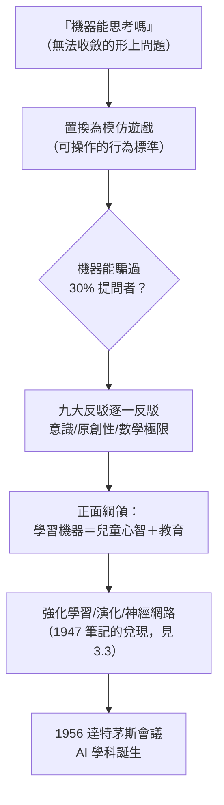

# 4.2 計算機器與智能（1950）

1950 年 10 月，圖靈在哲學期刊 *Mind* 發表〈計算機器與智能〉（*Computing Machinery and Intelligence*）。這篇論文用一個**思想實驗**取代了「機器能否思考」的形而上爭論——**模仿遊戲**（the imitation game），後世稱**圖靈測試**。它被視為**人工智慧的哲學奠基文獻**。

## 用問題的置換打開局面

圖靈開篇的招式是**繞開定義**：

- 「機器能思考嗎？」——「思考」無定義，「機器」邊界模糊，爭論無法收斂；
- 他提議換成一個**操作性的**問題：**模仿遊戲**——一位提問者透過純文字（電傳打字機）同時與一男一女交談，需猜出誰是誰；若把其中一人換成**機器**，機器能否使提問者誤判？
- 「機器能思考嗎」因此被置換為：「機器能在模仿遊戲中玩得像人嗎？」
- 這是行為主義式的聰明一擊：把不可觀察的「內心」換成可觀察的「對話表現」。

## 九大反駁與圖靈的回應

論文的主體是**辯論式的**：圖靈逐一列舉「機器不可能思考」的九種論調並反駁——「來自神學的」「來自意識的」「來自各種殘疾的」「Lady Lovelace 的」（機器只能做被告知的事）、「來自連續性的」「來自自發性的」等：

- 對**意識論**（Jefferson 教授：機器沒有感受故不算思考）：圖靈提出「**機器也許會承認錯誤、學著撒謊**」的驗證困境——我們判斷他人有意識時也只憑外部證據；
- 對**Lady Lovelace 反駁**：機器只能執行指令，不能「原創」——圖靈回應：機器可以**修改自身規則**（學習機器），且人腦本身也是有限狀態的機械系統；
- 對**數學極限**（Gödel／停機問題證明機器不如人）：他承認存在機器不可解的問題，但**人也會算錯**——「完美機器」的標準對人不公平（此處他繼承了〈論可計算數〉的嚴格性，見 2.1）。

## 學習機器：AI 的研究綱領

論文最後一節是**正面綱領**：與其造一臺模擬成人心智的機器，不如造一臺**兒童心智**，然後**教育**它：

- 他提出「**學習機器**」的路線：初始程式＋懲罰與獎賞＋隨機變異——這是**強化學習**與**演化計算**的直接預言；
- 他估計只需約 $10^9$ bits 的程式即可模擬 1950 年代的儲存能力——並預言「到本世紀末，機器能夠在模仿遊戲中騙過 30% 的提問者五分鐘」；
- 他還討論了讓機器**觀察並模仿人類行為**、以及用**隨機元素**促進學習——這些想法在 2010 年代的深度強化學習（如 AlphaGo）中逐一兌現（見 5.3）。

## 達特茅斯會議的前聲

1956 年夏，**達特茅斯會議**由 John McCarthy（→ 詳見《麥卡錫傳記》）發起，正式把這個領域命名為 **Artificial Intelligence**：

- 提案書的問題清單（語言、學習、抽象、創造）幾乎逐條對應圖靈 1950 年論文的議程；
- 會議召集人名單上赫然有**香農**（→ 詳見《香農傳記》第 4 章）——1943 年與圖靈在貝爾實驗室談「機器能否思考」的那位（見 3.1）；
- 圖靈本人未能參加（他 1954 年去世），也未收到邀請——美國 AI 社群與圖靈的直接聯繫斷了，但他的論文是每個與會者都讀過的文本；
- McCarthy 日後明言：把領域命名為 AI 而非「複雜自動機」，正是要與「模仿遊戲」所代表的行為主義立場區隔——**這門學科從誕生起，就活在与圖靈的對話與爭論之中**。

## 事件關聯與前因後果

| 年份 | 事件 | 後續影響 |
|------|------|----------|
| 1947 | 倫敦數學會「智能機器」報告（見 3.3） | 學習機器的最早公開陳述 |
| 1948 | 與 Michie、Good 戰後續談「思維機器」 | AI 議題在英國的私下流布 |
| 1950.10 | 《Mind》刊出模仿遊戲 | AI 的哲學與操作標準雙份奠基 |
| 1950 | 預言「2000 年 30% 過關」 | Loebner 競賽與 ELIZA 等後續實踐 |
| 1956 | 達特茅斯會議，McCarthy 命名 AI | 學科建制，以圖靈議程為底本 |

**因果**：這篇論文的**前因**有三條線——1936 年的通用機（機器可做任何明確規定的事）、1943 年與香農的深夜對話（問題的社交化）、1947 年的學習機器報告（綱領的初稿）。**後果**則是整門學科：模仿遊戲供給了 AI 的**驗收標準**，學習機器供給了 AI 的**方法論**，九大反駁供給了 AI 的**哲學戰場**。與維根斯坦 1939 年的爭論（見 2.3）構成遙遠的呼應：圖靈始終相信形式的（機械的）過程可以承載智能的實踐，而這一信念正是 AI 的賭注。1952 年起，命運的巨輪開始碾壓（見 4.3），但這篇論文已完成它的工作——**把一個哲學難題，變成可以排進研究議程的工程問題**。

### 同期的世界（1950–1956）

| 年份 | 事件 | 與圖靈的關聯 |
|------|------|--------------|
| 1950 | 香農發表〈電腦下棋〉（→ 詳見《香農傳記》第 4 章） | 機器智能議題的平行推進 |
| 1951 | UNIVAC 預測選舉；美國輿論震動 | 「電腦」成為大眾詞彙 |
| 1952 | 圖靈被捕（見 4.3） | 論文成為絕筆期的思想高峰 |
| 1956 | 達特茅斯會議 | AI 命名與建制 |

## 小結

- 〈計算機器與智能〉以**模仿遊戲**置換形而上爭論，是「操作主義」在哲學史上最成功的應用之一；
- 圖靈對九大反駁的回應，預先寫好了此後七十年 AI 辯論的劇本（意識、原創性、數學極限）；
- 「學習機器」一節是**強化學習、演化計算、神經網路**三條路線的共同源頭；
- 論文與達特茅斯會議之間隔著圖靈之死——AI 學科是沒有創始人親自到場的奠基儀式；
- 下一段，1952–54 年：一個把「機器能否思考」問得最好的頭腦，被一套把「人能否愛人」問得最糟的法律碾碎（見 4.3）。
