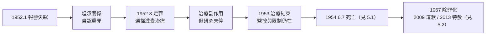

# 4.3 定罪與化學閹割（1952–1954）

1952 年 1 月，圖靈報警處理自家失竊案，卻因此承認與男子 Arnold Murray 的關係。依 1885 年《刑法修正法》的「嚴重猥褻」罪，圖靈被起訴、定罪，並接受**化學閹割**（雌激素注射）代替監禁。兩年後他死去。本節記錄這段被歷史稱為「制度性迫害」的過程。

## 1952 年 1 月：一次報警引發的審判

事件的起因平凡得殘酷：

- 1952 年 1 月，圖靈位於 Wilmslow 的寓所遭竊；他報警，警察上門；
- 圖靈向警員坦承與 Murray 的關係，以為這能解釋某些案情——他並未意識（或選擇不以為意）這等於自認重罪；
- 2 月 7 日被捕；3 月 31 日在曼徹斯特法庭認罪，被判「嚴重猥褻罪」成立；
- 法庭給予選擇：**監禁**或**緩刑附帶激素治療**——圖靈選後者，因為他不能離開（也捨不得離開）工作與電腦。

### 為什麼圖靈未因此失去戰時榮譽與職務

值得注意的悖論：圖靈當時仍持有 GCHQ 的機密顧問資格，且戰時的 OBE 勳位未被褫奪：

- 英國情報體系知曉此案，內部評估後**允許他繼續接觸機密**——他對國家的價值壓過了對法律的執行；
- 但他**被禁止赴美**（美國當時視同性戀者為安全風險），國際學術往來受限；
- 曼徹斯特大學並未解聘他；哲學與數學圈的友人（如 Newman 一家）依舊接納他；
- 換言之：**制度的羞辱是選擇性的**——法律給他罪名，學院給他職位，國家給他保密許可卻拿走他的出國自由。這種撕裂狀態持續到生命終點。

## 化學閹割的身心代價

1946 年起英國已有以雌激素治療「性犯罪者」的做法，圖靈接受的正是這種**ORG 與己烯雌酚（DES）注射**：

- 為期一年，副作用包括**男性乳房發育（gynecomastia）**、體脂重新分布、性慾抑制與情緒波動；
- 圖靈以他一貫的態度對待：向友人描述治療「沒有想像中可怕」，同時持續跑步（他參加業餘田徑賽，1948 年曾跑出接近奧運選拔標準的馬拉松成績 2 小時 46 分）、持續研究；
- 治療結束（1953 年 4 月）後，副作用部分可逆，但**法律監控與歧視**並未結束——他的檔案被標記，出入境受限制；
- 他對制度的嘲諷式適應：朋友記載他一度考慮「和一位女性假結婚」以換取出國自由，終究未實行。

## 學術的殘響（1952–1954）

被定罪的兩年裡，圖靈依然產出：

- 形態發生論文後續：他持續推展反應—擴散理論，留下關於**球面圖案、鱗莖結構、葉序**的大量未完成手稿（見 4.1）；
- 1953–54 年，他與**Christopher Strachey** 通信討論程式（Strachey 為曼徹斯特機寫了西洋跳棋程式——機器遊戲的先驅），並研究「**電腦作曲**」：1951 年 BBC 曾錄製曼徹斯特機播放的三段旋律——機器音樂的最早錄音；
- 1954 年 6 月 7 日前夜，他仍在修改論文。手稿的註記停在 6 月 7 日。

## 法律的債與平反的長路

這段迫害的完整清算是半個世紀的事（詳見 5.2）：

| 年份 | 事件 | 意義 |
|------|------|------|
| 1952 | 定罪、化學閹割 | 「國家英雄」與「法律罪犯」的同一具身體 |
| 1954 | 死亡（見 5.1） | 悲劇的終點 |
| 1967 | 英國除罪化同性戀 | 遲到十三年的法律修正 |
| 2009 | 英相 Brown 正式道歉（見 5.2） | 國家層級的承認 |
| 2013 | 女王簽署皇家特赦（見 5.2） | 法律檔案的抹除 |
| 2017 | 「圖靈法」自動赦免同案受害者 | 個案成為制度修正 |

## 事件關聯與前因後果

| 年份 | 事件 | 後續影響 |
|------|------|----------|
| 1952.1 | 報警、被捕 | 國家機器啟動於國家英雄 |
| 1952.3 | 定罪＋化學閹割 | 身體與人格的制度性羞辱 |
| 1952–53 | 持續研究（形態發生、機器作曲、跳棋程式顧問） | 創造力與迫害並行 |
| 1952 | 出國禁令 | 國際學術網絡斷裂 |
| 1954.6 | 死亡 | 見 5.1 |
| 1967–2017 | 除罪化→道歉→特赦→圖靈法 | 見 5.2 |

**因果**：這段歷史的因果最令人不安之處在於**圖靈自己的行動觸發了它**——他報警時的坦率，正是他一生「不表演、不偽裝」人格（自謝伯恩以來，見 1.1）的延續。**前因**：1885 年的法律、戰後的冷戰安全文化（同性戀＝勒索風險＝安全風險）、以及他拒絕以假面生活的脾性。**後果**：兩年後的死亡；以及更長的後果——他的案例成為英國乃至世界 LGBTQ+ 權利運動的標誌性敘事，2009 年的道歉、2013 年的特赦、2017 年的「圖靈法」，使一個人的被迫害成為一整套法律的死亡證明。與此同時，學術上的後果同樣具體：出國禁令使他錯過了 1950 年代美國 AI 社群的直接互動（見 4.2），形態發生學的推廣也因他的死而中斷三十年（見 4.1）。

## 小結

- 1952 年的定罪是**制度的三重撕裂**：法律定罪、學院留任、情報單位留用——國家無法決定如何處置它最好的頭腦；
- 化學閹割的身體傷害可部分復原，但其**象徵傷害**——一位戰爭拯救者被自己的國家宣判為罪犯——無法復原；
- 被定罪的兩年間他仍產出形態發生續作與機器作曲研究，創造力與羞辱同速；
- 這段時期是「圖靈傳奇」的情感核心：**理性者遭遇非理性制度**，而理性者拒絕撒謊；
- 下一段，1954 年 6 月 7 日，蘋果與氰化物（見 5.1）。
