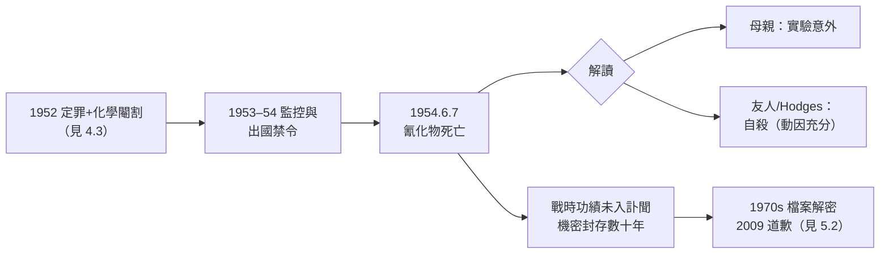

# 5.1 去世（1954）

1954 年 6 月 8 日清晨，圖靈的女管家發現他死於 Wilmslow 自家臥室床邊。驗屍確認死因：**氰化物中毒**。床頭放著一隻咬過的蘋果。日期是 6 月 7 日，他四十一歲。英國失去了一個世紀以來最原創的頭腦之一——彼時大多數人並不知道。

## 1954 年 6 月 7 日

根據驗屍與警方報告，可以還原的部分如下：

- 6 月 7 日（週一）圖靈如常工作；友人見他的最後幾天，他神態「如常甚至愉快」——他已談及未來的研究計畫與假期安排；
- 6 月 8 日晨，管家發現遺體；床邊的**蘋果被咬去數口**，經化驗**未能檢出氰化物**（蘋果組織的化驗靈敏度有限），但屍體與房間的氰化物濃度確鑿；
- 屋內的工作臺上有他常備的**氰化鉀**（他用於形態發生實驗的化學藥品，見 4.1 的化學線索），旁邊有電鍍用的氰化金溶液器皿；
- 警方認定他將氰化物注入蘋果；法官裁定**自殺**，「在心智健全的情形下自行了斷」。

### 蘋果與雪白的傳說

「一半吃掉的蘋果」成為圖靈傳說的核心意象，並衍生兩個流傳甚廣的說法：

- **格林童話說**：圖靈鍾愛迪士尼《白雪公主》，電影中毒蘋果的場景他曾在戰時向同事模仿吟誦——「蘋果浸了毒，血在血管裡凍結」；
- **Apple 商標傳說**：傳聞蘋果公司的缺口標誌是致敬圖靈——設計者與蘋果公司均**否認**此說，但傳說自身已成為文化事實；
- 歷史應當誠實：**蘋果上是否真的有氰化物，從未被確證**；「咬過的蘋果」是警方報告的記載，化驗沒有找到毒物殘留。傳記作者 Hodges 採取的立場是：無論蘋果是否為媒介，**氰化物的存在與量足以致命，且自殺意圖有充分的旁證**。

## 母親與世界的解讀分歧

死亡解讀立即分成兩個世界：

- **母親 Ethel（Sarah）Turin**堅持**意外說**：兒子在做電鍍實驗，不小心沾染氰化物——她無法接受自殺說，並終身如此主張（她 1959 年的回憶錄正是以此立場寫成）；
- **友人與同事**多接受**自殺說**：1952 年的定罪與激素治療（見 4.3）、出國禁令、監控狀態，構成清晰的動因脈絡；
- **Hodges（1983）**的權威傳記採取**中間立場**：死亡未必是深思熟慮的儀式性自殺，但**圖靈已向朋友透露過自殺念頭**，且他具備精確化學知識——「詩意的意外」與「自殺」之間，他選擇相信後者；
- 一個常被引用的細節：1930 年 Morcom 死後（見 1.1），圖靈寫信給母親說他相信「精神將在死後與 Christopher 重聚」——五十年後，這句話被反覆引用來詮釋他的死亡。

## 身後的即時安排

- 1954 年 6 月 12 日，葬禮在 Woking 火葬場舉行，骨灰與其父母同處；
- 訃聞見於《泰晤士報》與數學期刊，措辭是標準的學術訃文：皇家學會院士、可計算性與形態發生的研究者——**戰時貢獻因保密而隻字未提**；
- 他的 GCHQ 檔案封存；BP 的一切在《官方機密法》下塵封數十年；
- 國際學術圈的反應是安靜的：*Mind* 上無悼文，達特茅斯會議（1956）的出席者中多數並未讀過他的戰時故事——**英雄無聲地退場，天才無人告別**。

## 事件關聯與前因後果

| 年份 | 事件 | 後續影響 |
|------|------|----------|
| 1952–53 | 定罪、治療、監控（見 4.3） | 死亡的動因脈絡 |
| 1954.6.7 | 死於氰化物 | 「咬過的蘋果」成為世紀意象 |
| 1954.6.12 | 葬禮 | 學術圈的靜默告別 |
| 1954 | 訃聞無戰績 | 國家對英雄的沉默 |
| 1974–80s | F.W. Winterbotham《The Ultra Secret》(1974) 等解密 | BP 故事漸次公開 |
| 1983 | Hodges 傳記出版 | 圖靈形象的當代重構 |
| 2009–2013 | 道歉與特赦（見 5.2） | 死後五十九年的正名 |

**因果**：死亡的因果鏈是「**法律傷害→制度孤立→精神耗竭**」的直線。**前因**：1952 年的定罪沒有剝奪他的工作，卻剝奪了他的**未來**——出國禁令切斷國際學術，檔案標記暗示永久的次等公民身份，而這一切施加在一個終生「不偽裝」的人身上（見 1.1、2.3）。**後果**：短期是學術的損失（形態發生無人接手、AI 失去其哲學奠基者親自出席達特茅斯的可能，見 4.2）；長期則是記憶的政治——國家的沉默延續了半世紀，直到解密與道歉把圖靈從「被封存的數學家」還原為「被國家虧欠的戰爭英雄」。

## 小結

- 1954 年 6 月 7 日，圖靈死於氰化物；**蘋果的傳說與化驗的空白**並存，歷史只能證實毒物與死亡，不能證實儀式；
- 他的死亡在當時是**三重靜默**：訃聞無戰績、學界無哀榮、國家無致敬；
- 傳說的後世生命（白雪公主、Apple 商標）顯示：一個社會會為自己未能善待的天才，補寫神話；
- 這一切的翻案，要等半個世紀——下一段，2009 年的道歉與 2013 年的特赦（見 5.2）。
