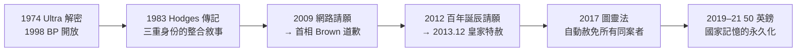

# 5.2 平反與道歉（2009–2013）

圖靈死後半個世紀，一場由網路發起的請願運動，迫使英國政府正式面對 1952 年的判決。2009 年首相道歉、2013 年皇家特赦、2017 年「圖靈法」——一個人的被迫害，最終成為一套法律與制度自我修正的推力。

## 解密的先行：英雄的重現（1974–2001）

道歉之前，須先「看見」：

- 1974 年，Winterbotham 出版《The Ultra Secret》，首次系統公開 **Ultra** 情報的存在——BP 破譯的戰略價值進入公共知識；
- 1970–90 年代，BP 檔案逐步解密，圖靈在 Hut 8 的角色、Bombe 的邏輯、Banburismus 的統計方法逐一曝光；
- 1983 年，Andrew Hodges 的傳記《*Alan Turing: The Enigma*》出版，將戰時英雄、邏輯天才、被迫害的同性戀者三重身份整合為一個敘事——成為日後一切平反運動的文本基礎；
- 1998 年起，BP 對公眾開放；1999 年，*Time* 雜誌將圖靈列入二十世紀百大人物——「科學家與思想家」類；
- 2001 年起，曼徹斯特與 Bletchley 相繼立像；2002 年，BBC 觀眾票選圖靈為史上最偉大英國人第 21 位。

## 2009 年：首相道歉

直接的觸發是一場**網路請願**：

- 2009 年 8 月，程式設計師 John Graham-Cumming 發起 Downing Street 請願，要求政府為圖靈案的「迫害」道歉；數萬人簽署；
- 2009 年 9 月 10 日，首相**戈登·布朗**（Gordon Brown）在《每日電訊報》發表正式聲明：
  > 「代表英國政府、以及所有因圖靈的貢獻而得以自由生活的人們：很抱歉，你被如此糟糕地對待。你的作品、你的遺產，比我們當時所做的更偉大——這個國家的虧欠，遠遠超過你所領受的一切。」
- 道歉的性質是**行政道歉**：承認迫害不義，但不推翻司法判決——法律上圖靈仍是「罪犯」。

## 2013 年：皇家特赦

法律層面的正名又等了四年：

- 2012 年（圖靈百年誕辰），第二輪請願（逾 37 萬人）要求正式赦免；司法部一度以「不能以今日標準追溯改寫歷史判決」為由拒絕；
- 2013 年 12 月 24 日，司法部長 Chris Grayling 促成**皇家特赦**（royal pardon），由伊莉莎白二世簽署：圖靈的 1952 年定罪正式被赦免；
- 特赦的侷限隨即引發討論：**為何只赦圖靈？**數萬名依同一法律被定罪者仍在法律檔案中——批評者稱之「赦免一個天才，遺忘萬個普通人」；
- 2017 年，國會通過**《警察與犯罪法》**（俗稱 **Turing's Law**，圖靈法）：自動赦免所有因歷史同性戀罪行被定罪（且已除罪化）的人——圖靈案成為**整部法律的命名由來**。

## 紀念的制度化（2010s）

| 年份 | 事件 | 意義 |
|------|------|------|
| 2012 | 圖靈百年誕辰，全球學術紀念年 | 圖靈獎之外的紀念系統成形 |
| 2019 | 英格蘭銀行宣布 50 英鎊紙鈔採用圖靈頭像 | 2021 年發行——數學家首次登上英鎊 |
| 2019 | BBC 觀眾票選「世紀偉人」（Icons）第一名 | 公眾記憶的頂點 |
| 2021 | 50 英鎊流通，附圖靈機示意與生日 1950 年表格 | 貨幣上的可計算性理論 |
| 2022 | GCHQ 與曼徹斯特大學的圖靈紀念設施擴充 | 情報機構的正式致敬 |

## 事件關聯與前因後果

| 年份 | 事件 | 後續影響 |
|------|------|----------|
| 1974 | Ultra 解密出版 | BP 故事進入公眾領域 |
| 1983 | Hodges 傳記 | 平反運動的文本基礎 |
| 2009.9 | 首相道歉 | 國家層級承認迫害不義 |
| 2013.12 | 皇家特赦 | 判決被赦，尚未及於他人 |
| 2017 | 圖靈法 | 個案正名擴展為制度修正 |
| 2021 | 50 英鎊發行 | 記憶的貨幣化與永久化 |

**因果**：這場平反的因果鏈始於**技術史的解密**（沒有 Ultra 的公開，就沒有「戰爭英雄」這個可供道歉的身份）→**傳記的整合**（Hodges 把三重身份縫合成不容忽視的敘事）→**網路時代的請願**（2009 年的簽名技術使民間記憶直接對接行政權力）→**法律追溯的正當性辯論**（特赦一人 vs. 赦免一類）→**圖靈法的制度落實**。值得注意的是因果的方向性：圖靈生前推動的是「機器與智能」，死後推動的是「法律與正義」——他的名字成為兩種「系統修正」的符號：一種是計算範式的更替（見 5.3），一種是國家對自身歷史的修錯。

### 與其他科學家平反案例的對照

| 人物 | 平反議題 | 方式 |
|------|----------|------|
| Galileo | 教會裁判 | 1992 年教廷重新評價 |
| Rosenblatt／感知機 | AI 冬天的冤案 | 1980s 連接主義復興平反（→ 詳見《Hinton傳記》） |
| 圖靈 | 法律迫害 | 2009 道歉／2013 特赦／2017 圖靈法 |
| 香農 | 無需平反 | 生前即獲榮譽（→ 詳見《香農傳記》第 5 章） |

## 小結

- 圖靈的平反走完了**解密→傳記→請願→道歉→特赦→立法→貨幣**的完整鏈條，是科學史平反案例中最完整的一次；
- 2009 年道歉承認了「國家虧欠」，2013 年特赦抹去了「罪犯」身份，2017 年圖靈法把個案正名擴展為**一整代受害者的赦免**；
- 平反的深度依賴於他生前成就的「可敘事性」：戰爭英雄＋電腦之父＋AI 奠基者——三重身份使圖靈案成為不可迴避的道德議題；
- 記憶的最終載體是日常之物：2021 年起，英國人每天在 50 英鎊上看到那張臉與那臺機器；
- 下一段，回到思想本身：圖靈測試、可計算性與 AI 在 1950–2026 年間的現代遺產（見 5.3）。
