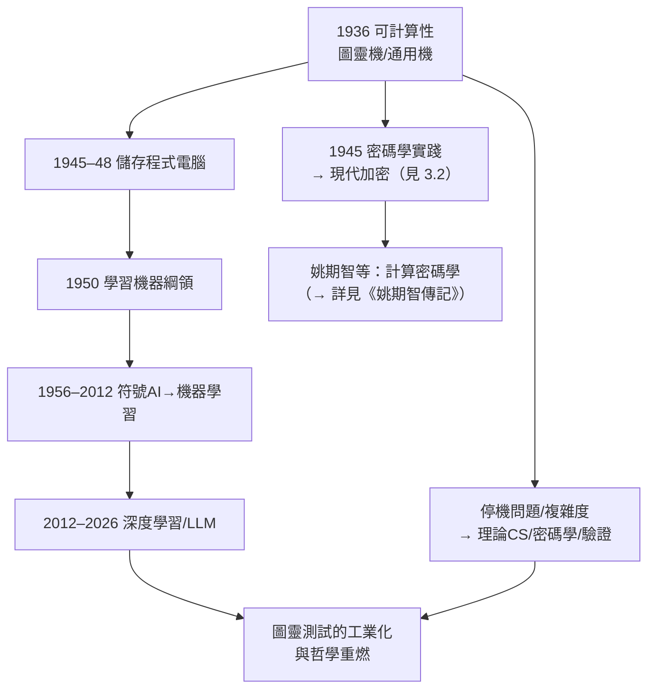

# 5.3 圖靈測試、AI 與可計算性的現代遺產（1950–2026）

圖靈死後七十年，他的三份遺產——**可計算性理論**、**通用機（電腦）**、**模仿遊戲（AI）**——逐一成為世界本身的架構。2020 年代的大型語言模型（LLM）浪潮，使 1950 年那個思想實驗從哲學閒談變成每日發生的現實。本節盤點這條遺產線。

## 遺產一：可計算性與理論計算機科學

- 1936 年的圖靈機成為整個理論計算機科學的**公理級定義**：可計算、不可判定、歸約、複雜度類（P／NP）全部以圖靈機為度量基準；
- **Church–Turing 論題**（見 2.2）經量子計算的檢驗依然穩固：量子電腦加速某些問題（如 Shor 演算法），但不擴展「可計算」的邊界——**不可判定的仍不可判定**；
- 姚期智（Andrew Yao，→ 詳見《姚期智傳記》）等理論家把通訊複雜性、密碼學複雜性建立在圖靈機模型上；圖靈獎（ACM Turing Award, 1966 年設立）成為計算機科學的諾貝爾獎；
- 停機問題的「不可判定」滲透到軟體工程的日常：形式驗證、病毒檢測、程式分析的天花板，都是 1936 年劃下的那條線（見 2.1）。

## 遺產二：通用機與電腦工業

- 1945 年的 ACE 報告與曼徹斯特機（見 3.3、4.1）開啟的**儲存程式**範式，至今未變：今天的 CPU 依然是「讀入指令、改變自身行為」的圖靈機；
- **軟體**作為一個產業（作業系統、編譯器、程式語言）的全部可能性，源於「程式＝資料」這一 1936 年的洞見；
- 圖靈 1947 年提出的「機器可以修改自身指令」——即**自我修改程式**與**機器學習**——在 2010 年代化為神經網路的梯度更新：權重就是被機器改寫的「指令」。

## 遺產三：從模仿遊戲到 LLM

1950 年論文的預言分批兌現：

| 年代 | 兌現 | 與圖靈的關聯 |
|------|------|--------------|
| 1956 | 達特茅斯會議，AI 命名（→ 詳見《麥卡錫傳記》） | 議程源自 1950 論文 |
| 1966 | Weizenbaum 的 ELIZA | 首個「騙過部分人」的對話程式 |
| 1980s–90s | 專家系統、Loebner 競賽 | 模仿遊戲的工程化嘗試 |
| 1997 | 深藍勝卡斯帕洛夫 | 機器超越人類的**特定**技能 |
| 2012 | 深度學習革命（AlexNet；→ 詳見《Hinton傳記》） | 「學習機器」路線的勝利 |
| 2016 | AlphaGo 勝李世石 | 強化學習（圖靈 1950 綱領）的巔峰 |
| 2022– | ChatGPT 等大型語言模型 | 模仿遊戲以工業規模上演 |

### 2020 年代的辯論：圖靈測試的存廢

LLM 使「機器能騙過人類嗎」從思想實驗變成計量問題，也使圖靈測試陷入新辯論：

- **通過論**：GPT 系列模型在多項研究中能以約人類比率誤導提問者——模仿遊戲的 30% 閾值已被觸及；
- **反對論**：McCarthy 當年的批評迴響再起——模仿遊戲衡量的是**欺騙能力**，不是智能；鸚鵡學舌式的統計生成是否「思考」，回到 1950 年的**意識反駁**（見 4.2）；
- **圖靈自己的立場**可能最接近第三種：他 1950 年寫道「問題本身太無意義，不值得討論」——他提出測試是為了**取代**形而上爭論，而 LLM 時代的人們正把它**重新變成**形而上爭論；他若在場，更可能追問的是：這臺機器的**學習機制**（梯度下降＋人類反饋）是否屬於他 1947–50 年設想的「教育機器」範式——答案是肯定的；
- 另一條遺產線也在此復活：**形態發生**（見 4.1）的自組織思想，成為解釋神經網路湧現能力的流行隱喻——「簡單規則湧現複雜性」是圖靈畢生的工作母題。

## 遺產的匯流：2026 年的圖靈世界

## 事件關聯與前因後果

| 年份 | 事件 | 後續影響 |
|------|------|----------|
| 1950 | 模仿遊戲＋學習機器綱領 | AI 的標準與方法論雙奠基 |
| 1956 | 達特茅斯會議 | AI 學科誕生 |
| 1966 | 圖靈獎設立 | 學科榮典以他命名 |
| 1997／2016 | 深藍／AlphaGo | 特定領域超越人類 |
| 2012– | 深度學習革命 | 學習機器路線全面勝利 |
| 2022–2026 | LLM 時代 | 模仿遊戲工業化，圖靈測試存廢之辯 |

**因果**：七十年遺產的因果結構是「**一個抽象，三次兌現**」。1936 年的通用機抽象第一次兌現為**硬體**（1945–48），第二次兌現為**軟體產業**（1960s–2000s），第三次兌現為**在硬體上學習的軟體**——即機器學習（2012–）。三條線最終在 LLM 匯流：一臺通用機（圖靈 1936）執行一個被教育出來的程式（圖靈 1950），在對話中表演模仿遊戲（圖靈 1950）——而他關於**生物自組織**的洞見（1952）則成為解釋這一切為何有效的思想資源。與同代人的呼應同樣清晰：香農供給了資訊的度量（→ 詳見《香農傳記》第 3 章），麥卡錫供給了學科的命名（→ 詳見《麥卡錫傳記》），Hinton 供給了學習的引擎（→ 詳見《Hinton傳記》），姚期智供給了複雜性的度量（→ 詳見《姚期智傳記》）——但一切回流的源頭，是 1936 年那篇以「論可計算數」為題的論文，以及一個在謝伯恩的黃昏裡思念亡友的少年（見 1.1）。

## 小結

- 圖靈的三份遺產——**可計算性的邊界、通用機的範式、學習機器的綱領**——在 2026 年的 LLM 世界同時在場；
- 圖靈測試的存廢之辯重演了 1950 年的九大反駁，但辯論本身的激烈，恰是圖靈「操作化問題」策略的成功證明；
- 形態發生的自組織思想，從生物學回流為 AI 的解釋框架——圖靈的三個身份在死後完成了合流；
- 從謝伯恩的孤獨少年（1930）、普林斯頓的博士（1938）、布萊切利的戰士（1941）、NPL 的受挫者（1947）、曼徹斯特的生物數學家（1952），到 50 英鎊紙鈔上的肖像（2021）——圖靈的一生是二十世紀理性史的縮影：**一個把「思考」變成數學的人，最終被時代提醒：數學之外還有正義**；
- 全書終。他的遺產仍在運行——此刻，你與我之間的這段文字，也是在那個遺產之上生成的。
