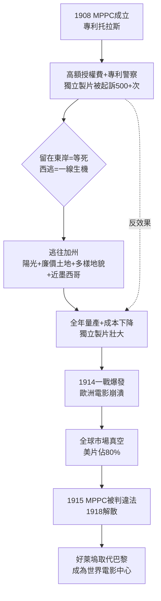

# 1.1 專利戰與西逃（1908-1915）

> 好萊塢不是被發現的，是被「專利警察」追出來的。一群在東岸活不下去的獨立製片人，逃往三千英里外的陽光之地，意外建立了世界電影之都。

## 一、愛迪生托拉斯：一場想壟斷影像的戰爭

1908 年，湯瑪斯・愛迪生（Thomas Edison）聯合 Biograph、Vitagraph、Essanay、Lubin、Selig、Kalem 等公司，成立**電影專利公司（Motion Picture Patents Company, MPPC）**，史稱「愛迪生托拉斯」。

其商業邏輯極其簡單粗暴：

- 掌握 16 項攝影機、放映機與底片關鍵專利；
- 向所有製片商收取每呎底片的授權費；
- 指定伊士曼柯達（Eastman Kodak）為唯一合法底片供應商；
- 透過 General Film Company 控制發行，只給加盟影院供片；
- 僱用偵探與律師，即所謂「專利警察」，沒收獨立業者的器材並提告。

若以市場份額公式表示其野心：

$$S_{MPPC} = \frac{Q_{授權放映}}{Q_{全美放映}} \to 100\%$$

$$ \pi = (p - c) \cdot Q - F_{訴訟} $$

其中 $p$ 為授權租金，$c \approx 0$ 為專利邊際成本，$F_{訴訟}$ 則是維持壟斷的執法成本。MPPC 試圖讓 $F_{訴訟}$ 高到獨立製片人無法承受。

短短兩年，MPPC 發起超過 500 起訴訟。全美電影業籠罩在白色恐怖中。諷刺的是，正是這種高壓，逼出了好萊塢。

## 二、為什麼是加州？為什麼是好萊塢？

獨立製片人（Independents）——包括後來的環球創辦人卡爾・萊默爾（Carl Laemmle）、福斯創辦人威廉・福斯（William Fox）、派拉蒙創辦人阿道夫・朱克（Adolph Zukor）——選擇向西逃亡，原因有四重因果疊加：

| 逃亡動因 | 具體機制 | 後果 |
|---|---|---|
| **逃避訴訟** | 加州遠離紐澤西法院，開庭、取締成本高；靠近墨西哥邊境，被查抄可連夜越境 | 獨立製片獲得喘息空間 |
| **陽光** | 南加州年均 300 天以上晴天，默片時代依賴自然光拍攝，可全年開工 | 產量 $\uparrow$，成本 $\downarrow$ |
| **土地便宜** | 好萊塢當時只是檸檬園與牧場，地租僅為紐約的 1/5 | 得以購買大片廠地，自建片廠 |
| **地貌多樣** | 一小時車程內有沙漠、海灘、雪山、城市、小鎮 | 西部片、冒險片取景成本大降 |

1910 年，D.W. 格里菲斯（D.W. Griffith）為 Biograph 來加州拍攝《In Old California》；1911 年 Nestor 公司在好萊塢 Sunset 與 Gower 街口租下第一間工作室——那就是今天好萊塢的起點。1913 年，塞西爾・德米爾（Cecil B. DeMille）與傑西・拉斯基（Jesse Lasky）本來要去亞利桑那，聽說太貴，轉往洛杉磯，拍出《Squaw Man》，成為好萊塢第一部故事長片。

專利警察追到加州，但為時已晚：一次世界大戰切斷歐洲電影供應，全美對國產片需求暴增，獨立製片人的產量反而成為救命稻草。

## 三、第一次世界大戰：歐洲自殺，好萊塢撿到天下

1914 年前，世界電影中心在巴黎（百代 Pathé、高蒙 Gaumont）與都靈、柏林。戰爭爆發後：

1. 歐洲片廠被徵用、人員上前線、化學原料斷供；
2. 美國 1917 年才參戰，本土片廠毫髮無傷；
3. 拉丁美洲、亞洲市場出現真空，美片長驅直入。

到 1918 年，美國電影已佔全球市場約 80%。MPPC 卻在此時內爆：1915 年聯邦法院在 *United States v. MPPC* 案中判決其違反《謝爾曼反托拉斯法》，1918 年正式解散。愛迪生贏了專利，輸了未來。

其悖論可用一個簡單模型概括。設獨立製片人的期望利潤為：

$$E[\pi_{ind}] = (1-q) \cdot R_{西岸} - q \cdot L_{罰款} - C_{遷移}$$

其中 $q$ 為被查獲機率。西逃使 $q \downarrow$、$R_{西岸} \uparrow$（陽光帶來高產量），於是 $E[\pi_{ind}] > 0$，逃亡成為理性選擇。托拉斯越打壓，$C_{遷移}$ 分攤到越多逃亡者身上，反而形成產業聚落（agglomeration）——這正是好萊塢的起源。

## 因果鏈

**專利壟斷（技術法權）→ 訴訟高壓（法規）→ 獨立製片西逃（地理套利）→ 陽光量產＋土地聚集（商業模式）→ 一戰歐洲真空（外部衝擊）→ 好萊塢全球化 → MPPC 崩解 → 為「八大片廠」騰出權力真空。**愛迪生想用專利鎖死電影，結果把電影趕到了一個他管不到的地方；那個地方後來叫好萊塢。下一節，我們看這群逃亡者如何從難兄難弟變成新的壟斷者——八大片廠。
