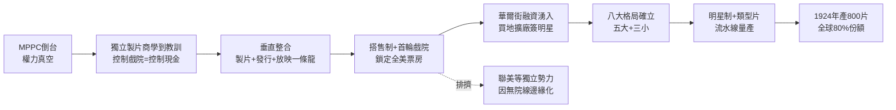

# 1.2 八大片廠的形成（1916-1924）

> 逃過愛迪生的人，建立了比愛迪生更大的帝國。八大片廠用「垂直整合」把製作、發行、放映鎖成一條龍，觀眾走進哪家戲院，就只能看哪家的夢。

## 一、從逃亡者到壟斷者：垂直整合的發明

MPPC 倒台後，真正的贏家不是藝術家，而是那批最懂發行與放映的獨立製片商人。他們學到的教訓是：**光會拍片沒用，要控制戲院。**

於是 1916-1924 年間，一套被經濟學家稱為「垂直整合（vertical integration）」的商業模式成形：

$$\Pi_{片廠} = \pi_{製片} + \pi_{發行} + \pi_{放映}$$

三大環節利潤全吃。具體做法：

1. **製片（Production）**：買地建廠，簽下導演、明星、編劇為長期雇員，實行「中央製片人制」，像工廠流水線一樣年產 50-100 部片。
2. **發行（Distribution）**：全國設交換所（exchanges），以「搭售制（block booking）」強迫戲院一次買下整季片單——要拿強片，爛片也得照單全收。
3. **放映（Exhibition）**：直接買下全美一線首輪戲院。派拉蒙的 Publix、福斯的 Fox Theatres、米高梅背後的 Loew's，合計控制全美約 70% 首輪票房。

這就是後來的「八大（Big Eight）」：

- **五大（Big Five，自有院線）**：派拉蒙（Paramount）、米高梅（MGM）、華納兄弟（Warner Bros.）、二十世紀福斯（Fox）、雷電華（RKO）；
- **三小（Little Three，無院線或弱院線）**：環球（Universal）、哥倫比亞（Columbia）、聯美（United Artists）。

## 二、關鍵人物：皮草商、廢品商如何變成電影大亨

好萊塢創辦人幾乎全是東歐猶太移民——在美國主流金融與社交圈被排斥，反而在沒人看得起的「鎳幣影院（nickelodeon）」裡找到機會：

- **阿道夫・朱克（Adolph Zukor，派拉蒙）**：匈牙利皮草商出身，提出「名角名劇（Famous Players）」戰略，高價挖舞台明星拍電影，第一個證明「明星＝票房」；
- **馬庫斯・洛伊（Marcus Loew，米高梅）**：從 penny arcade 起家，買戲院再向上游併購米etro、Goldwyn、Mayer，組成 MGM，並喊出「明星比天上還多」；
- **華納四兄弟**：波蘭移民，從俄亥俄巡迴放映起家，後以《爵士歌手》賭上有聲片，一戰成名；
- **卡爾・萊默爾（Carl Laemmle，環球）**：德國移民，以反托拉斯鬥士自居，在聖費南度谷建「環球影城」，專攻低成本西部片與恐怖片；
- **聯美（1919）**：卓別林、格里菲斯、瑪麗・璧克馥、道格拉斯・范朋克自立門戶——藝術家反抗片廠的第一槍，但因無院線，始終弱勢。

他們的共同點：**不懂藝術，但懂現金流。** 戲院每天收現金，是 1920 年代美國最好的生意之一。華爾街開始湧入，電影從雜耍變成金融業。

## 三、好萊塢體制化：明星制與類型片

到 1924 年，好萊塢年產約 800 部長片，佔全球 80% 以上。體制化的兩根支柱：

1. **明星制（Star System）**：七年合約綁死演員，片廠包辦名字、形象、緋聞乃至婚姻。明星的邊際票房可量化為：

$$V_{明星} = \bar{R}_{有明星} - \bar{R}_{無明星} \gg 薪資$$

只要 $V_{明星} > 0$ ，片廠就願意支付天價週薪，因為搭售制下明星片能帶動整季片單銷售。

2. **類型片（Genre）**：西部片（福斯、派拉蒙）、歌舞與黑幫（華納）、豪華歌舞與文藝（米高梅）、恐怖（環球）。類型＝可預測的現金流，劇本按公式生產。

## 因果鏈

**反托拉斯勝利（法規）→ 權力真空 → 發行商反向併購製片（商業模式反轉）→ 垂直整合＋搭售制 → 控制首輪票房 → 華爾街資本進入 → 八大壟斷 → 明星制與類型片的流水線（創作被商業馴化）。**逃亡者變成了新的守門人。這個守門人體制如此賺錢，以至於當下一個技術——聲音——出現時，沒有人想主動革命，除了最弱小的那一家。下一節：默片的巔峰，以及它如何在一夜之間變成古董。
