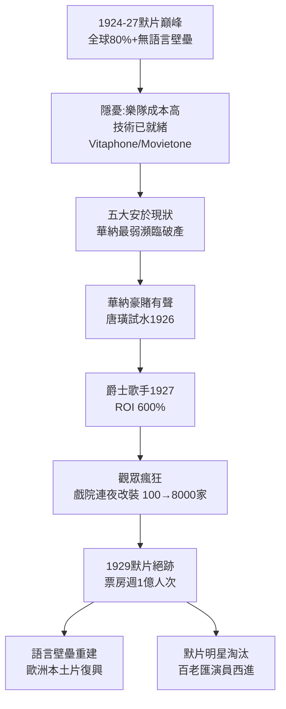

# 1.3 默片巔峰與有聲前夜（1924-1927）

> 1927 年之前，好萊塢以為自己在拍「世界語」。卓別林的一個手勢，東京和巴黎都看得懂。然後，艾爾・喬森開口說了一句話，這個世界語帝國一夜崩塌。

## 一、默片的最高藝術：沒有聲音，反而沒有國界

1924-1927 年是默片藝術的珠穆朗瑪峰：

- 卓別林《淘金記》（1925）、基頓《將軍號》（1926）、穆瑙《日出》（1927）、朗・錢尼《歌劇魅影》（1925）、艾森斯坦的蒙太奇傳入美國；
- 攝影、燈光、化妝、字卡設計高度成熟，洛杉磯已聚集全球最好的攝影師與佈景師；
- 默片沒有語言障礙，美國片配上當地字卡即可全球發行，出口成本極低：

$$C_{出口} = C_{拷貝} + C_{字卡翻譯} \approx 0$$

這意味著好萊塢的全球市場份額在默片時代達到歷史頂點。1926 年，英國銀幕上 95% 是美國片，法國、德國紛紛出台配額保護本土片——側面證明好萊塢默片的碾壓優勢。

但巔峰之下暗藏三個脆弱：

1. **現場配樂成本高**：大戲院需養 20-50 人樂隊，小戲院要請鋼琴師，有聲片若能把音樂印在膠片上，可省下一大筆；
2. **明星的聲音未知**：片廠不敢想像，觀眾聽到偶像開口會怎樣——這既是風險，也是華納這種小廠的賭博機會；
3. **技術已就緒**：貝爾實驗室的 Vitaphone（針同步聲盤）、福斯的 Movietone（光學聲軌）、RCA 的 Photophone，三家待命，只等有人敢用。

## 二、為什麼是華納？為什麼是《爵士歌手》？

五大片廠都不想革命：默片正賺錢，改裝戲院要錢，重拍片要錢，明星聲音可能崩盤。但**華納兄弟**別無選擇——它是五大中最弱的，沒有米高梅的豪華院線，沒有派拉蒙的明星陣容，1926 年還瀕臨破產。

華納的賭博邏輯：

$$E[\pi_{有聲}] = p_{成功} \cdot R_{差異化} - C_{改裝} > \pi_{默片跟隨}$$

對米高梅， $\pi_{默片跟隨}$ 很大，沒必要賭；對華納， $\pi_{默片跟隨} \approx 0$ ，不賭即死。於是華納與西部電氣合作，先拍《唐璜》（1926，全片配樂＋音效），試水成功；再拍《爵士歌手》（The Jazz Singer, 1927-10-06 首映），艾爾・喬森說出那句影史名言：「等著瞧吧，你們還沒聽到呢！（You ain't heard nothin' yet!）」

《爵士歌手》並非全對白片——全片只有約 2 分鐘對白，其餘仍是字卡配樂。但觀眾瘋了。投資 50 萬美元，票房 350 萬美元，回报率：

$$ROI = \frac{3.5 - 0.5}{0.5} = 600\%$$

華納一戰翻身，1928 年躋身五大。全美戲院連夜改裝：1927 年有聲戲院不到 100 家，1929 年超過 8000 家。

## 三、一夜之間，全球市場重設

有聲片的後果是雙面的：

- **國內**：票房暴漲。大蕭條前夜，週觀影人次突破 1 億（1929 年美國人口僅 1.2 億）；
- **國際**：語言壁壘重建。非英語市場需要配音或字幕， $C_{出口}$ 驟升，歐洲各國趁機復興本土有聲片，好萊塢份額短暫下滑；
- **創作**：攝影機被關進隔音棚（blimp），不能再自由移動；導演要學對白調度；大量默片明星因口音、嗓音被淘汰， simultaneously 百老匯演員大舉西進。

好萊塢用三年時間完成了殘酷換血。到 1929 年，默片基本絕跡。卓別林堅持到 1931 年的《城市之光》仍是默片，被視為最後的貴族抵抗。

## 因果鏈

**默片全球化成功（技術＋商業）→ 現場配樂成本痛點＋新技術待命 → 龍頭無意革命、弱者被迫革命（商業地位決定技術採用）→ 《爵士歌手》超額利潤示範 → 全行業被迫跟進 → 語言壁壘重建國際版圖、明星洗牌（創作端地震）。**聲音不是被發明的，是被「窮」逼出來的。下一章，我們進入黃金年代：當所有人都能說話，好萊塢決定讓他們說什麼——以及不准說什麼。
