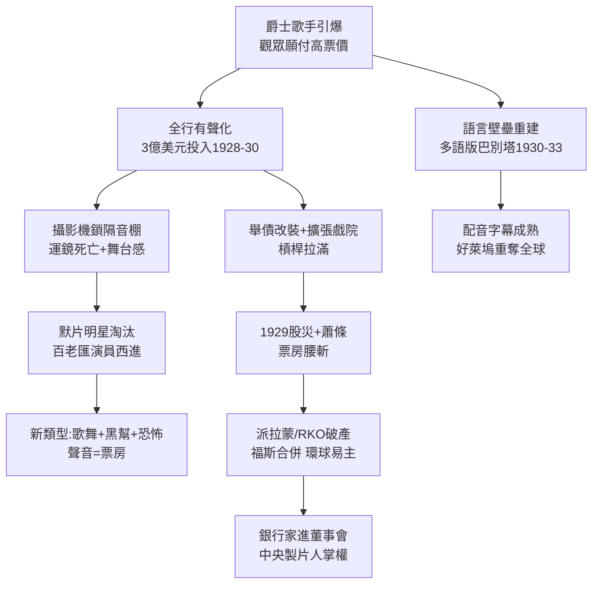

# 2.1 有聲革命（1927-1934）

> 觀眾第一次聽到明星說話，有人尖叫，有人退票。片廠花了三年，把全好萊塢的攝影機裝進冰箱，把百老匯搬到加州，把世界電影的語言重新洗牌。

## 一、技術地震：攝影機被關進「冰箱」

有聲片初期的技術約束極其笨拙：麥克風靈敏度低、收錄範圍小，攝影機運轉噪音會被收進去。解決方案是把攝影機鎖進笨重的隔音棚（soundproof booth / blimp），鏡頭只能透過玻璃拍攝——運鏡基本死亡。

導演從默片時代的上帝，降格為「對白錄音員」。1928-1929 年的早期有聲片多是靜態長鏡頭、舞台感極重，被嘲為「罐頭戲劇」。但市場用錢投票：

- 1927 年全美週觀影人次約 5700 萬；
- 1930 年達到 9000 萬-1.1 億的歷史峰值；
- 有聲改裝戲院票價可提高 10-25%，而改裝成本約 $15,000-$25,000/家，大戲院數月回本。

片廠利潤函數變為：

$$ \Pi = (p_{有聲} - p_{默片}) \cdot Q_{增量} - C_{改裝} - C_{重拍} $$

只要 $Q_{增量}$ 夠大，一切值得。於是 1928-1930 年，八大投入超過 3 億美元做有聲化——恰好撞上 1929 年股災，槓桿拉滿的片廠（尤其是派拉蒙、福斯、RKO）瞬間陷入債務危機，為下一輪洗牌埋雷。

## 二、大洗牌：誰的聲音活下來

有聲片是一場達爾文實驗：

- **殞落者**：大量默片明星因口音（歐洲口音）、嗓音尖細或年齡而被淘汰。約翰・吉爾伯特（John Gilbert）從一線小生跌落，被視為有聲片犧牲品的象徵（雖有片廠政治因素加成）。
- **崛起者**：百老匯演員大舉西進——詹姆斯・卡格尼、愛德華・G・羅賓遜、芭芭拉・斯坦威克、克拉克・蓋博。他們懂台詞節奏，片酬便宜，成為 1930 年代黑幫片與 screwball 喜劇的中堅。
- **新類型誕生**：歌舞片（《百老匯旋律》1929，奧斯卡最佳影片）、黑幫片（《小凱撒》《國民公敵》1931）、恐怖片（環球《德古拉》《科學怪人》1931）。聲音讓「唱歌、槍聲、尖叫」第一次有了票房價值。

同時，語言壁壘重塑全球市場。好萊塢的應對是「多語版（multiple-language versions）」：同一佈景，白天英語劇組拍，晚上西班牙語、法語、德語劇組拍。加州因此聚集了大批外語演員，1930 年前後的好萊塢是真正的巴別塔。直到配音（dubbing）與字幕技術成熟，多語版才在 1933 年後被淘汰。

## 三、華爾街接管：有聲片的債務後遺症

有聲化＋戲院擴張的錢從哪來？華爾街。1928-1930 年，派拉蒙、福斯、華納大舉發債、增發股票。到 1931-1933 年大蕭條谷底：

- 派拉蒙破產重整（1933）；
- 福斯瀕臨破產，後與二十世紀合併（1935 年成二十世紀福斯）；
- RKO 破產（1933）；
- 環球被接管，萊默爾家族出局（1936）；
- 唯一穩健的是米高梅（Loew's 院線現金流雄厚）與不玩擴張的哥倫比亞。

銀行家進入董事會，路易・B・梅耶（Louis B. Mayer）這類能「省錢又賺錢」的製片人權力大漲。**技術革命 → 資本結構革命 → 經營者革命**，這條鏈條決定了 1930 年代黃金年代的真正掌權者不是導演，而是中央製片人。

## 因果鏈

**有聲技術（技術）→ 票價與觀影量齊漲（商業誘因）→ 舉債有聲化＋院線擴張（資本）→ 創作端洗牌（明星淘汰、新類型）＋國際市場重設（多語版）→ 股災引爆債務（外部衝擊）→ 破產重整 → 銀行家＋中央製片人上位（權力轉移）。**有聲片先救了華納，再差點殺了所有人。活下來的片廠變得更集權、更依賴製片人——這正是下一節海斯法典能被執行的組織前提：沒有高度集權的片廠，就沒有 Stevens 那支能管住全好萊塢的筆。
