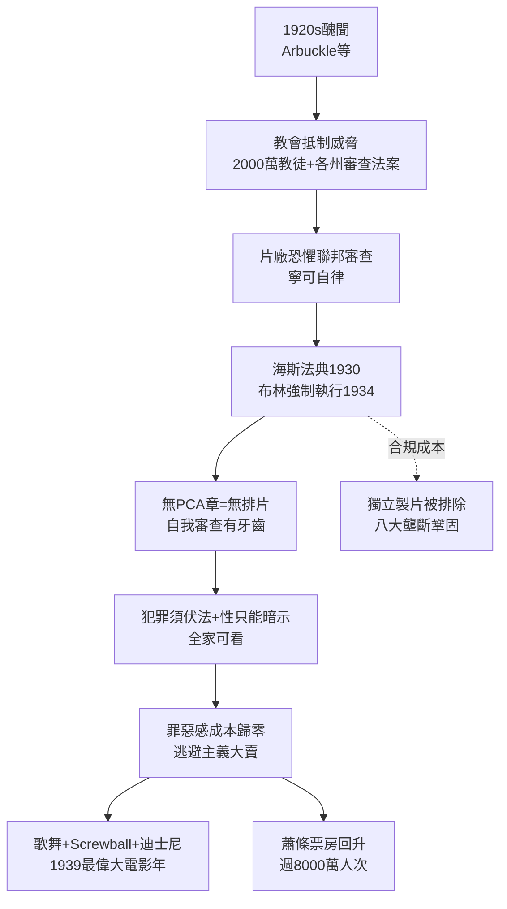

# 2.2 海斯法典與大蕭條的逃避主義（1930-1939）

> 銀行裡的錢沒了，戲院裡的夢卻更貴了。大蕭條十年，美國人每週花 25 美分買兩小時的忘憂——而好萊塢學會了在教會、政府與票房之間走鋼索。

## 一、為什麼需要「自我審查」？前因：醜聞＋天主教＋大蕭條

海斯法典（Hays Code, 1930 年頒布、1934 年強制執行）不是憑空掉下來的道德緊身衣，而是三重壓力疊加的產物：

1. **醜聞**：1921 年 Fatty Arbuckle 性醜聞案、導演 William Desmond Taylor 謀殺案、明星吸毒案，wyn 報紙把好萊塢描繪成索多瑪；
2. **宗教與政治壓力**：天主教「體面軍團（Legion of Decency）」1933 年發起抵制，揚言號召 2000 萬教徒拒看「不潔電影」；各州出現 100 多種審查法案，片廠面臨「被 48 州各剪一刀」的碎片化風險；
3. **經濟命脈**：大蕭條谷底（1932-33），週觀影人次從 1.1 億跌至 6000 萬，片廠破產邊緣，絕對承受不起大規模抵制或聯邦審查立法。

片廠的理性計算：與其被政府管，不如自己管。於是請來前郵政總長威爾・海斯（Will H. Hays）成立 MPPDA（後來的 MPAA），1930 年由耶穌會神父 Daniel Lord 起草法典，1934 年由約瑟夫・布林（Joseph Breen）執掌製作法典管理局（PCA），**沒有 PCA 蓋章，八大院線不排片**——自我審查有了牙齒。

法典核心三原則：不得同情犯罪、不得嘲弄宗教與法律、性只能暗示。通姦必須受罰、吻戲不得超過 3 秒（傳說）、裸露與毒品細節禁拍。

## 二、逃避主義：蕭條越慘，夢越甜

法典＋蕭條意外催生了好萊塢最賺錢的配方：**無害的華麗夢**。

票房數據說明一切。設觀眾效用為：

$$U = u(逃避) + u(希望) - p_{票價} - c_{罪惡感}$$

法典把 $c_{罪惡感}$ 降到零（全家可看、教會不罵），歌舞與喜劇把 $u(逃避)$ 拉滿。代表作：

- **歌舞片**：華納 Busby Berkeley 的萬人大陣仗（《42nd Street》1933）、米高梅 Fred Astaire＋Ginger Rogers 系列——失業的觀眾看銀幕上絲綢與大理石；
- **Screwball 喜劇**：《一夜風流》（It Happened One Night, 1934，橫掃五項奧斯卡）、《育嬰奇譚》——窮小子＋富家女的階級和解幻想；
- **黑幫片的馴化**：1931 年《國民公敵》歌頌混混，法典後《G-Men》(1935) 主角變成 FBI，犯罪必須伏法；
- **兒童與動畫**：秀蘭・鄧波兒（Shirley Temple）成為蕭條偶像；迪士尼《白雪公主》（1937）投資 150 萬美元、票房 800 萬，證明全家歡＝印鈔機。

1939 年被譽為「史上最偉大電影年」：《亂世佳人》《綠野仙蹤》《史密斯先生到華盛頓》《驛馬車》《蝴蝶夢》同年誕生——法典束縛下的創意大爆發。限制反而逼出暗示、雙關與蒙太奇的藝術。

## 三、悖論：審查如何鞏固壟斷

海斯法典還有一個被低估的經濟功能：**提高獨立製片的合規成本，鞏固八大壟斷。**

- 獨立製片若拍擦邊球之作，拿不到 PCA 章＝進不了八大院線＝死；
- 八大則有法務與布林辦公室的長期博弈經驗，知道邊界在哪，甚至能拿「被刪幾刀」做宣傳；
- 搭售制＋法典雙鎖：戲院只能放「八大＋合規」的片，獨立與外國藝術片被系統性排除。

直到 1948 年派拉蒙判決打破院線鎖、1952 年最高法院「奇蹟案」賦予電影言論自由，海斯法典才鬆動。但 1934-1948 年，它是好萊塢穩定的基石。

## 因果鏈

**醜聞（聲譽危機）＋教會抵制威脅（法規風險）＋蕭條票房崩盤（商業危機）→ 片廠選擇自我審查（以守為攻）→ PCA＋院線排片掛鉤（執行機制）→ 全家歡逃避主義（創作轉向）→ 票房回升＋1939 巅峰 → 獨立與外國片被合規成本擋在門外（壟斷強化）。**道德緊身衣變成了防彈衣。下一節，我們看穿上防彈衣的片廠如何把「製片人中心制」運轉成世界最有效率的造夢機器——以及明星制如何把人變成資產。
