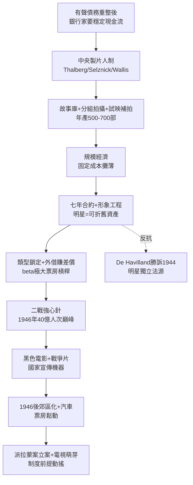

# 2.3 製片人制度與明星制（1935-1948）

> 在黃金年代，導演是工頭，明星是資產，製片人才是作者。一部片的署名屬於導演，但靈魂屬於坐在辦公室裡看收支表的那個人。

## 一、中央製片人制：福特生產線搬進片廠

1930 年代成熟的好萊塢，是人類歷史上最高效的文化生產線。其組織發明叫**中央製片人制（Central Producer System）**，由 Irving Thalberg（米高梅）、David O. Selznick（後獨立製片《亂世佳人》）、Hal Wallis（華納）為代表。

流程如工廠：

1. **故事部**：買小說、劇本版權，建立劇本庫（story library），每週開題會；
2. **製片人定調**：定預算、定卡司、定檔期，導演只是被指派的執行者，隨時可換（《亂世佳人》換過三任導演）；
3. **分組拍攝**：各組平行作業，B 級片 2-3 週殺青，A 級片 6-8 週；
4. **預告＋試映＋補拍**： sneaks preview 測觀眾反應，不好就補拍結局——大數據時代前的 A/B 測試。

產量驚人：米高梅年產 50 部、華納 60 部、派拉蒙 60 部，全好萊塢年產 500-700 部。單位成本可控：

$$C_{均} = \frac{F_{片廠固定成本}}{N_{年產量}} + c_{單片變動成本}$$

$N$ 越大， $C_{均}$ 越低——規模經濟。這就是為什麼片廠痴迷量產：戲院每週要換片，片庫就是現金流。

## 二、明星制：把人變成可折舊資產

明星是片廠最重要的資產，會計意義上接近「商譽＋存貨」。運作機制：

- **七年合約＋優先續約權**：演員像棒球新秀，被綁死；片廠可外借（loan-out）賺差價，如克拉克・蓋博借給哥倫比亞拍《一夜風流》，米高梅淨賺租金；
- **形象工程**：改名（Archibald Leach→Cary Grant）、整牙、健身、編造身世、包辦婚姻與離婚聲明，宣傳部（publicity department）全天候運轉；
- **類型鎖定**：蓋博＝硬漢、Astaire＝優雅、Bogart＝冷面、Bette Davis＝悍婦——觀眾買的是可預期的性格，片廠降低選片風險。

明星的票房槓桿可用簡式表達。設某片預期票房：

$$E[R] = \alpha + \beta \cdot StarPower + \gamma \cdot Genre + \epsilon$$

在 1930 年代， $\beta$ 極大——有蓋博與無蓋博的《亂世佳人》是兩部不同的電影。這就是為什麼 Selznick 為 Scarlett 選角試鏡 1400 人、為 Clark Gable 付天價： $\beta$ 值得。

代價是人的異化：Bette Davis 1936 年出走英國拍片，被華納起訴敗訴歸來；Olivia de Havilland 1944 年起訴華納勝訴，終結「停工期自動續約」的不平等條款（De Havilland Decision），為日後明星獨立埋下法源。

## 三、巔峰與暗影：二戰與 1946 票房之巔

二戰（1941-45）是黃金年代的強心針：1600 萬美軍＋後方軍工女工，口袋有錢、需要娛樂、無處可去——除了電影院。1946 年全美觀影人次達歷史絕對峰值：**週均 9000 萬-1 億，年度 40 億人次**，票房 $1.7B（當年幣值）。

戰時創作也留下遗产：黑色電影（film noir,《馬爾他之鷹》《雙重賠償》）把德國表現主義＋硬漢偵探小說熔於一爐；戰爭片、後方音樂片提振士氣；政府 OWI（戰爭資訊局）審查劇本，輸出美國價值——好萊塢第一次成為國家宣傳機器。

但巔峰即轉折：1946 年後退伍軍人返鄉、郊區化、汽車普及、生育高峰佔用閒暇，票房開始鬆動；司法部反托拉斯案（派拉蒙案）已立案；電視機從實驗室走出。製片人制度的一切假設——觀眾每週進城看電影、戲院全滿、搭售制有效——即將失效。

## 因果鏈

**債務重整後的穩定需求（商業）→ 中央製片人集權（組織）→ 流水線量產＋規模經濟 → 明星資產化（創作被標準化）→ 二戰需求高峰（外部紅利）→ 1946 絕對巔峰 → 郊區化與司法立案（前提侵蝕）。**黃金年代是最完美的機器，也正因完美而脆弱——它假設世界不變。下一章，世界變了：法院拆散了它的戲院，電視偷走了它的觀眾，國會調查了它的思想。
