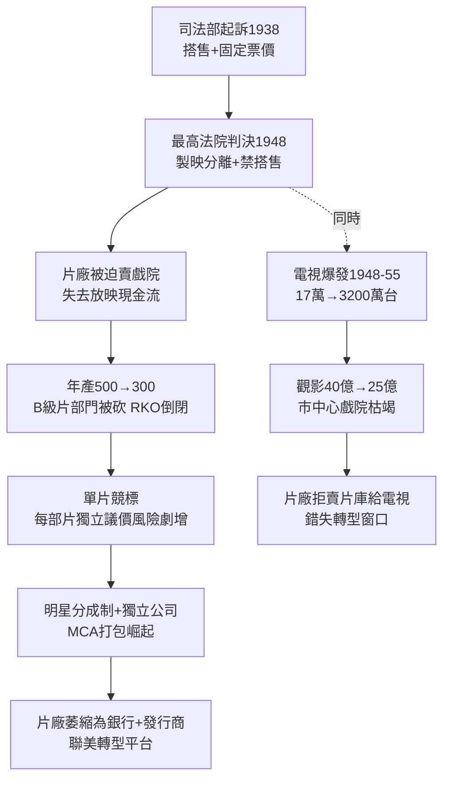

# 3.1 派拉蒙判決與製映分離（1948-1955）

> 1948 年 5 月 3 日，最高法院一紙判決，拆掉了好萊塢二十年的印鈔機。片廠被迫賣掉戲院，從「房東＋製片」變回「製片」——而觀眾，恰好也在那一年開始不進城了。

## 一、判決：美國訴派拉蒙案（United States v. Paramount, 1948）

司法部從 1938 年起訴八大違反《謝爾曼法》，指控搭售（block booking）、固定票價、分割市場（dividing territories）。1948 年最高法院裁定：

1. **製映分離（divorcement）**：擁有院線的五大必須賣掉戲院，製片與放映不得同一老闆；
2. **禁止搭售**：戲院有權單片競標（single-picture bidding），不得強買整季；
3. **禁止固定最低票價**。

經濟後果立竿見影。原來的利潤公式：

$$\Pi_{舊} = \pi_{製片} + \pi_{發行} + \pi_{放映} \quad (放映最穩)$$

變成：

$$\Pi_{新} = \pi_{製片} + \pi_{發行} - C_{競爭性租賃}$$

片廠失去放映端的穩定現金流，每部片都要到市場上單獨議價，風險劇增。年產量從 500＋驟降至 300 左右——因為不再需要餵飽自家戲院，爛片失去存在意義。B 級片部門率先被砍，RKO 1957 年乾脆關門，片庫賣給電視。

## 二、雙重夾擊：電視＋郊區化

判決若單獨發生，片廠或許能適應。但 1948-1955 年，電視爆發與郊區化同時到來，形成「死亡交叉」：

- **電視機保有量**：1948 年全美 17 萬台 → 1955 年 3200 萬台（近 2/3 家庭）；
- **觀影人次**：1946 年 40 億 → 1953 年 25 億 → 1962 年 12 億，腰斬再腰斬；
- **郊區化**：退伍軍人貸款＋州際公路，市中心首輪大戲院（movie palace）客流枯竭，汽車戲院（drive-in）短暫興起但單價低。

觀眾的時間預算約束變了：

$$T_{閒暇} = T_{電視免費} + T_{電影付費} + T_{其他}$$

當 $T_{電視免費}$ 的品質從雪花新聞提升到《I Love Lucy》與直播棒球， $T_{電影付費}$ 必須提供電視給不了的東西——否則觀眾用腳投票。這直接逼出下一節的寬銀幕與彩色：**差異化求生**。

片廠最初傲慢應對：1950 年代初拒絕把片庫賣給電視、拒絕為電視製片，稱電視為「敵人」。結果是把黃金時段拱手讓給廣告商與新興電視網（ABC、CBS、NBC），錯失轉型窗口。直到 1955 年後，華納、迪士尼才開始為電視製片（Disneyland 劇場、Warner Bros. Presents），用電視養電影。

## 三、權力轉移：從片廠到經紀人

製映分離＋減產的意外後果，是**明星與獨立製片人**的解放：

- De Havilland 判決（1944）＋派拉蒙判決，七年合約＋搭售雙鎖鬆動；
- 大明星（Stewart、Hitchcock、Powell）成立獨立公司，以「分成制（profit participation）」代替週薪——如《溫徹斯特 '73》(1950)，Stewart 拿票房分成，開啟天價片酬時代；
- 經紀公司（MCA／Lew Wasserman）崛起，打包明星＋劇本＋導演，向片廠「批發」項目，後來 MCA 直接收購環球（1962），經紀人變老闆；
- 聯美轉型為「只發行不製片」的平台，為獨立製片融資發行，1960 年代成為新浪潮在美國的推手。

片廠從「工廠」萎縮為「銀行＋發行商」。這個身份轉變，是理解此後 70 年好萊塢的關鍵：**風險外包給獨立製片，利潤留給發行。**

## 因果鏈

**反托拉斯訴訟（法規，1938 立案）→ 1948 製映分離 → 失去放映現金流＋禁搭售（商業模式斷裂）→ 減產＋單片風險 → 恰逢電視＋郊區化（技術＋人口結構）→ 觀影腰斬 → 片廠傲慢拒電視 → 權力外移至明星／經紀人／獨立製片（組織革命）。**法院拆了牆，電視挖了地基。片廠不再是帝國，變成銀行。而銀行最怕的，就是接下來十年國會要查的東西——你的思想。
