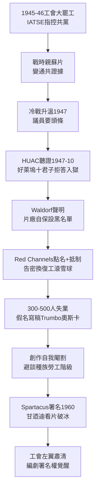

# 3.2 黑名單與冷戰恐懼（1947-1960）

> 好萊塢歷史上最黑暗的十三年，不是票房崩盤，而是一份名單。國會問你一句「你現在是或曾經是共產黨員嗎」，整個行業用三千個失業者的沉默來回答。

## 一、前因：為什麼是好萊塢？為什麼是 1947？

眾議院非美活動委員會（HUAC）盯上好萊塢，是四股力量合流：

1. **工會鬥爭**：1945-46 年佈景工會（CSU）大罷工，親資方的 IATSE 指控 CSU 被共產黨滲透，片廠老闆（尤其迪士尼、華納）樂於借反共打壓工會；
2. **戰時親蘇片原罪**：二戰時羅斯福要求好萊塢拍親蘇宣傳片（《莫斯科使團》《北極星》），戰後這些片成為「通共證據」；
3. **政治套利**：冷戰升溫（杜魯門主義 1947），議員發現「調查好萊塢」有免費頭條，J. Parnell Thomas 與後來的 McCarthy 靠此上位；
4. **行業脆弱**：派拉蒙判決＋電視衝擊下，片廠不敢得罪政府與退伍軍人團體，選擇犧牲員工自保。

1947 年 10 月，HUAC 傳喚 41 人，其中「好萊塢十君子（Hollywood Ten）」（含編劇 Dalton Trumbo、Ring Lardner Jr.）援引憲法第一修正案拒答，被判藐視國會入獄。1947-11-25，五十大亨在 Waldorf-Astoria 開會，通過 **Waldorf 聲明**：開除十君子，設立黑名單——不僱用任何拒絕「洗白」的共產黨員或第五修正案援引者。

## 二、機制：黑名單如何運轉

黑名單不是法律，是行業私刑＋市場封殺的精密機器：

- **刊物點名**：《Red Channels》（1950）點名 151 名廣電電影人；右翼專欄、退伍軍人團體發起抵制威脅戲院；
- **洗白儀式**：被點名者必須到 HUAC「指認他人」才能復工，形成告密鏈——指認 $n$ 人換自己復工，名單滾雪球；
- **經濟絞殺**：編劇用假名（front）寫稿，薪水被抽 50%；Trumbo 用假名寫《羅馬假期》（1953）拿奧斯卡，上台的不是他；
- **人數**：約 300-500 人被正式列入，數千人間接受害（同情者、配偶、前夫前妻）。左翼工會、社會寫實題材連根拔起。

創作後果是自我閹割。1950 年代好萊塢幾乎不碰種族、勞工、階級題材，西部片的印第安人更臉譜化，戰爭片變成反共寓言（《Big Jim McLain》）。用一個審查模型表示：

$$C_{創作} = C_{藝術} + \lambda \cdot P(被點名) \cdot L_{失業}$$

當 $\lambda$ （政治敏感係數）在 McCarthy 時代趨近無窮大，理性創作者自動避開一切爭議——比海斯法典更有效，因為海斯只管性與暴力，黑名單管思想。

## 三、終結與遺產：從 Spartacus 到今天

轉折點有三：

1. **1959-60 破冰**：Kirk Douglas 堅持《Spartacus》(1960) 署名 Dalton Trumbo，Otto Preminger 為《出埃及記》署名 Trumbo，甘迺迪總統公開去看《Spartacus》，黑名單公開處刑終結；
2. **法院鬆動**：最高法院系列判決限縮 HUAC 權力；
3. **電視吸納**：被電影開除的人轉往紐約電視直播劇（live TV drama），反而催生電視黃金年代（Paddy Chayefsky 等）。

但遺產深遠：工會左翼被肅清，此後好萊塢工會偏保守，直到 2023 年大罷工才再現 militancy；政治驚弓之鳥心態延續數十年，片廠對爭議題材的規避機制（coverage、legal clearance）即源於此；同時，「署名權＝人格權」的編劇意識覺醒，為 WGA 1970 年代後的強勢埋下種子。

票房公式之外，好萊塢學到最貴的一課：**當商業模式脆弱時，言論自由是第一個被賣掉的資產。**

## 因果鏈

**工會鬥爭（勞資）＋戰時親蘇片（歷史包袱）＋冷戰政治套利（法規／政治）＋票房脆弱不敢得罪人（商業）→ HUAC 聽證 → Waldorf 聲明（片廠自保賣員工）→ 黑名單私刑機制 → 思想自我審查（創作萎縮）→ 1960 破冰 → 工會保守化＋規避機制遺產。**黑名單證明：製映分離後的好萊塢更賺錢時更膽小。而就在人人自危時，工程師們在實驗室裡憋出了一個救票房的大招——把銀幕變寬、把顏色變濃。
