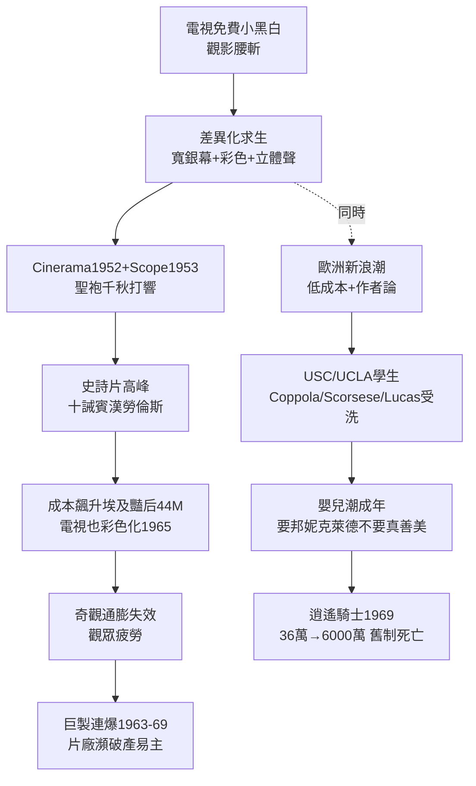

# 3.3 寬銀幕彩色與電視對抗（1952-1969）

> 電視是免費的小方盒，好萊塢的回答是：花錢才能看到的大、寬、濃。你在家看 12 吋黑白，我給你 60 呎彩色沙漠——這就是 1950 年代的軍備競賽。

## 一、技術軍備：Cinerama、CinemaScope、Technicolor

1952-1957 年，好萊塢把能想到的感官升級全押上：

- **Cinerama (1952)**：三機拍攝、三機放映，弧形巨幕＋七聲道，《This Is Cinerama》票房爆棚，但系統笨重、接縫明顯，僅 7 部片；
- **CinemaScope (1953，福斯)**：變形鏡頭壓縮＋拉伸，2.55:1 寬幅，只需換鏡頭＋加寬銀幕，成本低易推廣。《聖袍千秋》（The Robe, 1953）打響第一槍，全行跟進；
- **VistaVision、70mm（Todd-AO）、3D 短潮（1952-54《蠟像院魔魂》）**、立體聲（stereo）；
- **彩色**：Technicolor 三帶染色法成本下降＋Eastmancolor 單帶彩色普及，1955 年後彩色片過半，1965 年後黑白基本只剩藝術選擇。

經濟邏輯是差異化溢價。設觀眾願付：

$$WTP_{電影} = WTP_{電視免費=0} + \Delta_{奇觀}$$

$\Delta_{奇觀} = f(銀幕寬度, 顏色, 音響, 外出社交)$。只有 $\Delta$ 夠大，觀眾才願付票價＋開車＋ babysitter。史詩片（《十誡》1956、《賓漢》1959、《阿拉伯的勞倫斯》1962）就是 $\Delta$ 最大化的產物——四小時、幕間休息、預售票、高票價，專治電視。

短期有效：1955-57 票房小幅回升，《十誡》美國票房 $65M（當年幣值）震驚全行。但長期看，奇觀通膨不可持續：成本飆升（《埃及豔后》1963 超支至 $44M，差點拖垮福斯），觀眾口味疲勞，電視很快也彩色化（1965 年 NBC 全彩）。

## 二、歐洲與日本衝擊：新浪潮給好萊塢上課

當好萊塢沉迷更大更貴時，歐洲用更小更便宜反殺：

- **義大利新寫實主義**（羅塞里尼、De Sica）：實景、非職業演員，證明電影可以不要片廠；
- **法國新浪潮**（1959-64，Truffaut《四百擊》、Godard《斷了氣》）：跳接、手持、自然光、低成本＋作者論（auteur theory, Truffaut 1954）——導演即作者，徹底否定中央製片人制；
- **日本**：黑澤明《羅生門》（威尼斯 1951）、《七武士》（1954）打開美國藝術院線；
- **英國**：Lean《桂河大橋》證明國際合拍＋海外取景可行。

《電影筆記本》＋安德魯・薩里斯（Andrew Sarris）把作者論引進美國，1960 年代電影學院（USC、UCLA、NYU）學生人手一本。這批學生叫 Coppola、Scorsese、Spielberg、Lucas——下一章的主角。技術→商業→創作的鏈條在此反轉：**創作理念（作者論）先行，等待商業崩盤給它讓路。**

## 三、片廠衰落：1960 年代末的廢墟

1960 年代末，黃金年代的軀殼終於撐不住：

- **災難巨製連爆**：《埃及豔后》(1963)、《杜立德醫生》(1967)、《Hello, Dolly!》(1969) 巨虧；
- **觀眾結構劇變**：戰後嬰兒潮成年，25 歲以下佔票房 70%，他們不要《真善美》（雖 1965 大賣），要《邦妮和克萊德》(1967)、《畢業生》(1967)、《逍遙騎士》(1969)——性、暴力、搖滾、反權威；
- **收視率**：1962 年觀影 12 億人次谷底，市中心大戲院改成保齡球館；
- **易主**：1966 MCA 收購環球、1967 迪士尼 Walt 去世、1969 Kirk Kerkorian 買米高梅拆賣片庫地產、華納被 Seven Arts 併購——老片廠逐一淪陷。

1969 年《逍遙騎士》以 $36 萬成本換 $6000 萬票房，$ROI \approx 16000\%$，宣告舊制度死亡、新制度臨盆。片廠高層平均 60 歲，不懂嬉皮；電影學院畢業生 25 歲，懂搖滾。權力即將交棒。

## 因果鏈

**電視免費衝擊（技術）→ 差異化軍備（寬銀幕＋彩色，商業應對）→ 短期回升＋成本通膨（副作用）→ 電視彩色化抹平優勢 → 歐洲低成本作者電影示範替代路徑（創作輸入）→ 嬰兒潮人口結構劇變（需求側革命）→ 巨製連爆＋片廠易主 → 舊制度廢墟 → 為電影學院派騰出舞台。**好萊塢想用更大的銀幕擋住未來，結果未來從後門進來了——一群 25 歲的電影系學生。下一章：新好萊塢。
