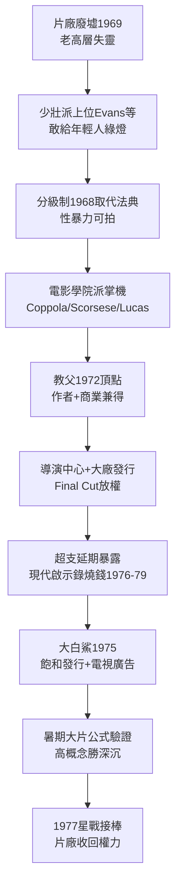

# 4.1 新好萊塢作者導演（1969-1977）

> 歷史上唯一一次，片廠把鑰匙交給了 25 歲的孩子。七年時間，他們拍出了《教父》《出租車司機》《 Chinatown》，然後親手把鑰匙換成了更大的一把鎖——大片。

## 一、前因：廢墟＋分級制＋年輕觀眾

新好萊塢（New Hollywood / Movie Brats）的誕生需要三個前提同時成立，缺一不可：

1. **片廠廢墟**：1969 年老高層束手無策，Robert Evans（派拉蒙 34 歲主管）、Peter Bart 等少壯派上位，敢給年輕人開綠燈；
2. **分級制取代法典（1968）**：Jack Valenti 推 MPAA 分級（G/M/R/X），海斯法典壽終正寢。性與暴力可拍，嬰兒潮觀眾要的就是這個；
3. **電影學院派**：Coppola（UCLA）、Scorsese（NYU）、Spielberg（加州州立）、Lucas（USC）、De Palma、Friedkin、Hal Ashby——第一代系統學過電影史的導演，左手戈達爾、右手約翰・福特。

代表作井噴：1969《逍遙騎士》→ 1971《法國販毒網》→ 1972《教父》→ 1973《美國風情畫》《驅魔人》→ 1974《教父 II》《Chinatown》→ 1975《飛越杜鵑窩》《大白鯊》→ 1976《出租車司機》《洛奇》《電視台風雲》。

《教父》（1972）是頂點：Coppola 以黑幫外衣拍美國資本主義寓言，票房 $245M（當年全球）＋奧斯卡最佳影片，證明**作者性＋商業性可以兼得**。派拉蒙靠它＋《愛情故事》起死回生。

## 二、機制：導演即作者，片廠即銀行

新好萊塢的商業模式是「導演中心＋獨立製片＋大廠發行」：

- 導演拿最終剪輯權（final cut）、高分成；
- 製片公司小型化（BBS Productions 拍《逍遙騎士》《五支歌》）；
- 大廠只管融資發行，不干涉創作——與 1930 年代中央製片人制完全倒置。

風險模型：

$$E[R] = p_{爆款} \cdot R_{爆款} + (1-p_{爆款}) \cdot R_{小片} - C_{放權}$$

1969-75 年 $p_{爆款}$ 奇高（年輕觀眾飢渴＋競爭少），放權划算。但 1976 年後，Coppola《對話》虧、Scorsese《紐約紐約》虧、Friedkin《魔鬼剋星》後連撲，$C_{放權}$（超支＋延期）暴露：Coppola《現代啟示錄》從 1976 拍到 1979，預算從 $13M 膨脹到 $31M。華爾街開始問：為什麼把幾千萬交給一個 30 歲的人在叢林裡燒錢？

## 三、轉折：1975《大白鯊》——作者時代的掘墓人恰是自己人

諷刺的是，殺死新好萊塢的正是新好萊塢最乖的孩子——Steven Spielberg。1975 年《大白鯊》（Jaws）：

- 全國 409 家戲院**同步飽和發行（saturation booking）**＋電視黃金時段密集廣告（$700K 買斷 NBC 檔）；
- 首創暑期檔大片（summer blockbuster），票房 $470M 全球，觀影排隊繞街區；
- 證明公式：**高概念（high concept，一句話講清）＋大營銷＋寬發行 >> 作者深沉**。

Lucas 在一旁看懂了，回去拍《星際大戰》。Coppola 晚年自嘲：「我們以為在革命，結果在幫下一代壟斷者探路。」1977 年之後，片廠收回 final cut，大片時代開幕，作者導演退守 1980 年代獨立圈（Scorsese 沉寂半個十年，直到《蠻牛》）。

## 因果鏈

**片廠破產（商業真空）＋分級制（法規鬆綁）＋嬰兒潮成年（需求）＋作者論留學歸來（創作理念）→ 導演中心制 → 1972-75 井噴 → 放權成本（超支）暴露 → 同門師弟用大片公式證偽作者商業性 → 權力回擺。**新好萊塢是片廠史上最短的春天，也是最昂貴的實驗——它證明天才可以賺錢，也證明複製天才不如複製鯊魚。下一節：鯊魚與星艦如何變成工業。
