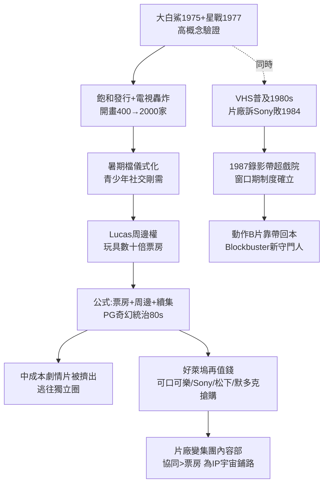

# 4.2 大片時代與錄影帶併購潮（1975-1989）

> 從 1975 年起，好萊塢不再賣電影，賣的是「事件」。暑假只有兩件事：看大片，買玩具。而製造事件的公司，先後被賣給了飲料商、石油商和日本人。

## 一、大片公式：高概念＋飽和發行＋周邊

《大白鯊》（1975）＋《星際大戰》（1977，全球 $775M）確立了沿用至今的**大片（blockbuster）工業公式**：

1. **高概念（High Concept）**：25 秒能講清——「鯊魚吃人」「太空歌劇」。Don Simpson / Jerry Bruckheimer（《閃舞》《壯志凌雲》）將其制度化；
2. **飽和發行＋全國同步＋電視轟炸**：開畫戲院從 1975 年 409 家 → 1980 年代 2000＋家，營銷費佔比從 10% 飆至 30-50%；
3. **檔期儀式化**：暑期檔（Memorial Day- Labor Day）＋聖誕檔，觀影變成青少年社交儀式，復看率高；
4. **周邊（tie-in）**：Lucas 只要了《星戰》周邊版權＋續集權（福斯以為不值錢），結果玩具、遊戲、書籍收入數十倍於票房。公式變為：

$$\Pi_{大片} = R_{票房} + R_{周邊} + R_{續集現值} - C_{製作} - C_{營銷}$$

當 $R_{周邊} + R_{續集現值} \gg R_{票房}$ ，片廠行為徹底改變：寧可花 $100M 拍一部 PG 級太空片，不花$ 10M 拍十部 R 級劇情片——因為前者能賣玩具，後者不能。1980 年代票房前十幾乎全是 PG/PG-13 奇幻冒險（《E.T.》《印第安納瓊斯》《回到未來》《蝙蝠俠》1989）。

代價：中成本劇情片被擠出大廠，逃往獨立圈（下一節）；導演 final cut 收回，製片人＋營銷主管掌權；續集化開始（《星戰》《星艦》《超人》《13 號星期五》）。

## 二、第二現金流：錄影帶（VHS）救了好萊塢，也改變了它

1975 年 Sony Betamax、1976 年 JVC VHS，1980 年代初錄影機普及。片廠最初起訴（環球訴 Sony, Betamax 案 1984，最高法院判家用錄影合法），後發現：**錄影帶是比戲院更大的金礦。**

- 1980 年錄影帶收入幾乎為零 → 1987 年超過戲院票房分成，成為第一大收入；
- 一部中等片：戲院 $20M → 錄影帶租賃＋銷售$ 40-60M，長尾 5-10 年；
- 公式：$$R_{總} = R_{戲院} + R_{錄影帶} + R_{付費電視} + R_{免費電視}$$，窗口期（windowing）制度確立：戲院（6 個月）→ 錄影帶 → HBO → 電視網，每層再收一次錢。

錄影帶的創作後果：恐怖片、動作 B 片（Stallone、Schwarzenegger、Van Damme）靠錄影帶回本，錄影帶店（Blockbuster 1985 創立）成為新的守門人；同時，觀眾第一次能「擁有」電影，重看文化＋影迷文化（cult）興起，為 DVD 與串流埋伏筆。

## 三、誰擁有了好萊塢？併購十年

大片＋錄影帶讓好萊塢再次值錢，1980 年代迎來第一次全球併購潮——買家全是外行：

- **可口可樂買哥倫比亞（1982, $750M）**：想賣爆米花＋飲料聯動，失敗 1989 賣給 Sony；
- **Sony 買哥倫比亞（1989, $3.4B＋$ 1.6B 債務）**：日本製造業巔峰，「硬體＋軟體」戰略，Betamax 敗給 VHS 後決心買內容；
- **松下買 MCA／環球（1990, $6.6B）**：同樣硬體＋內容邏輯，後 1995 賣給 Seagram；
- **默多克買福斯（1985）**：建 Fox 電視網，用片庫養電視；
- **Time＋Warner 合併（1989, $14B）**：內容＋有線（HBO、CNN），垂直整合 2.0。

1989 年，八大中只剩迪士尼還是獨立美國公司。好萊塢從「加州工廠」變成「跨國集團的內容部門」。決策邏輯從票房變成集團協同：電影要能帶動主題樂園、電視、音樂、遊戲。這直接導向 2000 年代的 IP 宇宙——因為只有 IP 能跨部門變現。

## 因果鏈

**作者超支（成本失控）＋年輕觀眾儀式需求（需求）→ 高概念＋飽和發行（商業模式創新）→ 周邊＋續集現值主導決策（財務邏輯質變）→ 中成本片外溢 → 錄影帶第二現金流（技術紅利，先訴後香）→ 估值飆升 → 跨國併購（所有權革命）→ 片廠集團化 → 為 IP 宇宙時代準備組織前提。**大片救了票房，也賣了公司。被擠出去的中成本與作者們沒有消失——他們在聖丹斯搭起了帳篷，下一節見。
