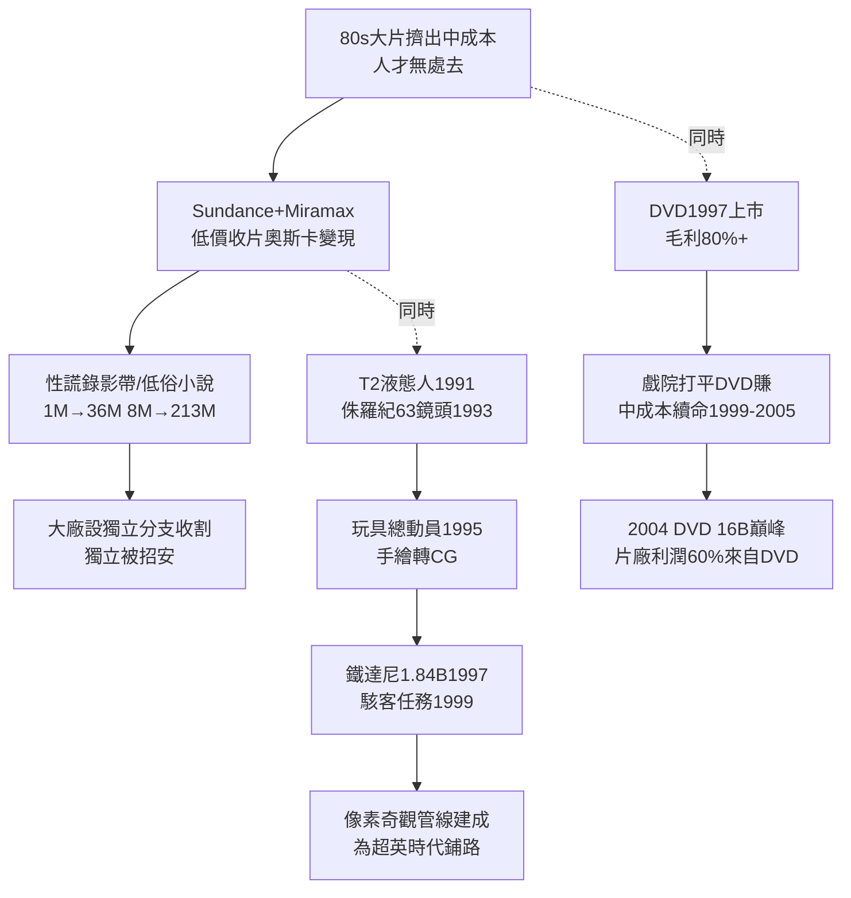

# 4.3 獨立電影與CGI黎明（1990-1999）

> 1990 年代的好萊塢是雙頭怪：一頭在聖丹斯賣 100 萬成本的黑白片，一頭在矽谷渲染 1 億成本的恐龍。十年後，恐龍贏了票房，黑白片贏了靈魂——而兩者的孩子叫皮克斯。

## 一、獨立電影：被大片擠出去的人，在聖丹斯建國

1980 年代大片化把中成本劇情片趕出大廠，恰好遇上三個 liberating 力量：

1. **聖丹斯（Sundance, Redford 1978 創立，1985 成競賽影展）＋米拉麥克斯（Miramax, Weinstein 兄弟）**：低價收片＋奧斯卡營銷機器。《性、謊言、錄影帶》(1989, $1.2M→$36M)、《低俗小說》(1994, $8M→$213M)、《英國病人》《莎翁情史》連拿最佳影片；
2. **錄影帶＋DVD 長尾**：獨立片戲院不賺，錄影帶能回本，Blockbuster 貨架需要充實；
3. **人才蓄水池**：Tarantino、Soderbergh、Linklater、Kevin Smith、Wes Anderson、Coen 兄弟——拍大廠不給拍的題材，用對白與結構創新代替特效。

獨立片經濟學：

$$ROI_{ind} = \frac{R_{戲院小} + R_{錄影帶} + R_{奧斯卡溢價} - C_{小}}{C_{小}}$$

$C_{小}$ 僅 $1-8M$，$R_{奧斯卡溢價}$（獲獎後錄影帶＋海外翻倍）可觀，賠率誘人。1990 年代是大廠紛紛設「獨立分支」（Sony Classics、Miramax 被迪士尼收購 1993、Searchlight）收割獨立紅利——獨立被招安，Sundance 首映＝大廠競價，Weinstein 的奧斯卡公關戰把藝術變成軍備。

## 二、DVD：1997 年的印鈔機 2.0

1997 年 DVD 上市，1999-2005 黃金期，利潤率高到荒唐：

- 成本：光碟壓片 $1-2，售價 $20-30，毛利率 80%+；
- 附加價值：導演評論音軌、刪減片段、幕後——影迷重複購買；
- 片庫重賣一次：每部老片重新數位修復再賣，零拍攝成本純利；
- 2004 年 DVD 收入峰值約 $16B，超過戲院＋海外總和，片廠利潤 60-70% 來自 DVD。

DVD 養活了最後的中成本片（$20-60M 劇情、喜劇、驚悚），因為「戲院打平、DVD 賺錢」：

$$E[\Pi] = (R_{戲院} - C_{營銷}) + R_{DVD高毛利} - C_{製作} > 0$$

即使戲院小虧，DVD 補回。這是 1990 年代末成人劇情片（《美國心玫瑰情》《木蘭花》《大開眼戒》）還能存在的財務原因——串流時代殺死 DVD，也殺死了這個品類（見第 5 章）。

## 三、CGI：從《魔鬼終結者 2》到《玩具總動員》

1990 年代另一條線是像素革命：

- **1991《魔鬼終結者 2》**：ILM 液態金屬人，CG 首奪奧斯卡視效，證明 CG＋實拍可行；
- **1993《侏羅紀公園》**：Spielberg 原想定格動畫，ILM 測試 CG 恐龍成功，全片 63 個 CG 鏡頭，全球 $1.03B，嚇得全行連夜買 SGI 工作站；
- **1995《玩具總動員》**：皮克斯＋迪士尼，全 CG 長片，$373M，Jobs 的 NeXT＋Pixar 翻身，動畫從手繪轉向 CG（迪士尼手繪部門 2004 關閉）；
- **1997《鐵達尼號》**：$200M 成本豪賭＋CG 海水＋實景，全球 $1.84B，卡麥隆證明「舊類型＋新技術＝新大片」；
- **1999《駭客任務》**：bullet time，港式武術＋CG＋哲學，預示千禧年美學。

技術成本曲線：

$$C_{CG/鏡頭}(t) = C_0 \cdot e^{-kt} + C_{人力}$$

1993 年單鏡頭數十萬美元，1999 年降至數萬，電視與獨立也能用。ILM、Pixar、DreamWorks（1994 成立）、Weta 前身形成，人才從加州流向矽谷＋紐西蘭。**大片從「實景奇觀」轉向「像素奇觀」**，為 2000 年代超級英雄（全 CG 第三幕）鋪好管線。

## 因果鏈

**大片擠出效應（商業）→ 聖丹斯＋米拉麥克斯承接（組織創新）→ 低成本高 ROI 示範 → 大廠招安獨立（收編）→ DVD 高毛利續命中成本（技術紅利）→ 同時 CG 成本指數下降（技術）→ 侏羅紀＋玩具總動員＋鐵達尼驗證像素大片 → 實景轉像素管線。**1990 年代是好萊塢最後的「雙軌繁榮」：文藝與特效各賺各的。DVD 一死，雙軌斷一軌；CG 一成熟，大片成本結構永久改變。下一章：當所有片都是 CG 大片，賣什麼才能區分？答案：宇宙。
