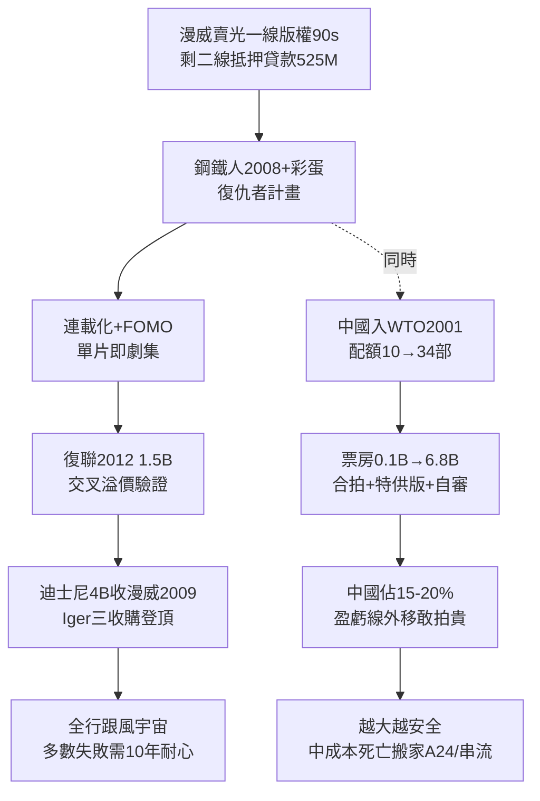

# 5.1 漫威宇宙與中國市場（2000-2015）

> 2008 年，一個瀕臨破產的漫畫公司用一個二線英雄賭了一把；2012 年，全世界發現賭的不是一部電影，是一個宇宙。而宇宙的另一半門票，在長城那一邊。

## 一、MCU：把電影變成電視劇

漫威（Marvel）在 1990 年代把蜘蛛俠、X 戰警版權賣光（Sony、Fox），2005 年以剩餘二線角色（鋼鐵人、雷神、美國隊長）為抵押，向 Merrill Lynch 貸 $525M，自立 Marvel Studios。2008《鋼鐵人》$ 585M＋片尾彩蛋 Nick Fury「復仇者計畫」，開啟**電影宇宙（Cinematic Universe）**：

商業創新有三：

1. **連載化**：單片即劇集，片尾彩蛋即預告，觀眾為「不掉隊」而全看，復看＋補看，缺席成本（FOMO）拉滿；
2. **風險對沖**：宇宙內交叉補貼，單片失手（《雷神 2》口碑差）不傷整體，宇宙品牌即保險。組合期望：

$$E[R_{宇宙}] = \sum_i E[R_i] + \rho \cdot N_{交叉} \cdot V_{粉絲黏性}$$

$\rho$ 為交叉溢價， $N_{交叉}$ 越多，總值非線性增長——2012《復仇者聯盟》$1.5B 驗證；
3. **PG-13＋CG 第三幕＋全球通行幽默**：暴力無血、性無露骨、笑點視覺化，配音無障礙，全球最大公約數。

迪士尼 2009 年以 $4B 收購漫威，被視為撿漏（Bob Iger 三大收購：皮克斯 2006$ 7.4B、漫威 2009、盧卡斯 2012 $4B）。到 2015，MCU 全球$ 8B＋，迪士尼靠宇宙＋《冰雪奇緣》＋皮克斯，登頂六大之首。全行跟風：DC 宇宙、環球 Dark Universe（2017 木乃伊慘敗即死）、傳奇怪獸宇宙——多數失敗，證明宇宙需要 10 年耐心，不是 PPT。

## 二、中國市場：第二引擎與合拍遊戲

2001 年中國加入 WTO，進口分帳片配額從 10 部→20 部（2002）→34 部（2012，美方拿 25% 分成）。中國票房：2003 年 $0.1B → 2010 年$ 1.5B → 2015 年 $6.8B → 2017 年$ 8.6B，超北美指日可待。

好萊塢的應對是「為中國改劇本」：

- **合拍（co-production）**：中美合拍算國產片，不佔配額、拿 43% 分成（vs 分帳 25%）。《長城》(2016)、《功夫熊貓 3》試水，審查＋創作權拉扯，多數水土不服；
- **特供版**：加中國演員 3 分鐘（《鋼鐵人 3》范冰冰特供版、《變形金剛 4》李冰冰＋重慶取景），加 1-2 億美元票房；
- **內容自我審查**：為過審，刪 LGBTQ、鬼魂、敏感地圖，全球版一起改——中國審查外溢為全球審查，爭議至今；
- **資本流入**：萬達 2012 買 AMC（ $2.6B）、2016 買傳奇（$ 3.5B）、阿里／騰訊參投派拉蒙、華納——後因北京外匯管制＋萬達債務，2017 後退潮。

公式上，中國把好萊塢大片的盈虧線外移：

$$R_{全球} = R_{北美} + R_{中國} + R_{其他}$$

2010 年代 $R_{中國}$ 從 5% 漲至 15-20%，一部 $200M 成本大片，北美$ 150M＋中國 $150M 即可回本。於是片廠更敢拍貴、更不敢碰爭議——宇宙＋中國雙輪，鎖定了 2010 年代「越大越安全、越安全越大」的格局，中成本徹底死亡（見下一節串流承接）。

## 三、代價：原創已死？

2000-2015 票房前十：續集＋重啟＋宇宙佔 80%＋。Soderbergh、Fincher 轉投電視（《紙牌屋》2013 Netflix），因為「成人劇情只有 HBO／Netflix 肯投」。Stallone 感嘆：「中成本電影死了。」

但硬幣另一面：MCU 的工業化品控（製片人 Kevin Feige 中央集權，恰似 Thalberg 2.0）、全球化就業（Weta、新西蘭、倫敦、亞特蘭大稅收優惠拍攝地）、中國銀幕從 5000 塊漲到 40000 塊，電影作為大眾娛樂的滲透率歷史最高。原創沒死，只是搬家——搬到聖丹斯、A24（2012 成立，《月光男孩》《媽的多重宇宙》）與串流。

## 因果鏈

**版權賣光被迫自立（絕境）＋貸款（資本）→ 連載宇宙（商業模式創新，電視劇邏輯吃電影）→ 交叉溢價驗證 → 迪士尼收購放大（集團協同）→ 中國市場開放（外部紅利）→ 全球票房公式改寫 → 更貴＋更安全＋更審查 → 原創外溢至獨立與串流。**宇宙解決了大片的可持續性，中國解決了大片的回本線——兩者合謀，殺死了中間。下一節：當觀眾連戲院都不想去，宇宙再大又如何？Netflix 來了。
