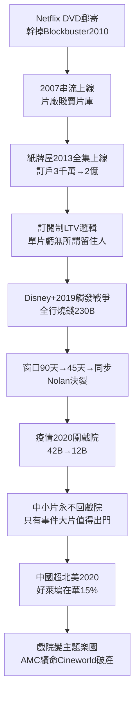

# 5.2 串流戰爭與疫情衝擊（2007-2022）

> 2007 年，Netflix 按下了一個按鈕：DVD 信封變成播放鍵。十五年後，全好萊塢為這個按鈕燒掉 1000 億美元，關掉半數戲院，然後發現——按鈕回不去了。

## 一、Netflix：從錄影帶店到製片廠

三段跳：

1. **DVD 郵寄（1997-2007）**：長尾＋無滯納金，幹掉 Blockbuster（2010 破產）；
2. **串流 licensed 內容（2007-2012）**： $8/月無限看，片廠以為是「額外窗口」，賤賣片庫（Starz 協議$ 30M/年，後悔終身）；
3. **原創（2013-）**：《紙牌屋》$100M 兩季豪賭＋全集上線（binge），＋《女子監獄》《怪奇物語》，訂戶 2012 年 3000 萬 → 2020 年 2 億。

Netflix 的武器是數據＋訂閱制。傳統票房最大化單片利潤：

$$\max \Pi_{單片} = R - C$$

Netflix 最大化訂戶生命價值：

$$\max LTV = \frac{ARPU \cdot margin}{churn} - CAC$$

單片虧無所謂，只要降低 churn（流失率）或帶來新訂戶。於是敢投傳統片廠不敢投的： $90M《羅馬》（黑白西語，奧斯卡）、$ 160M《愛爾蘭人》、韓劇《魷魚遊戲》（ $21M 成本帶來$ 900M 價值，內部估算）。**訂閱制解放了內容多樣性，也消滅了單片盈虧紀律。**

## 二、串流戰爭：2020 年前後，所有人 All-in

迪士尼 2019-11-12 上線 Disney+（首日 1000 萬訂戶），觸發軍備：

- **Disney+**：漫威＋星戰＋皮克斯＋國家地理＋《曼達洛人》，2022 年 1.6 億；
- **HBO Max（Max）**：華納片庫＋《權遊》《繼承之戰》，AT&T→Discovery 合併（WBD 2022）；
- **Apple TV+、Paramount+、Peacock、Hulu**，加上 Amazon 2021 年 $8.5B 收購米高梅；
- **燒錢**：內容支出全行 2022 年超 $230B，Disney＋、WBD、Paramount 串流合計虧損超$ 10B/年，股價崩（Netflix 2022 年初跌 70%，迪士尼跌 50%）。

窗口期崩潰：戲院窗口從 90 天 → 45 天 → 同步上線（HBO Max 2021 全片同步，傳奇《沙丘》《哥吉拉》抗議，導演 Nolan 與華納決裂轉投環球）。戲院老闆視串流為叛徒，觀眾用遙控器投票：方便贏。

## 三、疫情：加速五年，暴露真相

2020-2021 新冠關閉全球戲院 6-18 個月：

- 2020 全球票房 $12B（2019 年$ 42B），北美 $2.2B（1980 年代水準）；
- 《花木蘭》Disney+ PVOD $30、《信條》逆行者堅守戲院慘敗、《蜘蛛人：無家日》2021 年$ 1.9B 證明大片仍需大銀幕；
- 中國 2020 年首超北美成全球第一票倉（ $3B vs$ 2.2B），國產片《八佰》《長津湖》登頂，好萊塢在華份額從 40% 跌至 15%——疫情＋審查＋民族主義三殺。

疫情證明兩件事：① 中小片觀眾永遠不回戲院了（方便＋便宜＋大電視）；② 只有事件大片（event film）值得出門。戲院從「大眾娛樂」萎縮為「主題樂園」（IMAX、4DX、粉絲首映）。AMC 2021 meme 股＋發債續命，Regal 母公司 Cineworld 2022 破產——放映端第二次死亡（第一次是 1948 製映分離）。

## 因果鏈

**DVD 郵寄長尾（技術＋商业）→ 串流 licensed 紅利（片廠誤判窗口）→ 原創＋binge（模式創新）→ 訂閱 LTV 取代單片利潤（財務邏輯革命）→ 迪士尼被迫跟進 → 全行燒錢戰爭 → 窗口崩潰 → 疫情加速五年（外部衝擊）→ 戲院主題樂園化＋中國脫鉤。**串流先救了多樣性（什麼都敢投），再殺了紀律（什麼都虧）。當錢燒完，帳單寄給誰？寄給編劇和演員——下一節，2023 大罷工。
