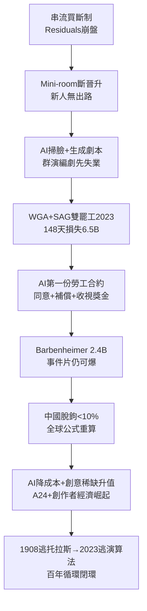

# 5.3 2023大罷工與AI未來（2023-）

> 2023 年 5 月 2 日，編劇放下筆；7 月 14 日，演員放下麥。好萊塢停擺 148 天，不是為了加薪而已——是為了在 AI 學會寫劇本之前，先寫好人類的合約。

## 一、為什麼罷工？串流＋AI 雙重擠壓

WGA（編劇工會，11,500 人）與 SAG-AFTRA（演員工會，160,000 人）1960 年以來首次雙罷工，訴求直指串流時代的三個結構性剝削：

1. **Residuals（重播分紅）崩盤**：電視時代重播一次拿一次錢，串流時代買斷制——《怪奇物語》編劇拿固定薪，無論 1 億人看還是 10 億人看。公式對比：

$$R_{電視} = w_0 + \sum_t r_t \cdot Q_t \quad vs \quad R_{串流} = W_{買斷}$$

當 $Q_t$ 爆發式增長， $R_{串流} \ll R_{電視}$ ，創作者被增長拋棄；

2. **Mini-room（迷你編劇室）**：串流為省錢，劇集開拍前只雇 3-4 編劇寫幾集即散，不給製片人頭銜（producer credit）與跟組經驗——斷了新人晉升階梯；
3. **AI 威脅**：製片方（AMPTP）最初拒絕承諾「AI 不列為編劇、不拿人類劇本訓練、不掃描群演永久使用肖像」。演員更恐懼：一天工資掃全身，之後無限複製（digital replica）， background actor 先失業。

背景是 2022 年燒錢戰後，華爾街從「訂戶增長」轉向「盈利」，迪士尼、WBD、Netflix 砍內容 20-30%、裁員、合併，省下的錢不想分給創作者。罷工 148 天（WGA 5/2-9/27，SAG 7/14-11/9），全美損失估 $6.5B，洛杉磯餐飲、道具、燈光連帶寒冬。

## 二、合約：人類第一次給 AI 立法

2023-9/11 達成的 MBA（Minimum Basic Agreement）被稱為「AI 時代第一份勞工合約」，要點：

- **WGA**：AI 不能列為編劇、不能寫改寫分功勞；公司不能要求編劇用 AI，編劇可用（需披露＋公司同意）；公司不得拿編劇作品訓練 AI（保留追訴）；
- **SAG**：建立「數位複製人（digital replica）」同意＋補償框架：生前掃描須知情同意＋每次使用付費；群演掃描一天工資永久使用被禁；
- **串流分紅**：引入「收視獎金（viewership bonus）」——高收視劇集編劇、演員拿額外獎金（Netflix、Disney+ 須披露部分收視數據，歷史性讓步）；
- **Mini-room  floor**：強制最小編劇室人數＋雇傭週數。

資方為何讓步？① 罷工逢頒獎季＋秋季檔空窗，2024 片單斷流；② 加州政客＋工會聯盟施壓；③ AI 爭議下資方形象極差。但合約只管 3 年（至 2026），AI 能力每 6 個月翻倍——2026 談判必再戰。

## 三、未來：好萊塢傳記的下一章由誰寫？

2024-2026 的好萊塢是四股力量角力：

| 力量 |現狀| 因果指向 |
|---|---|---|
| **戲院復甦分化** | 《Barbenheimer》(2023, $2.4B 合計) 證明原創事件片仍可爆；但中小片只去串流 | 戲院＝主題樂園化不可逆 |
| **中國脫鉤** | 好萊塢在華份額 <10%，《阿凡達 2》《銀河護衛隊 3》不如國產春節檔 | 全球公式重算， $R_{中國}$ 歸零 |
| **AI 生產力** | Runway、Sora 生成預覽、換臉、配音，預算 $100M 的視效$ 20M 可做；同時編劇用 AI 提速 30% | $C_{製作} \downarrow$ ，但 $V_{人類創意}$ 稀缺性 $\uparrow$ |
| **獨立＋創作者經濟** | A24 $2.5B 估值、《媽的多重宇宙》奧斯卡＋$ 140M；YouTube、TikTok 搶 Z 世代注意力，MrBeast 製作費超多數電影 | 守門人從片廠變演算法 |

百年循環在 2023 年閉環：1908 年獨立製片人逃離愛迪生托拉斯，2023 年編劇演員罷工逃離演算法托拉斯——都是**技術壟斷 → 創作者出走 → 新中心誕生**。好萊塢的傳記從來不是一家公司的傳記，而是一種能力的傳記：**把技術變成夢、把夢變成錢、把錢再變成下一個技術。**

只要人類還願意在黑暗中一起笑、一起哭，好萊塢就不會死——它只會搬家。從紐澤西搬到加州，從戲院搬到電視，從電視搬到手機，從手機搬到……下一個黑暗的房間。

## 因果鏈

**訂閱買斷（商業模式）→ 分紅崩盤＋迷你室（分配＋組織）→ AI 生成威脅（技術）→ 華爾街轉向盈利不分錢（資本導火）→ 雙罷工（勞工反擊）→ AI 勞工合約（法規創新）→ 戲院分化＋中國脫鉤＋AI 降本（新均衡）→ 百年循環閉環：技術→商業→創作→法規→下一波技術。**好萊塢一百年，每一章的結尾都是下一章的開頭：專利戰生出片廠，片廠生出法典，法典生出電視對抗，電視生出大片，大片生出宇宙，宇宙生出串流，串流生出罷工，罷工生出 AI 規則——而規則，正在生出下一個好萊塢。
