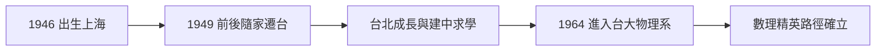

# 1.1 上海童年與台灣求學（1946–1964）

1946 年 12 月 24 日，姚期智（Andrew Chi-Chih Yao）出生於上海。這一年，第二次世界大戰剛結束，中國正陷入國共內戰的動盪。他的家庭屬於受過良好教育的知識分子階層——這個出身，在往後的每一次遷徙中，都成為他能夠「重新開始」的資本。

## 戰後上海的出生

- 姚家在戰後的上海屬於典型的士紳家庭：重視教育、重視數理、重視子女的語言訓練；
- 1949 年前後，政局劇變，姚家如同百萬個中國家庭一樣面臨去留抉擇；
- 幼年姚期智隨家人遷往**台灣**——這次遷徙決定了他前二十年的成長環境，也使他成為「戰後台灣培育、最終回饋中國科學」這條歷史弧線上最著名的例子之一。

## 台灣的成長與求學

在台灣，姚期智接受了當時華人社會中最完整的一套「數理精英」教育路徑：

- 中學時代他就讀**建國中學**——台北的頂尖男校，同時期的同窗與學長中，日後走出多位院士與企業家；
- 建中時期的姚期智以數理見長，但並非「競賽神童」型：他的風格是安靜地想清楚，而非搶答；
- 1960 年代台灣的升學體制極度看重聯考，物理系是當時最優秀數理學生的第一志願——這個風氣直接塑造了姚期智的下一步。

### 建國中學的時代氛圍

1960 年代初的建中，彌漫著一種特殊的智識氣氛：

- 白色恐怖的陰影仍在，但校園裡的數理社團提供了相對自由的思考空間；
- 同輩之間以「誰能把習題想得更深」為榮，而非以家境或社交取勝；
- 這種「以思考論英雄」的文化，與姚期智日後低調、專注、不喜張揚的性格高度契合。

### 太空時代與物理熱

姚期智的少年時代恰逢**太空競賽**與物理學的黃金年代：

- 1957 年史潑尼克升空、1960 年雷射發明、1960 年代量子電動力學完成最終檢驗——物理學是當時全球最光榮的科學；
- 在華人世界，楊振寧與李政道 1957 年獲諾貝爾物理獎，掀起「學物理救國／成名」的巨大風潮；
- 一個建中資優生選擇物理，几乎是那個時代的預設答案——姚期智也不例外。

### 與同時代人物的對照

| 人物 | 出生 | 少年主題 | 成年貢獻 |
|------|------|----------|----------|
| 圖靈 | 1912 | 寄宿學校的孤獨實驗 | 可計算性理論（→ 詳見《圖靈傳記》第 1 章） |
| 香農 | 1916 | 小鎮電報玩具 | 資訊理論（→ 詳見《香農傳記》第 1 章） |
| 姚期智 | 1946 | 戰亂遷徙與建中數理 | 計算複雜性與密碼學理論 |

比香農年輕三十歲的姚期智，成長於完全不同的世界：不是車庫與電報線，而是升學主義與聯考；不是動手組裝，而是紙筆推演。這也預示了他的學術風格：**純理論的、數學化的計算機科學**，與香農的「工程化直覺」形成兩極。

## 離散家庭與「二次遷徙」的能力

姚家遷台是 1949 年大遷徙的一角，這段歷史給了幼年姚期智三種日後反覆使用的稟賦：

- **語言**：在上海與台灣之間，家庭維繫了吳語與國語的雙重語境，之後又是英語——多語環境培養了對「符號系統可以替換」的直覺，這正是形式化思維的萌芽；
- **無根性**：遷徙者家庭不把任何現狀視為理所當然，這使姚期智日後敢於兩次歸零——從物理轉計算（見 1.2），從普林斯頓回清華（見 4.2）；
- **教育即資本**：在動盪年代，唯一搬得走的財產是學問。姚家把全部資源投在子女教育上，這在 1950 年代的台灣知識分子家庭中是普遍策略，但在姚家執行得格外徹底。

### 台灣數理教育的結構

1960 年代的台灣形成了世界上罕見高效的數理人才管道：

| 環節 | 機制 | 產出 |
|------|------|------|
| 競賽與聯考 | 全國統一選拔 | 高信度的選才 |
| 明星高中 | 同儕密度極高 | 智力競爭的習慣 |
| 台大 | 唯一綜合頂校 | 精英集中訓練 |
| 留美 | 幾乎唯一的深造出路 | 與世界前沿接軌 |

這條管道在 1960–1980 年代輸送了大批華人科學家進入美國學術界，姚期智是其中走得最深的一位。有趣的是，管道的每一環都強調**解題**而非**提問**——姚期智日後最了不起的能力恰恰是**提出新問題**（百萬富翁問題、通信複雜度模型，見 3.2、2.3），這是他個人天賦對教育體制的超越，而非體制的產物。

### 建中同代的命運光譜

姚期智的建中同代人，日後散布在幾條典型的路上：留美學界、台灣科技產業、以及少數往返兩岸之間的人物。姚期智本人橫跨了所有這些世界——他是美國學界的頂峰（見 2.1、4.1），也是兩岸科技交流最著名的象徵（見 4.2）。一個建中學生的道路能同時貫穿這三個世界，在整個世代中近乎唯一。

## 為什麼是物理

1964 年，姚期智進入**國立台灣大學物理系**。選擇的邏輯很清楚：

- 物理是當時「理解世界最終規律」的學科，數理資優生的天然歸宿；
- 台大物理系有很好的傳統，教授多受日式或美式嚴格訓練；
- 在 1960 年代，**計算機科學**在華人世界還幾乎不存在——沒有人會把「電腦」當成一生的志業。

但命運的伏筆已經埋下：姚期智在物理系接受的數學與抽象訓練，正是日後計算理論最需要的素質。

## 事件關聯與前因後果

| 年份 | 事件 | 後續影響 |
|------|------|----------|
| 1946 | 出生於上海 | 知識分子家庭的數理傳統 |
| 1949 前後 | 隨家遷台 | 台灣教育體系塑造前二十年 |
| 1957 前後 | 楊李獲諾獎、太空競賽 | 「學物理」成為時代信仰 |
| 1960 年代初 | 就讀建國中學 | 同儕競爭與深度思考的習慣 |
| 1964 | 進入台大物理系 | 見 1.2 |

**因果**：如果說香農的童年是被**玩具**塑造的（→ 詳見《香農傳記》第 1 章），姚期智的少年則是被**時代風潮**塑造的——戰亂給了他遷徙的能力，楊李神話給了他物理的方向。而當這個方向日後被證明不是終點時，他的遷徙經驗再次發揮作用：**換一個國家、換一個學科，重新開始**。這種「遷徙能力」，是姚期智傳記中最一致的母題。

## 小結

- 1946 年生於上海，1949 年前後遷台，姚期智的前半生是一部戰後華人離散史的縮影；
- 建國中學與台大物理系，構成 1960 年代台灣最標準的數理精英路徑；
- 太空時代的物理光榮、楊李諾獎的示範效應，把他推向物理——這個選擇在 1964 年無可挑剔；
- 但計算機科學正在太平洋另一端悄悄成形：圖靈機的理論傳統（→ 詳見《圖靈傳記》第 2 章）即將迎來它的黃金年代；
- 1964 年秋天，十八歲的姚期智走進台大物理館。他還不知道，物理學只是他的中繼站（見 1.2）。
