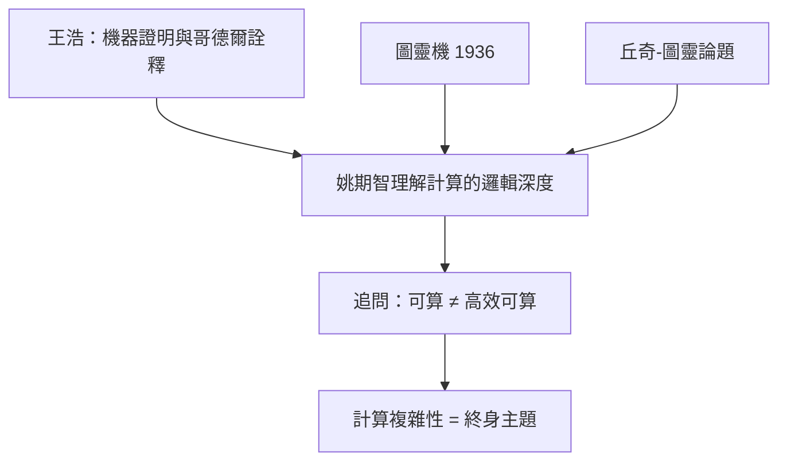

# 1.3 哈佛轉攻計算理論（1970–1972）

1970 年，姚期智進入**哈佛大學**應用數學系，兩年後（1972 年）以計算機科學方向的博士學位畢業。從物理碩士到計算理論博士只花了三年——這個速度本身，就是天才的證明。而引導這次轉向的關鍵人物，是邏輯學家**王浩**（Hao Wang）。

## 哈佛的計算機科學

1970 年前後的哈佛沒有獨立的計算機科學系，計算理論掛在**應用數學**之下：

- 這個「寄居」狀態反而有利：姚期智同時浸潤在數學的嚴格性與新興計算理論的開放性中；
- 哈佛的計算小組雖小，但問題極深：自動機理論、遞迴函數、計算的邏輯基礎；
- 對一個剛離開物理的人來說，這裡提供了「像物理一樣根本，又像數學一樣純粹」的問題。

## 王浩的影響

**王浩**（1921–1995），出生於濟南的華裔邏輯學家，當時在哈佛任教，是哥德爾思想的權威詮釋者。他對姚期智的影響有三層：

- **智識上**：王浩的研究横跨**機器證明**與數理邏輯——他用 IBM 704 寫程式證明了《數學原理》中的數百條定理（1958–1960）。這條「邏輯＋機器」的路線，正是圖靈機傳統的延伸（→ 詳見《圖靈傳記》第 2 章、《丘奇傳記》第 5 章）；
- **身分上**：王浩向姚期智展示了一個華人可以在西方邏輯與計算的最高殿堂立足——姚期智成為王浩之後、華人在計算理論登上頂峰的下一棒；
- **問題上**：王浩與哥德爾的對話（哥德爾 1970 年前後向王浩口述其思想）使「什麼是可計算、什麼是機械程序」這類問題帶有哲學重量。姚期智日後的複雜性研究，正是這類問題的**定量版**。

### 圖靈機的吸引

姚期智自己回顧轉行原因時，最核心的一句是：**圖靈機把他迷住了**。

- 圖靈 1936 年的定義（→ 詳見《圖靈傳記》第 2 章）把「計算」還原為一條紙帶與有限狀態——一個物理碩士立刻能看出這是**最徹底的還原論**，比物理學的還原更乾淨；
- 丘奇－圖靈論題（→ 詳見《丘奇傳記》第 5 章）宣稱：一切可算的都等價於圖靈可算的。但姚期智敏銳地意識到：**「可算」與「實際可算」之間有一道鴻溝**——指數時間的演算法在理論上可算，在宇宙尺度上不可行；
- 填補這道鴻溝，就是**計算複雜性理論**的使命。姚期智的一生事業，就是為這道鴻溝畫出精確的數學邊界。

## 博士論文與早期工作

姚期智在哈佛的博士論文屬於**計算理論與自動機**方向：

- 研究涉及計算模型之間的等價與分離，延續圖靈、麥卡錫一系的形式化傳統（→ 詳見《麥卡錫傳記》第 2 章）；
- 1972 年取得博士學位後，他立即獲得北美頂尖學校的職位——這在當時的理論計算機圈子裡是標準的搶人大戰；
- 三年完成從物理到博士的跨越，說明物理訓練給他的不是知識，而是**數學成熟度**：拿到一個新領域，幾個月就能摸到前沿。

### 王浩其人

王浩的學術生涯本身就是一部二十世紀邏輯史：西南聯大出身，哈佛博士，先後與奎因、哥德爾、圖靈傳統深度對話：

- 1950 年代他在**機器證明**上的工作，是「用機器做數學」的最早成功案例之一，比 AI 這個詞的誕生（1956 達特茅斯，→ 詳見《麥卡錫傳記》《香農傳記》第 4 章）還早；
- 他晚年致力於哥德爾思想的研究與闡釋，出版《哥德爾》等著作；
- 他與哥德爾的多次長談，是二十世紀數理哲學最重要的口述史料。

對姚期智而言，王浩證明了一個關鍵命題：**形式化思維不是西方的專利**。這個示範的效力，要在三十四年後才完全顯現——2004 年，姚期智把圖靈機傳統帶回華語世界（見 4.2），完成了王浩未竟的一步。

### 複雜性理論的黎明語境

姚期智進入領域時，學科的骨架正在成形：

| 年份 | 事件 | 提出者 |
|------|------|--------|
| 1936 | 圖靈機 | 圖靈（→ 詳見《圖靈傳記》第 2 章） |
| 1956 | 計算作為學科建制化 | 達特茅斯群體 |
| 1965 | 多項式時間＝「好演算法」 | Edmonds、Cobham |
| 1971 | NP 完備性定理 | Cook（Karp 1972 擴充） |
| 1972 | 姚期智入場 | —— |

在這個語境下，一個既有物理直覺又有邏輯訓練的年輕人，恰恰是領域最需要的人：複雜性理論本質上是「計算的物理學」——研究資源的守恆與轉換。姚期智的物理背景（見 1.2）使他能把「能量」「熵」式的思維帶進計算：Yao 氏原理（見 2.2）正是這種思維的第一個結晶。

## 事件關聯與前因後果

| 年份 | 事件 | 後續影響 |
|------|------|----------|
| 1970 | 進入哈佛應用數學 | 計算理論的正式起點 |
| 1970–1972 | 受教於王浩 | 邏輯傳統與華人榜樣 |
| 1971 | Cook 發表 NP 完備性 | 領域爆發，姚期智趕上頭班車 |
| 1972 | 取得博士學位 | 進入 MIT 任教（見 2.1） |

**因果**：如果沒有物理的挫折（見 1.2），姚期智不會轉行；如果沒有王浩與哈佛，他可能只是一個普通的轉行者。王浩把**圖靈—哥德爾**的邏輯血統親手交給了姚期智：從希爾伯特的纲领到哥德爾的不完備（→ 詳見《希爾伯特傳記》《圖靈傳記》），再到圖靈機，再到複雜性——姚期智成為這條鏈上華人世界的第一環。他日後常說，自己是「運氣好，趕上了新領域剛誕生」；但運氣只青睞那些在 1969 年敢於歸零的人。

## 小結

- 哈佛三年（1970–1972）完成了姚期智從物理到計算的徹底轉型，博士畢業即任教 MIT；
- **王浩**是關鍵人物：機器證明、哥德爾詮釋、以及「華人也能登頂」的身分示範；
- 圖靈機的徹底簡潔（→ 詳見《圖靈傳記》第 2 章）使姚期智確立終身問題：**可算性與可行性之間的鴻溝**；
- Cook 的 NP 完備性（1971）宣告計算複雜性成為獨立學科，姚期智趕上了它的黎明；
- 1972 年秋天，二十六歲的姚期智走進 MIT——那裡正聚集著計算理論最強的陣容（見 2.1）。
