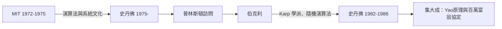

# 2.1 MIT、史丹佛與伯克利教職輾轉（1972–1986）

1972 年博士畢業後，姚期智開始了一段罕見的「巡回頂校」歷程：**MIT → 史丹佛 → 普林斯頓（訪問）→ UC 伯克利 → 史丹佛**。十四年間五次移動，橫跨美國計算理論的全部重鎮。這不是漂泊，而是一種**採集**——每到一地，他就吸收一種傳統，然後把它轉化為自己的成果。

## MIT（1972–1975）：理論計算機的心臟

姚期智的第一個教職在**麻省理工學院**：

- 當時的 MIT 擁有計算機科學最強的陣容：**麥卡錫**雖已西行史丹佛，但 MIT 的 AI 實驗室（明斯基主導）與計算結構小組仍如日中天（→ 詳見《麥卡錫傳記》第 4 章）；
- 計算理論方面，MIT 匯聚了 Albert Meyer、Michael Fischer、Ronald Rivest 等人——密碼學的 RSA（1977）即將從這裡誕生；
- 姚期智在這裡展開對**演算法分析**與**計算模型**的系統研究，建立了複雜性理論家的方法論直覺。

### MIT 的風格塑造

- MIT 的傳統是「理論要能接觸真實系統」：演算法、資料結構、密碼學都被視為理論的出口；
- 姚期智日後最著名的成果之一——**百萬富翁協定**（1982，見 3.2）——正是這種「抽象模型＋真實問題」風格的極致表現；
- 在 MIT 他也確立了研究品味：不做零散技巧，只做**開創模型**的工作。

## 史丹佛與伯克利之間（1975–1986）

1975 年姚期智西遷**史丹佛**，之後又回到東岸的普林斯頓做訪問，再到**UC 伯克利**，最後 1982 年重返史丹佛：

- **史丹佛**：麥卡錫在此建立 AI 重鎮（→ 詳見《麥卡錫傳記》第 5 章），Knuth 的演算法學派也在成形；姚期智與 Knuth 一系的演算法文化互相滋養；
- **伯克利**：理論計算機的西部重鎮，Richard Karp（NP 完備性共同提出者）在此；姚期智在伯克利發展了隨機演算法下界的思想；
- 這段輾轉使他成為**同時熟悉東西兩岸所有學派**的人——1980 年代他逐漸成為理論計算機科學的「樞紐型」人物。

### 教職輾轉的深層邏輯

| 駐留 | 傳統 | 帶走的東西 |
|------|------|------------|
| MIT | 系統＋理論並重 | 「模型要能落地」的品味 |
| 史丹佛 | 演算法與 AI 創業文化 | 演算法分析的精確手感 |
| 伯克利 | Karp 的組合與複雜性 | 下界證明技術 |
| 普林斯頓 | 純數學氛圍 | 日後長期駐紮的伏筆（見 3.1） |

## 黃金十年的產出

1975 到 1986 年間，姚期智完成了奠定其歷史地位的兩大支柱：

- **Yao 氏原理**（1977–1982）：把隨機演算法的下界化約為機率分布下的確定性下界（見 2.2）；
- **百萬富翁協定與多方安全計算**（1982）：密碼學從「保密通訊」躍升為「計算本身」的理論（見 3.2）；
- 加上溝通複雜度（見 2.3）等一系列模型創建，姚期智在四十歲前已確立大師地位。

### 理論計算機的黃金世代

姚期智所處的 1970 年代，是理論計算機科學的「軸心時代」，同代人構成一張天才網絡：

| 人物 | 貢獻 | 與姚期智的交會 |
|------|------|----------------|
| Knuth | 《電腦程式設計藝術》、演算法分析 | 史丹佛同事，演算法文化的源頭 |
| Karp | NP 完備性二十一道題（1972） | 伯克利，下界技術的傳授氛圍 |
| Rivest–Shamir–Adleman | RSA（1977） | MIT 圈子，密碼學工具箱 |
| Rabin | 隨機化演算法 | Yao 氏原理的問題來源（見 2.2） |
| 麥卡錫 | AI 與形式化常識推理 | 史丹佛，形式化方法的同調（→ 詳見《麥卡錫傳記》第 5 章） |

姚期智的特殊之處在於：這些學派彼此之間有壁壘（演算法派輕視密碼學，密碼學派懷疑複雜性），而姚期智是極少數**在每個學派都有一等一成果**的人。這種跨壁壘的地位，正是 1982 年他能在一年之內同時投下 Yao 氏原理與百萬富翁協定兩顆炸彈的資本（見 2.2、3.2）。

### 輾轉的另一面：學生的流動

教職輾轉也帶動了學生的流動：姚期智在 MIT、伯克利、史丹佛先後指導的學生與博士後，把他的風格——**模型先行、下界緊隨、定義即貢獻**——散播到北美各校。這個以他為節點的傳承網絡，是他日後能在清華迅速重建一個學派的社會資本（見 4.2）。

## 事件關聯與前因後果

| 年份 | 事件 | 後續影響 |
|------|------|----------|
| 1972 | 任教 MIT | 進入理論計算機核心圈 |
| 1975 | 轉往史丹佛 | 接觸 Knuth 與麥卡錫傳統 |
| 1977 | Yao 氏原理雛形 | 隨機演算法下界的標準工具 |
| 1979–1982 | 伯克利與重返史丹佛 | 百萬富翁協定誕生（1982） |
| 1986 | 轉任普林斯頓 | 十年輾轉的終點（見 3.1） |

**因果**：MIT 給了他系統的視野，史丹佛與伯克利給了他數學的深度，五次移動使姚期智成為把各學派**熔於一爐**的人。這條軌跡與香農的「貝爾→MIT→貝爾」不同：香農是深根，姚期智是採蜜。而採蜜的成果——Yao 氏原理與百萬富翁協定——將分別重塑**演算法理論**與**密碼學**（見 2.2、3.2）。

## 小結

- 1972–1986 的十四年五遷，姚期智完成了對北美計算理論全部重鎮的「採集」；
- MIT 供給模型落地的品味，史丹佛供給演算法文化，伯克利供給下界技術；
- 這段時期他確立了研究風格：**開創模型而非解決零散問題**；
- 1986 年，四十歲的姚期智選定終點：普林斯頓——那裡將成為他二十年理論帝國的根據地（見 3.1）。
