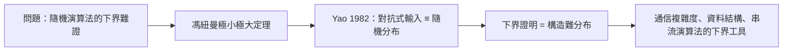

# 2.2 Yao 氏原理（1977–1982）

1982 年，姚期智在 *Journal of the ACM* 發表〈Probabilistic Computations: Toward a Unified Measure of Complexity〉，提出日後被稱為 **Yao 氏原理**（Yao's Principle, minimax principle）的引理。這可能是計算機科學史上被引用最多的「引理」——它把混亂的隨機演算法下界問題，化約為一個乾淨的極小極大問題。

## 問題的由來

1970 年代，**隨機化演算法**異軍突起：

- Rabin 與 Solovay–Strassen 的質數判定演算法證明：丟銅板可以大幅加速計算；
- 演算法設計者於是問：隨機化到底能快多少？有沒有**下界**證明「即使丟銅板也快不過 X」？
- 難點在於：隨機演算法的行為依賴隨機位元與輸入的互動，直接分析下界極為棘手。

## Yao 氏原理的內容

姚期智的洞見來自賽局論的**極小極大定理**（von Neumann 的遺產，→ 詳見《馮紐曼傳記》第 1 章）。他證明：

$$
\text{最壞輸入下、隨機演算法的期望成本}
\;\ge\;
\text{對某個固定的輸入分布、最佳確定性演算法的期望成本}
$$

換句話說：

- **要證明隨機演算法的下界，只需構造一個輸入機率分布**，使任何確定性演算法在該分布下期望表現都差；
- 「對抗隨機化的敵人」可以換成「一個狡猾的機率分布」——下界證明從動態對抗變成靜態構造；
- 反方向也成立：對隨機分布最佳的確定性演算法，可以隨機化後對抗最壞輸入。

### 為什麼這是一個「原理」而不只是引理

- 它把**賽局論**、**機率論**、**複雜性理論**焊接在一起，成為整個領域的工作範式；
- 從此，「distributional complexity」成為標準研究對象；
- 幾乎所有重要的隨機演算法下界——資料結構、通信複雜度、串流、學習理論——都是用 Yao 氏原理證明的；
- 它體現了姚期智一貫的方法論：**找到正確的對偶視角**（→ 馮紐曼賽局論的對偶思想，詳見《馮紐曼傳記》第 3 章）。

## 應用的爆發

Yao 氏原理之後成為下界證明的「萬能模具」：

| 領域 | 用 Yao 氏原理證明的典型下界 |
|------|------------------------------|
| 通信複雜度 | 集合不相交問題（Disjointness）的 $\Omega(n)$ 下界（見 2.3） |
| 資料結構 | 動態字典、範圍查詢的查詢時間下界 |
| 串流演算法 | 常數空間無法精確計數流元素 |
| 計算學習理論 | PAC 學習的樣本與計算複雜度 |

### 原理的證明骨架

Yao 氏原理的證明優雅得可以寫進教科書：

- 把「演算法設計者 vs 敵手輸入」看作一場**零和賽局**：設計者的純策略是確定性演算法，敵手的純策略是具體輸入，收益是計算成本；
- 馮紐曼 1928 年的極小極大定理（→ 詳見《馮紐曼傳記》第 1 章）保證：混合策略下的雙方最優值相等；
- 於是「隨機演算法對最壞輸入」的最優值，等於「確定性演算法對最壞分布」的最優值；
- 證明下界時，只需展示一個**具體的難分布**——例如把問題的難實例隨機平移，構造出「任何確定性演算法平均都慢」的分布。

這個技巧的深層意義是方法論上的：它教會整個領域，**對抗性可以用機率語言消解**。此後「構造分布」成為下界證明的標準起手式，如同歸謬法之於古典數學。

### 一個具體例子

以最簡單的「在無序陣列中找元素」為例：

- 任何確定性演算法，在均勻隨機輸入下期望要看 $n/2$ 個位置；
- 由 Yao 氏原理，任何隨機化演算法在最壞輸入下也至少要看 $n/2$ 個位置——隨機化救不了線性搜尋；
- 這個平凡例子的推廣版（元素相異性、集合不相交）給出了數據結構與通信的深刻下界（見 2.3）。

## 事件關聯與前因後果

| 年份 | 事件 | 後續影響 |
|------|------|----------|
| 1928 | 馮紐曼證明極小極大定理 | Yao 氏原理的數學祖先（→ 詳見《馮紐曼傳記》） |
| 1976–1977 | Rabin、Solovay–Strassen 隨機化演算法 | 提出下界問題 |
| 1977–1982 | 姚期智發展並發表 Yao 氏原理 | 隨機演算法下界的標準範式 |
| 1979 | 姚期智提出通信複雜度 | Yao 氏原理的最佳應用場（見 2.3） |
| 1990s– | 串流與學習理論興起 | Yao 氏原理持續成為核心工具 |

**因果**：圖靈機回答了「什麼可算」（→ 詳見《圖靈傳記》第 2 章），Cook 回答了「什麼難算」（見 1.3），而姚期智回答了「**隨機能不能讓難算變好算**」的下界。這個問題的答案竟藏在馮紐曼 1928 年的賽局定理裡——理論計算機科學再次證明自己是數學老傳統的新枝。Yao 氏原理也直接滋養了姚期智自己的通信複雜度理論（見 2.3）：兩者是一體兩面。

## 小結

- Yao 氏原理（1982）：隨機演算法的下界，等價於構造一個難倒所有確定性演算法的輸入分布；
- 它是馮紐曼極小極大定理在計算複雜性中的化身（→ 詳見《馮紐曼傳記》第 1 章）；
- 半世紀以來，它幾乎是所有隨機化下界證明的起點，從通信複雜度到機器學習理論；
- 這一成果確立了姚期智「模型開創者」的地位；
- 而在幾乎同時，他投下了另一顆更震撼的炸彈：兩位百萬富翁如何在電話裡比富而不洩漏財產（見 3.2）。
