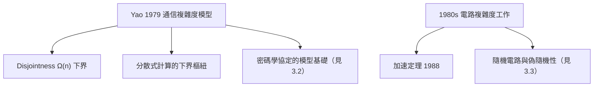

# 2.3 溝通複雜度與電路複雜度（1980s）

1980 年代，姚期智開創了兩個至今仍在爆炸性成長的領域：**通信複雜度**（communication complexity）與對**電路複雜度**（circuit complexity）的關鍵貢獻。如果說 Yao 氏原理是工具（見 2.2），通信複雜度就是他親手打造的最佳應用場。

## 通信複雜度的誕生（1979）

1979 年，姚期智發表〈Some complexity problems related to distributive computing〉，提出通信複雜度模型：

- **設定**：兩方 Alice 與 Bob 各持有輸入 $x$ 與 $y$，要共同計算函數 $f(x,y)$，最小化雙方交換的位元數；
- 這個看似玩具的模型，捕捉了**分散式計算的本質代價：資訊傳輸**；
- 與圖靈機的「單一計算者」不同（→ 詳見《圖靈傳記》第 2 章），通信複雜度把計算放到**多主體**的場景——這條線最終通往分散式系統、密碼學協定（見 3.2）乃至量子通信。

### 標誌性成果

- 姚期智用 Yao 氏原理證明 **Disjointness 問題**（兩個集合是否不相交）需要 $\Omega(n)$ 位元的通信——接近輸入長度的線性下界；
- 他證明瞭許多基本函數的精確通信複雜度，建立了這個領域的「元素週期表」；
- 通信複雜度後來成為證明**其他模型下界**的樞紐：串流演算法、電路、資料結構、乃至量子通信的下界，常常是從通信複雜度「約化」而來。

## 電路複雜度的貢獻

電路複雜度問的是：用最簡單的計算元件（AND、OR、NOT 閘）組成的電路，計算某個函數需要多少閘、多深？這是逼近 P vs NP 的主戰場之一：

- **Yao 的加速定理**（1988）：姚期智證明存在函數，其電路規模可以**嚴格遞增地改進**——即存在「能被逐漸加速」的計算問題，連接了 Blum 加速定理的傳統；
- **深電路與時間—空間交換**：他對電路深度與計算時間的關係給出深刻結果，包括著名的 OR 函數電路深度下界工作；
- 1980 年代末，姚期智在**隨機電路**上也有奠基性結果：他證明多項式規模、多項式深度的電路若允許隨機閘，其能力有精確刻畫——這些工作通往日後的偽隨機性理論（見 3.3）。

### 通信複雜度的意外報酬

通信複雜度最迷人之處在於它的**外溢效應**：

| 領域 | 如何借用通信複雜度 |
|------|---------------------|
| 串流演算法 | 空間下界 ← 單趟串流 ≡ 一步通信 |
| 電路下界 | 電路分割後即通信協定 |
| 資料結構 | 證明者—驗證者通信 |
| 量子計算 | 量子通信複雜度（姚期智 1990s 亦參與開拓，見 4.3） |
| 密碼學 | 安全兩方計算的不可避免通信量 |

### 為什麼 Disjointness 如此之難

Disjointness（兩集合是否不相交）的下界證明是通信複雜度的皇冠明珠：

- 直覺：要確定「沒有任何共同元素」，Alice 的每一個位元都可能被 Bob 的任何位元「取消」——資訊無法壓縮；
- 姚期智先用 Yao 氏原理（見 2.2）把問題化為分布下的確定性通信，再構造一個巧妙的難分布（大交集附近的「臨界」實例）；
- 結論：即使允許隨機化與誤差，仍需 $\Omega(n)$ 位元通信。

這個下界之所以重要，是因為 Disjointness 可以**嵌入**大量實際問題：資料庫的 join、分散式事務的衝突檢測、串流中的重複偵測——一個下界，鎖住一片領域的理論天花板。

### 電路複雜度的大圖景

1980 年代電路複雜度的核心戰場，是證明某些函數「多項式電路算不出」，從而逼近 $\mathbf{P} \ne \mathbf{NP}$：

- 姚期智 1988 年的加速定理證明：存在函數，其電路規模可以不斷改進但永不到達極限——「計算的漸近改進沒有終點」這個 Blum 式現象在電路模型中重現；
- 他關於**隨機電路**的結果顯示：帶有多項式深度隨機閘的電路，能力恰好等價於某個確定性複雜性類——把隨機性「去魅」為複雜性類之間的關係；
- 這些工作與偽亂數理論（見 3.3）合流，指向當代最大的未解問題：$\mathbf{BPP} = \mathbf{P}$ 是否成立。

## 事件關聯與前因後果

| 年份 | 事件 | 後續影響 |
|------|------|----------|
| 1979 | 提出通信複雜度模型 | 分散式計算與下界理論的新基礎 |
| 1982 | Yao 氏原理發表 | 通信下界的標準證明工具（見 2.2） |
| 1980s | Disjointness 等經典下界 | 通信複雜度成為獨立領域 |
| 1988 | Yao 電路加速定理 | 連接 Blum 加速與現代電路理論 |
| 1990s– | 串流、量子通信興起 | 通信複雜度成為下界「母港」 |

**因果**：通信複雜度的誕生，是姚期智把 MIT 的系統視野（分散式計算，見 2.1）與馮紐曼式模型建構能力（→ 詳見《馮紐曼傳記》第 3 章）結合的產物。它與 Yao 氏原理（見 2.2）互為表裡：模型提供舞台，原理提供武器。而這個模型最深遠的後裔，是 1982 年那個看似童話的問題——兩個百萬富翁比富（見 3.2）。

## 小結

- 1979 年姚期智開創通信複雜度：兩方交換多少位元才能算出 $f(x,y)$；
- Disjointness 的 $\Omega(n)$ 下界等經典結果，使通信複雜度成為下界理論的樞紐；
- 電路複雜度方面，加速定理與隨機電路工作為偽隨機性理論鋪路（見 3.3）；
- 通信複雜度的外溢效應橫跨串流、密碼學與量子計算，至今仍是活躍前沿；
- 1986 年，帶著這些成果，姚期智進入普林斯頓，開始他的黃金二十年（見 3.1）。
