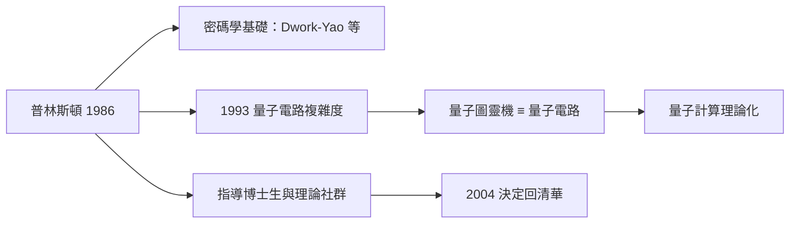

# 3.1 普林斯頓與計算理論中心（1986–2004）

1986 年，姚期智從史丹佛轉任**普林斯頓大學**計算機科學系，並於 1991 年成為 William 和 Edna Macaleer 工程與應用科學講席教授。此後十八年，普林斯頓成為他學術人生的根據地：在這裡他完成量子計算的奠基工作、指導一批頂尖博士生、並成為計算理論界公認的領袖——直到 2004 年，他做出震驚兩岸的決定（見 4.2）。

## 普林斯頓的學術環境

普林斯頓的氣質與 MIT、史丹佛截然不同：

- 純數學氛圍濃厚，馮紐曼與哥德爾的幽靈仍在校園遊蕩（→ 詳見《馮紐曼傳記》《圖靈傳記》）——這正是姚期智智力品味的故鄉；
- 計算機科學系規模不大，但理論組極強，與數學系往來密切；
- 姚期智在這裡可以心無旁騖地做**最抽象**的問題：量子計算、密碼學基礎、複雜性極限。

## 量子計算的奠基工作

1990 年代，姚期智把複雜性方法論帶進剛誕生的量子計算：

- **1993 年**：姚期智發表量子電路複雜度的奠基論文，證明**量子圖靈機與均勻量子電路族多項式等價**——為整個量子計算領域提供了乾淨的計算模型基礎（猶如圖靈機之於古典計算，→ 詳見《圖靈傳記》第 2 章）；
- **量子通信複雜度**：他把 1979 年的通信複雜度模型（見 2.3）推廣到量子情境，證明量子通信的優勢與極限；
- 這些工作使量子計算從物理實驗家的好奇心，轉變為**有嚴格複雜性理論的數學學科**。

### 1993 年論文的意義

在 Yao 之前，量子計算的模型（Deutsch 的量子圖靈機）定義繁瑣、難以操作：

- 姚期智證明：任何多項式時間量子圖靈機都可以被**多項式規模、多項式深度**的量子電路模擬，反之亦然；
- 量子電路直觀、可組合，此後所有量子演算法（Shor 1994、Grover 1996）都用電路語言描述；
- 一句話：**姚期智給了量子計算它的「圖靈機時刻」**。

## 指導與社群建設

普林斯頓十八年，姚期智指導了數十位博士生與博士後，遍布今日理論計算機的各大重鎮：

- 他與 Lisa Dwork 等人合作的密碼學基礎工作，推動了**安全計算的形式化**（見 3.3）；
- 他長期服務於 STOC、FOCS 等頂會的委員會，2001 年成為 ACM Fellow；
- 這段社群領袖經歷，預演了他日後在清華的建制工程（見 4.2）。

### 普林斯頓的幽靈網絡

姚期智在普林斯頓的日常，處於一個歷史密度極高的場域：

- 馮紐曼的遺產無所不在：賽局論（Yao 氏原理的數學基礎，見 2.2）、自複製自動機、以及最早 stored-program 電腦的設計（→ 詳見《馮紐曼傳記》第 3 章）；
- 哥德爾 1930 年代在此工作，其不完備定理間接催生了圖靈機（→ 詳見《圖靈傳記》第 2 章）；
- 圖靈本人 1936–1938 年在普林斯頓取得博士學位（→ 詳見《圖靈傳記》第 3 章）。

姚期智 1993 年的量子電路工作，可以看作這個幽靈網絡的產物：**把圖靈的機器、馮紐曼的電路、哥德爾的邏輯嚴格性，一次性嫁接到量子物理上**。這種嫁接只有在普林斯頓的土壤上才顯得自然。

### 從理論到建制的預演

普林斯頓十八年，姚期智也完成了從「偉大研究者」到「學術領袖」的轉型：

- 他主持討論班的方式——要求每個結果都講出**定義層面的動機**——日後原樣搬到清華的姚班課堂（見 4.2）；
- 他與 IAS（高等研究院）的往來，使他熟悉「小規模、高密度、無行政負擔」的研究所模式——交叉資訊研究院的藍圖（見 4.3）；
- 他觀察到美國理論社群的運作機制：頂會、大師講席、學生流動——這套機制被他完整移植到亞洲。

## 事件關聯與前因後果

| 年份 | 事件 | 後續影響 |
|------|------|----------|
| 1986 | 轉任普林斯頓 | 十四年輾轉的終點（見 2.1） |
| 1991 | Macaleer 講席教授 | 學術地位的制度化 |
| 1993 | 量子電路複雜度論文 | 量子計算的模型基礎 |
| 1995 前後 | 量子通信複雜度 | 量子資訊理論成形 |
| 2000 | 獲圖靈獎 | 巔峰承認（見 4.1） |
| 2004 | 宣布回清華 | 十八年普林斯頓時代落幕（見 4.2） |

**因果**：普林斯頓的純數學土壤，讓姚期智敢於在 1993 年投入一個當時「太物理」的領域——量子計算。他把圖靈機傳統（→ 詳見《圖靈傳記》第 2 章）與通信複雜度工具（見 2.3）移植到量子世界，完成了量子計算的理論化。而 2000 年圖靈獎的到來（見 4.1），使他在「功成名就」的頂點上，擁有了做出下一次大遷徙的自由——這一次，方向是東方（見 4.2）。

## 小結

- 普林斯頓十八年（1986–2004）是姚期智的巔峰期：密碼學基礎、量子計算理論化、指導英才；
- 1993 年的量子電路複雜度工作，為量子計算提供了模型基礎，是該領域的「圖靈機時刻」；
- 通信複雜度（見 2.3）成功推廣到量子情境，展示其方法論的普適性；
- 2000 年圖靈獎（見 4.1）確認了他的歷史地位，也為 2004 年的東歸鋪路（見 4.2）。
