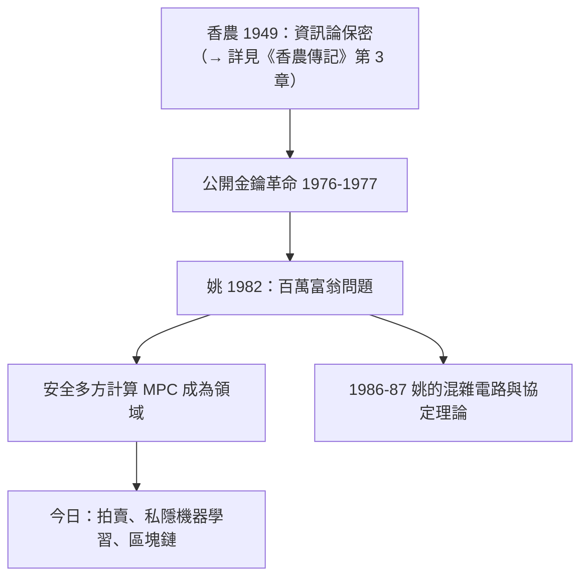

# 3.2 百萬富翁協定與多方安全計算（1982）

1982 年，姚期智發表兩篇論文：〈Protocols for Secure Computations〉與〈Theory and Applications of Trapdoor Functions〉。前者提出了一個近乎童話的問題——**兩個百萬富翁想在互不透露財富的前提下，比出誰更有錢**——以及它的解法。這個「百萬富翁問題」（Yao's Millionaires' Problem），成為**安全多方計算**（secure multi-party computation, MPC）的開山之作。

## 問題的提出

姚期智的問題設定簡潔到不可思議：

- Alice 有 $i$ 億，Bob 有 $j$ 億，$i, j \in \{1, \dots, 10\}$；
- 兩人想知道 $i \ge j$ 或 $i < j$；
- 但**誰都不想讓對方（或任何竊聽者）知道自己的確切財富**；
- 問：存在這樣的通訊協定嗎？

答案：存在。姚期智用公開金鑰密碼學構造了第一個解法，並提出更普遍的問題：

> **兩方（或多方）能否共同計算任意函數 $f(x_1, x_2, \dots, x_n)$，使得除了 $f$ 的輸出之外，沒有任何一方學到關於他人輸入的任何資訊？**

這就是安全兩方計算（two-party secure computation）的定義。

## 深遠的意涵

百萬富翁問題的真正革命性，在於它把密碼學的目標改寫了：

- **古典密碼學**（含香農 1949 的資訊論保密，→ 詳見《香農傳記》第 3 章）問的是：「如何讓訊息在傳輸中不被讀懂？」——保護的是**通訊**；
- **姚期智的問題**問的是：「如何讓計算在不洩漏輸入的前提下完成？」——保護的是**計算本身**；
- 這意味著密碼學從「藏訊息」躍升為「**藏一切中間狀態的分散式計算**」——一門新的學科就此誕生。

### 後續的理論大廈

1982 之後，姚期智本人與 Goldreich、Micali、Wigderson 等人把這座大廈蓋完：

| 年份 | 工作 | 貢獻者 |
|------|------|--------|
| 1982 | 百萬富翁問題、安全兩方計算定義 | 姚期智 |
| 1982 | 混雜電路（garbled circuits）技術 | 姚期智（數年後發表） |
| 1986–1987 | 多方安全計算的一般定理 | Goldreich–Micali–Wigderson |
| 1990s | MPC 成為密碼學標準組件 | 學界 |

姚期智的**混雜電路**至今仍是安全兩方計算效率最高的通用技術，被廣泛用於實際系統。

## 與香農的對話

百萬富翁問題可以看作對香農的一次「超越性致敬」：

- 香農證明了**資訊論安全**（一次一密）的極限：完美保密要求金鑰與訊息等長（→ 詳見《香農傳記》第 3 章）；
- 姚期智轉向**計算安全**：不要求「數學上讀不出」，只要求「多項式時間算不出」——用計算複雜性（見 3.3）取代資訊熵作為安全度量；
- 這個典範轉移的哲學底蘊，仍可追溯到圖靈機：**「對手的能力」被形式化為圖靈機的計算資源**（→ 詳見《圖靈傳記》第 2 章）。

### 百萬富翁協定的一個版本

姚期智的原始解法用了公開金鑰加密，其精神可以用簡化版描述：

1. Alice 選一個大數 $N$ 與公鑰，把 $X = N + i$（她的財富）加密後的一部分給 Bob；
2. Bob 對每個 $j = 1, \dots, 10$ 計算 $Y_j = (N + j)$ 的對應值，並只對 $j \le j_{Bob}$ 的情況做某種可交換操作；
3. Alice 收回後檢查 $N+i$ 是否在「被操作過」的集合中，從而得知 $i \le j$ 與否；
4. 關鍵：Alice 學到的不多於一個位元，Bob 學到的也不多於一個位元。

用現代術語說，這是一個**兩方安全函數求值**（2PC）的實例：理想功能是比較函數，現實協定以加密與隨機化逼近理想世界的隔離。

### 混雜電路的巧思

姚期智稍後提出的混雜電路（garbled circuits）更顯其風格：

- 把函數 $f$ 編成一個布邏輯電路，對每個閘的每條線隨機賦予兩個「偽標籤」；
- Alice 把整個電路「打亂加密」後交給 Bob；Bob 用從 OT（不經意傳輸）取得的標籤，逐閘解密計算，卻永遠看不到中間值的明文；
- 整個協定只需常數輪通信——在網路延遲昂貴的今天，這正是它四十多年不衰的原因。

### 從兩方到多方：姚期智的問題留給世界

姚期智在 1982 年論文末尾提出，三方以上、半誠實甚至惡意對手的情形如何？這個問題由 Goldreich、Micali、Wigderson 在 1986–87 年給出一般解（GMW 定理），Micali 與 Wigderson 也因此獲圖靈獎（2007、2019 與 Yao 的 2000 遙相呼應）。一個問題開出的花，先後結出三個圖靈獎——這在計算機科學史上絕無僅有。

## 事件關聯與前因後果

| 年份 | 事件 | 後續影響 |
|------|------|----------|
| 1949 | 香農的保密系統理論 | 資訊論安全的極限（→ 詳見《香農傳記》第 3 章） |
| 1976–1977 | Diffie–Hellman 與 RSA | 公開金鑰工具箱就緒 |
| 1982 | 姚期智發表百萬富翁問題 | 安全多方計算誕生 |
| 1982 | 混雜電路構想 | 效率最高的兩方安全計算技術 |
| 1986–1987 | GMW 多方一般定理 | MPC 理論完成 |
| 2010s– | 隱私計算、聯邦學習、區塊鏈 | MPC 走入工業實用 |

**因果**：沒有公開金鑰密碼學（1976–1977）的工具，百萬富翁問題無從解起；沒有姚期智把「保密」重新定義為「計算中不洩漏」，就沒有 GMW 的多方定理，也沒有今日的隱私計算產業。姚期智用一個童話問題，完成了密碼學史上最大的一次目標躍遷——這也是他獲得 2000 年圖靈獎的核心理由之一（見 4.1）。

## 小結

- 1982 年百萬富翁問題：在不洩漏財富的前提下比較大小，開創安全兩方／多方計算；
- 混雜電路至今仍是兩方安全計算的主力技術；
- 姚期智把密碼學從「保護通訊」升級為「保護計算」，以計算複雜性（見 3.3）取代資訊論作為安全基礎；
- 這條線從香農的熵（→ 詳見《香農傳記》第 3 章）出發，經姚期智，通往今日的隱私計算與區塊鏈；
- 與此同時，他在理論的另一翼——偽隨機性與複雜性基礎——也同步推進（見 3.3）。
