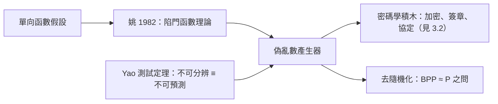

# 3.3 計算複雜性、偽亂數與密碼學理論化（1980s–1990s）

如果說百萬富翁協定（見 3.2）是姚期智給密碼學的「問題」，那麼他在 1980–90 年代的另一組工作，就是給密碼學的「地基」：用**計算複雜性理論**為密碼學奠定嚴格基礎，並對**偽亂數**（pseudo-randomness）給出根本性的刻畫。

## 密碼學的理論化

1982 年，姚期智發表〈Theory and Applications of Trapdoor Functions〉：

- 他給出**陷門函數**（trapdoor functions）的嚴格定義，並證明其存在性可由更弱的假設（單向函數的變體）導出；
- 這項工作與 Blum–Micali、Levin 等人並行，共同催生了「**現代密碼學 = 複雜性理論**」的範式：安全性不再依賴「夠複雜就行」的直覺，而是建立在**圖靈機計算資源**的精確定義上（→ 詳見《圖靈傳記》第 2 章）；
- 姚期智隨後與人合作證明：只要存在足夠強的陷門置換，就能構造安全的**偽亂數產生器**——密碼學的每一塊積木都有了複雜性理論的承重牆。

## 偽亂數：複雜性的迴響

偽亂數理論是 1980 年代複雜性理論最深刻的成就之一，姚期智是核心建築師：

- **定義**：一個確定性演算法，把短的真隨機種子拉長成長序列，使任何多項式時間統計測試都無法分辨它與真亂數；
- **Yao 的測試定理**（1982）：「通過一切多項式時間統計測試」等價於「無法預測下一個位元」——兩種看似不同的偽亂數定義被證明等價；
- **與下界的對偶**：偽亂數的存在蘊含某些函數有高的電路複雜度（見 2.3）——**亂數與難度是一體兩面**；
- 這條思想線後來發展為去隨機化（derandomization）理論，直指 $\mathbf{BPP} = \mathbf{P}$ 之問。

### Yao 的 XOR 引理

姚期智還證明了著名的 **XOR 引理**：若一個函數的每個位元都難以預測，那麼其位元的 XOR 更難預測——把「逐位元硬度」放大為「整體硬度」。這個放大技術成為硬核謂詞理論與安全性歸約的標準工具，今天每一個密碼學教科書都在講它。

## 理論的統一

1980–90 年代，姚期智的工作呈現罕見的統一性：

| 支柱 | 成果 | 互相支撐 |
|------|------|----------|
| 複雜性 | 通信複雜度、電路下界（見 2.3） | 提供對手能力的度量 |
| 隨機性 | Yao 氏原理（見 2.2）、偽亂數 | 亂數與難度互換 |
| 密碼學 | 百萬富翁、陷門函數（見 3.2） | 安全性即計算不可行 |
| 量子 | 量子電路複雜度（見 3.1） | 同一套方法論推廣 |

貫穿四者的，是同一個圖靈機直覺：**一切對手——自然、敵人、隨機性本身——都是一台資源受限的圖靈機**（→ 詳見《圖靈傳記》第 2 章；計算之於演算法的架構地位，可參照 → 詳見《馮紐曼傳記》第 3 章）。

### 從熵到計算不可行：安全概念的兩次革命

密碼學的歷史可以濃縮為兩次「安全」定義的革命：

| 革命 | 年代 | 定義 | 工具 |
|------|------|------|------|
| 第一次：資訊論安全 | 香農 1949 | 敵人連無限算力也讀不出（→ 詳見《香農傳記》第 3 章） | 熵、一次性密碼本 |
| 第二次：計算安全 | 姚期智等 1982 | 敵人在多項式時間內讀不出 | 單向函數、偽亂數 |

第二次革命讓密碼學「活了下來」：一次性密碼本在實務上不可行，而以 $\mathbf{P} \ne \mathbf{NP}$ 型假設（見 1.3）為地基的計算安全，使有限金鑰的加密成為可能。姚期智的測試定理是這座橋的樞紐螺栓：**安全性＝不可分辨性＝不可預測性**，三種直觀被證明為同一件事。

### 偽亂數的哲學重量

偽亂數理論的深遠之處，在於它動搖了「隨機」的本體論地位：

- 若存在多項式時間不可分辨的偽亂數，則「宇宙中是否需要真隨機」對計算而言成為**不可判定於實務**的問題；
- 這直接呼應圖靈機的決定論本質（→ 詳見《圖靈傳記》第 2 章）：一台決定論機器可以模擬出「任何有效測試都驗不出來」的隨機；
- 姚期智把這個哲學問題變成數學定理，這是他「公理化工程師」風格的極致——與香農當年把「資訊」公理化（→ 詳見《香農傳記》第 3 章）如出一轍，只是公理更換為複雜性假設。

## 事件關聯與前因後果

| 年份 | 事件 | 後續影響 |
|------|------|----------|
| 1982 | 陷門函數理論、Yao 測試定理 | 現代密碼學的複雜性基礎 |
| 1982–1985 | 偽亂數產生器理論成形 | Blum–Micali–Yao–Levin 傳統 |
| 1980s | XOR 引理與放大技術 | 安全歸約的標準工具 |
| 1990s | 去隨機化與硬核謂詞 | BPP=P 問題的現代框架 |
| 2000 | 圖靈獎授予姚期智 | 上述全線工作的承認（見 4.1） |

**因果**：香農 1949 年以熵定義完美保密（→ 詳見《香農傳記》第 3 章），但證明了完美保密代價高昂；姚期智這一代人改以「計算不可行」定義安全，使密碼學得以在有限金鑰下運作。這個轉向的代價是：安全性從**數學定理**降格為**複雜性假設**——我們至今無法證明單向函數存在（等價於 $\mathbf{P} \ne \mathbf{NP}$ 的變體，見 1.3）。姚期智的工作正是這場「假設之上建造大廈」工程的主要承重結構。

## 小結

- 1982 年的陷門函數理論與 Yao 測試定理，是現代密碼學複雜性基礎的支柱；
- XOR 引理成為硬度放大與安全歸約的標準工具；
- 偽亂數理論把「亂數」與「計算難度」焊接為一體，通往去隨機化的核心問題；
- 姚期智在複雜性、隨機性、密碼學、量子四線作戰而方法論統一，這是他 2000 年獲圖靈獎的學術全景（見 4.1）；
- 下一章，圖靈獎與東歸——姚期智人生最大的轉向即將到來（見 4.1）。
