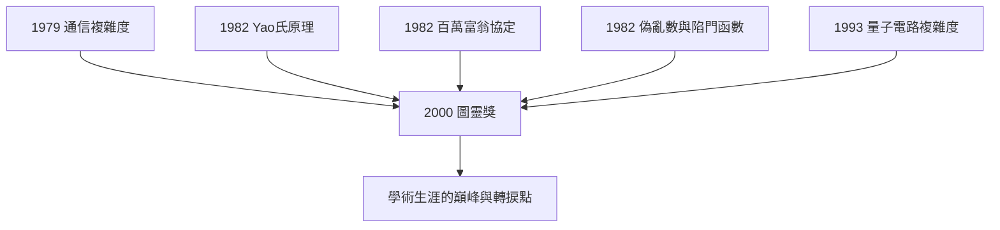

# 4.1 2000 圖靈獎

2000 年，美國計算機學會（ACM）宣布：**姚期智**因「對計算理論的貢獻，包括偽亂數產生理論、密碼學與通信複雜度」獲得**圖靈獎**（Turing Award）——計算機科學的最高榮譽。他是史上第一位、也是迄今唯一一位獲此殊榮的華人學者（截至獲獎時）。

## 頒獎詞背後的全景

ACM 的頌詞點出三大貢獻，正好對應本書前三章的主線：

- **偽亂數理論**：Yao 測試定理與陷門函數（見 3.3）——「什麼是亂數」的計算性回答；
- **密碼學**：百萬富翁問題與安全多方計算（見 3.2）——「保密」概念的重新發明；
- **通信複雜度**：1979 年的模型與下界（見 2.3）——分散式計算的資訊代價理論。

加上 Yao 氏原理（見 2.2）與量子電路複雜度（見 3.1），圖靈獎表彰的是一個**體系**而非幾篇論文：姚期智幾乎單槍匹馬地把「計算的資源與對手」形式化為一門精密科學。

## 以圖靈為名的榮耀

圖靈獎以 Alan Turing 命名（→ 詳見《圖靈傳記》），這對姚期智有特殊的意義：

- 他的整個事業建立在圖靈機這個概念之上（見 1.3）——從可計算性（→ 詳見《圖靈傳記》第 2 章、〈丘奇傳記〉第 5 章）到複雜性，再到密碼學的「對手即圖靈機」；
- 他獲獎的三大領域，全都是「圖靈機思想」的延伸：把圖靈機放到通信線兩端，得到通信複雜度；放到敵人的位置，得到計算安全；放到隨機位元的產生者，得到偽亂數；
- 六十四年前圖靈定義了「計算」，六十四年後姚期智定義了「計算的極限與防護」——這是一次跨越世紀的接力。

### 頒獎典禮與演講

- 2001 年，姚期智在 AC 圖靈講座上發表演講，回顧了他對**量子計算與密碼學**的看法——他把兩者視為「資訊與物理相遇」的兩個方向；
- 領獎時他已經是普林斯頓的講席教授（見 3.1），並開始頻繁往返亞洲講學；
- 圖靈獎帶來的不只是榮譽，還有一種**自由**：他已證明了自己，可以去做證明之外的事。

### 圖靈獎的名單語境

把姚期智放進圖靈獎的歷史序列，可以看清他的位置：

| 年份 | 得主 | 主題 |
|------|------|------|
| 1975 | Simon、Newell | AI 早期（→ 詳見《麥卡錫傳記》第 4 章） |
| 1978 | Knuth | 演算法分析 |
| 1985 | Karp | NP 完備性 |
| 1995 | Blum | 計算複雜性基礎 |
| 2000 | **姚期智** | 偽亂數、密碼學、通信複雜度 |
| 2007 | Clarke、Emerson、Sifakis | 模型檢驗 |
| 2012 | Shafi Goldwasser、Silvio Micali | 密碼學複雜性（姚的後裔領域） |
| 2019 | Wigderson | 計算複雜性理論 |

姚期智是名單上第一位以「理論計算機科學」整體身分獲獎的亞裔學者；更值得注意的是 2012 與 2019 兆——Goldwasser–Micali 與 Wigderson 的工作皆直接生長在姚期智 1982 年開闢的土壤上（見 3.2、3.3）。圖靈獎委員會在 2000 年就預見了這片土壤的肥沃。

### 得獎當下的中國語境

2000 年前後，中國媒體稱姚期智獲獎為「華人計算機科學家的諾貝爾時刻」：

- 當時中國大陸尚無一所大學的計算機理論研究進入世界前列；
- 圖靈獎的關注使姚期智的名字進入中國科技界的視野，清華等校開始與他接觸；
- 楊振寧 1999 年後定居清華的先例，說明頂尖華裔學者回流的通道已經存在——姚期智將把這條通道拓寬成高速公路（見 4.2）。

## 事件關聯與前因後果

| 年份 | 事件 | 後續影響 |
|------|------|----------|
| 1979–1993 | 通信複雜度、Yao 氏原理、百萬富翁、偽亂數 | 獲獎的學術根基 |
| 2000 | 獲圖靈獎 | 華人計算機科學家的歷史性突破 |
| 2000–2003 | 加密講座、亞洲講學頻繁 | 對中國計算機科學的關注升溫 |
| 2004 | 決定回清華 | 榮譽兌現為行動（見 4.2） |

**因果**：圖靈獎是姚期智前半生的總結，也是後半生的許可證。如果沒有 2000 年的頂點承認，2004 年放棄普林斯頓終身教職回清華（見 4.2）的決定將難以想像——只有已經登頂的人，才能輕裝下山，再攀另一座山。香農在 1966 年獲國家科學獎章後逐漸轉向個人好奇（→ 詳見《香農傳記》第 5 章）；姚期智在 2000 年圖靈獎後的選擇則更宏大：**把一座山搬到自己的祖國**。

## 小結

- 2000 年圖靈獎表彰姚期智在偽亂數、密碼學、通信複雜度上的體系性貢獻；
- 他是首位華人圖靈獎得主，象徵華人學者在計算理論核心的登頂；
- 獲獎成果全部是圖靈機思想的延伸——這是對圖靈傳統最深的一種致敬（→ 詳見《圖靈傳記》）；
- 巔峰的榮譽帶來行動的自由：2000 年之後，姚期智的目光轉向東方；
- 2004 年，五十八歲的他做出震驚學界的決定（見 4.2）。
