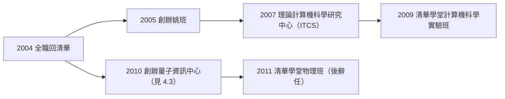

# 4.2 放棄普林斯頓終身教職回清華（2004）

2004 年，五十八歲的姚期智做出一個讓整個學界屏息的決定：**辭去普林斯頓的終身講席教授職位，全職加入北京清華大學**。一位已獲圖靈獎、位於學術頂點的美國院士，放棄一切回到當時計算機理論幾近空白的祖國——這個決定的分量，怎麼估計都不為過。

## 決定的背景

姚期智的東歸不是一時衝動，而是多條線索的匯合：

- **個人淵源**：他出生上海、成長台灣（見 1.1），對「中國人的計算機科學」有切身關懷；
- **時機成熟**：2000 年前後中國經濟起飛，清華等校開始以國際標準延攬人才；1990 年代末姚期智已多次回中國講學；
- **巔峰的自由**：圖靈獎（見 4.1）使他能夠不受任何職業考量的束縛，純粹按理想行動；
- **問題的判斷**：他認為中國不缺聰明學生，缺的是**一流的問題、一流的訓練、一流的學術社群**——而這些可以靠一個人的制度建設來補。

## 落地清華：從一間辦公室開始

2004 年姚期智到清華時，條件簡樸得驚人：

- 計算機科學理論方向幾乎沒有國際級學者；
- 他親自為本科生開課、講習題，從最基礎的計算理論教起；
- 2005 年，他創辦**計算機科學實驗班**——這就是日後名滿天下的「**姚班**」（Yao Class）：從全校新生中選拔最優秀者，用美國頂校的教材與強度，四年內培養理論計算機的未來棟樑。

### 制度建設的三部曲

- **姚班（2005）**：本科生精英培養，目標「半數學生成為世界頂尖研究者」；
- **ITCS（2007）**：清華理論計算機科學研究中心，成為亞洲計算理論的重鎮，年年舉辦國際會議與暑期學校；
- **講席教授團**：他邀請圖靈獎得主與頂尖學者輪流到清華授課，把「訪問一流學者」制度移植到北京。

## 棄美歸中的時代意義

在 2000 年代，頂尖華裔科學家「落葉歸根」早有先例（楊振寧晚歲亦定居清華），但姚期智的模式不同：

- 楊振寧們是**晚年歸來**，姚期智是**盛年歸來**——他回國時仍有二十年的學術創造力；
- 他不是來「掛名」，而是**放棄美國教職、全職工作**——這在制度上意味著徹底轉移；
- 他的目標不是自己做研究，而是**複製一個「普林斯頓」**：學生、中心、學派、國際網絡，一次到位。

### 決定的具體過程

據姚期智本人事後回顧，這個決定醞釀了數年：

- 1990 年代末他已多次到中國講學，目睹「學生極好、訓練極舊」的落差；
- 2002–2003 年間，他與清華的接觸轉趨具體，包括暑期課程與短期講席的試水；
- 2003–2004 年，他做出全職決定，辭去普林斯頓教職、出售房產，舉家遷京——這不是「兼職顧問」式的回流，而是**連根移植**；
- 他當時對友人說過大意如下的話：中國的學生那麼好，缺的只是有人在這裡辦一所「小普林斯頓」。我可以是那個人。

### 姚班的第一堂課

2005 年姚班開課，姚期智親自講授計算理論入門：

- 他用英文授課、國際教材，第一屆學生震撼於「原來計算機科學是這樣一門數學」；
- 他要求學生直接讀原文經典——從圖靈 1936 年的論文（→ 詳見《圖靈傳記》第 2 章）到 Yao 氏原理本身（見 2.2）；
- 這種「直接對話大師文本」的訓練，是姚班與一般本科教學的根本分野。

### 為什麼是清華

選擇清華而非其他大學，有具體的結構性原因：

| 因素 | 清華的條件 |
|------|------------|
| 生源 | 全國最強的理工生源池 |
| 校方支持 | 時任校方願給予辦學自主權 |
| 工科傳統 | 計算機科學的工程基礎完備 |
| 政策窗口 | 2000 年代初的「人才強校」戰略 |

普林斯頓給了姚期智學術高度，清華給了他**制度實驗的空白畫布**——這兩者缺一不可。

## 事件關聯與前因後果

| 年份 | 事件 | 後續影響 |
|------|------|----------|
| 2000 | 圖靈獎 | 獲得行動自由的巔峰身分（見 4.1） |
| 2004 | 辭普林斯頓、全職入清華 | 華人頂尖學者回流的標誌性事件 |
| 2005 | 創辦姚班 | 中國計算機科學精英教育的原型（見 5.1） |
| 2007 | 創辦 ITCS | 亞洲計算理論的重鎮 |
| 2010 | 創辦量子資訊中心 | 把量子理論帶回中國（見 4.3） |

**因果**：沒有圖靈獎就沒有清華的膽識與姚期智的號召力（見 4.1）；沒有 1972–2004 三十年積累的學術網絡，就不可能把國際頂尖學者一批批帶到北京（見 2.1、3.1）。姚期智的回國是整條因果鏈的收束：上海出生的孩子（見 1.1），繞行地球一週，最終把圖靈機的傳統（→ 詳見《圖靈傳記》第 2 章）帶回華語世界。這是他人生第二次、也是最大的一次「轉行」——從做理論的人，變成**建定理論的人**。

## 小結

- 2004 年姚期智放棄普林斯頓終身教職全職回清華，是華人科學回流史上最徹底的示範；
- 姚班（2005）、ITCS（2007）構成他的制度雙引擎；
- 他從「研究者」轉型為「建制者」，目標是在中國複製世界一流計算理論學派；
- 這次遷徙的成果——姚班學生的全球影響——將在十年內顯現（見 5.1）；
- 而他的建設並未止步於本科教育：2009 年起，學堂班與量子資訊中心接續登場（見 4.3）。
