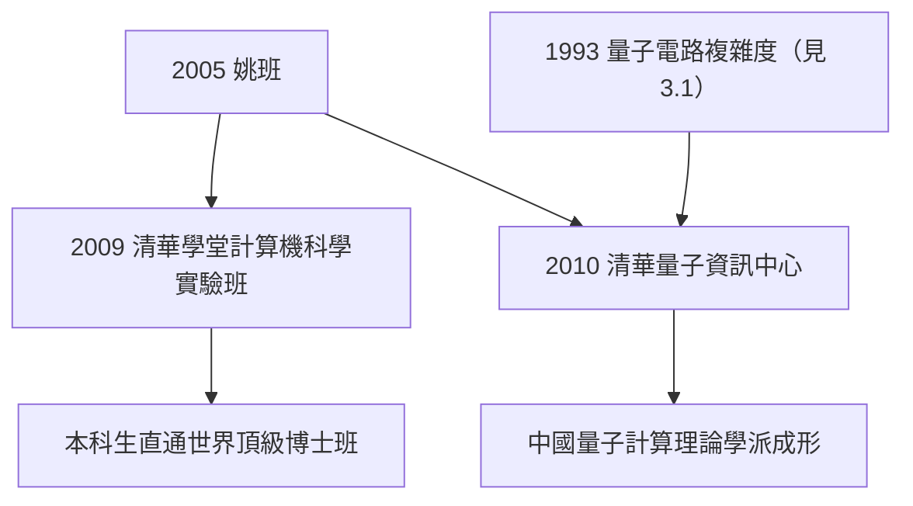

# 4.3 清華學堂班與量子資訊中心（2009–2010s）

姚期智在清華的建制工程沒有停在姚班。2009 年，清華推出「**清華學堂計劃**」，姚期智受命主持**計算機科學實驗班**（學堂班），把精英培養升級到全校頂尖層級；2010 年，他再創**清華大學量子資訊中心**，把他 1990 年代開創的量子計算理論（見 3.1）整體搬到中國。

## 清華學堂計劃與計算機科學實驗班

2009 年，清華借鑑劍橋、哈佛的住宿學院傳統，啟動「清華學堂人才培養計劃」，選定數學、物理、化學、生命科學、計算機六個學科：

- 姚期智主持的**學堂計算機科學實驗班**與原有姚班一脈相承，但資源更集中、目標更明確：對標 MIT、史丹佛的博士生培養質量；
- 培養理念是姚期智的名言式綱領：「**讓最好的學生，跟最好的老師，做最難的問題**」；
- 學堂班的學生低年級即進入研究組，大學部畢業論文以國際會議水平要求。

### 2011 年的物理班插曲

2011 年，清華學堂計劃增設物理學班，姚期智一度受命主持——這呼應了他自己的物理出身（見 1.2）。後來物理班由楊振寧主導的團隊接手，姚期智專注計算機與量子兩線。

## 清華量子資訊中心（2010）

2010 年，姚期智創辦**清華大學量子資訊中心**（Center for Quantum Information, CQI）並親任主任：

- 他的邏輯一如既往：**先立理論，再圖實驗**——中心首批骨幹以量子計算理論與量子密碼學為主；
- 這是他 1993 年量子電路複雜度工作的「制度化延伸」（見 3.1）：在中國建立量子計算的理論學派；
- 中心與姚班聯動，大批姚班學生進入量子資訊領域，成為中國量子計算研究的新生代。

### 量子中心的戰略意義

- 2010 年代全球量子競賽升溫，中國以潘建偉的實驗路線（墨子號衛星）聞名；姚期智的清華中心補上了**理論與計算機視角**這一半；
- 他主張「量子計算是計算機科學的下一章」，與其 2001 年圖靈講座的主題一脈相承（見 4.1）；
- 這使清華成為少數同時擁有**計算理論＋量子理論＋精英本科**三件套的機構。

## 2015 年：交叉資訊研究院的成熟與院士

- 姚期智在清華建立的院系最終定名為**交叉資訊研究院**（Institute for Interdisciplinary Information Sciences, IIIS），姚班、學堂班、量子資訊中心盡在其中；
- 2015 年，姚期智當選**中國科學院外籍院士**；2017 年他放棄美國國籍、轉為中國科學院院士——完成了身分上的最後一步「歸航」；
- 至此，他的清華帝國成型：本科（姚班/學堂班）、研究（ITCS、CQI）、國際網絡（圖靈獎得主講席）三位一體。

### 「交叉」的深意

研究院命名為「交叉資訊」，而非「計算機科學」，是姚期智刻意的宣言：

- 他相信計算機科學的下一站在**邊界**：量子物理、神經科學、經濟學的機制設計；
- 這個命名也是他自身軌跡的註腳：物理→計算→量子，他的一生就是在交叉地帶開墾（見 1.2、3.1）；
- 研究院同時設有理論計算機、量子資訊、以及後來的人工智慧方向，結構上複製了「普林斯頓＋MIT 理論圈」的混合體。

### 量子資訊中心的人才策略

中心的建設遵循姚期智一貫的「兩條腿」策略：

- **引進**：從海外聘請量子計算理論與實驗方向的青年學者，並請國際名家定期駐校；
- **自產**：姚班學生從本科就進入量子組，畢業後赴 MIT、伯克利等校深造再回流的循環，在 2010 年代後半開始收網；
- 到 2010 年代末，清華已成為與中科大並列的中國量子研究雙中心之一——一個重實驗通信（潘建偉系統），一個重計算理論與演算法。

### 姚期智教學的最前線

即使在建制成熟後，姚期智仍保持本科授課：

- 他在姚班開設的「計算機應用數學」等課程，多年親自批改作業；
- 學生回憶他上課的特點：語速不快、每個定義都問「為什麼要這樣定」、喜歡在黑板前長時間沉默思考；
- 這種「大師給本科新生上基礎課」的配置，在全世界都是稀有品——它正是姚班品牌的核心製造工序（見 5.1）。

## 事件關聯與前因後果

| 年份 | 事件 | 後續影響 |
|------|------|----------|
| 2009 | 清華學堂計劃啟動，主持計算機科學實驗班 | 精英培養升級為全校戰略 |
| 2010 | 創辦量子資訊中心 | 中國量子計算理論學派起步 |
| 2011 | 短暫主持物理學班 | 物理出身的回望（見 1.2） |
| 2015 | 當選中國科學院外籍院士 | 學術身分的中國化 |
| 2017 | 放棄美國國籍、轉為中科院院士 | 歸航的完成式 |

**因果**：學堂班是姚班的制度化放大（見 4.2），量子資訊中心是他 1993 年量子工作的地理移植（見 3.1）。兩件事共享同一個方法論：**把他在西方驗證過的模型，在清華重新實例化**——正如他把圖靈機放上通信線兩端得到通信複雜度（見 2.3），他把「普林斯頓」放上清華的土地，得到交叉資訊研究院。2017 年放棄美國國籍，是這場長達十三年的歸航的句號。

## 小結

- 2009 年學堂班使姚班模式成為清華的全校戰略，2010 年量子資訊中心補上量子理論一翼；
- 姚期智的建制公式：「最好的學生 × 最好的老師 × 最難的問題」；
- 交叉資訊研究院成為本科—研究—國際網絡三位一體的學術帝國；
- 2015–2017 年院士身分的轉換，標誌物理意義與法律意義上的雙重歸航；
- 而這個帝國最重要的產出，是一批正在重塑世界計算機科學的學生（見 5.1）。
