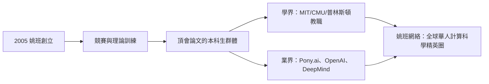

# 5.1 姚班學生的全球影響（2005–2026）

姚期智清華事業最驚人的產出不是論文，而是**人**。自 2005 年首屆姚班以來，二十餘年間數百名畢業生進入世界頂尖學府與企業，其中相當比例成為理論計算機、人工智慧與量子計算的領軍人物。「姚班」已成為國際計算機學界公認的品牌——一個成立於北京、品質對標 MIT 的本科項目，在人類學術史上沒有先例。

## 從零到品牌的奇蹟

姚班的第一屆（2005 級）入學時，誰也無法保證實驗成功：

- 學生來自全國競賽與高考的頂端，但此前幾乎無人接觸過真正的理論計算機研究；
- 姚期智親自設計課程：計算理論、進階演算法、密碼學、量子計算，直接使用國際研究生教材；
- 到 2008–2009 年，首批姚班學生已開始在 STOC、FOCS（理論計算機最高會議）發表論文——本科生在頂會發文，在當時的中國是天文現象。

## 代表性人物

姚班畢業生中的翹楚，構成一張橫跨學界與業界的網：

| 姓名 | 姚班屆別 | 領域 | 代表成就 |
|------|----------|------|----------|
| **樓天城** | 2004 級（首屆） | 自駕／競賽 | 編程競賽傳奇「ACRush」；小馬智行（Pony.ai）共同創辦人 |
| **張昆瑋** | 2005 前後 | 理論計算機／教育 | 編程教育先驅，計算幾何與競賽訓練影響一代人 |
| **朱澤園** | 2005 級 | 理論與 AI | 微軟研究院、Apple 特殊專案組，理論機器學習 |
| **�昱辰（Yu Chen 等屆別群像）** | 2000s–2010s | 密碼學 | 分布於 MIT、伯克利等校任教 |
| **吳翼** | 2010 級 | 強化學習 | 多智能體強化學習，回清華任教 |
| **範浩強** | 2013 級 | 計算機視覺 | 曠視科技核心工程師 |

（群像遠不止此：姚班畢業生任教於普林斯頓、MIT、CMU、史丹佛者以十計，任職於 DeepMind、OpenAI、Anthropic 者更多。）

### 樓天城：競賽到自駕的標本

- 樓天城是姚班精神的最佳標本：從國際資訊學奧林匹亞金牌，到姚班期間即嶄露理論鋒芒；
- 2006 年起他連年橫掃 Google Code Jam、TopCoder 等世界競賽，被譽為「中國最強程式設計師」；
- 2016 年與彭軍共同創辦小馬智行（Pony.ai），成為自動駕駛獨角獸——姚班「用最難的演算法改變世界」的理想，在業界兌現。

### 朱澤園與理論—AI 的橋

朱澤園代表姚班另一種路徑：從理論計算機出發，進入機器學習的理論基礎研究，先後任職微軟研究院與蘋果特殊專案組。他的軌跡說明姚班訓練的**可遷移性**：複雜性思維（見 3.3）正是理解深度學習為何有效、何時失效的最佳工具。

## 網絡效應

姚班最大的資產隨時間顯形——**校友網絡**：

- 姚班畢業生互相提攜，形成「清華理論幫」，在美國頂校教授推薦、初創公司組隊中互相背書；
- 姚期智本人持續把國際大師帶到清華授課（見 4.2），學生在大學階段就與圖靈獎得主同場；
- 到 2020 年代，姚班背景已是國際計算機學界的一種**品質標籤**——如同當年的 MIT 數學系之於香農時代（→ 詳見《香農傳記》第 3 章）。

### 為什麼是姚班：成功要素的拆解

姚班的奇蹟可以被分解為五個可複製（但難以齊備）的要素：

1. **選才**：全國範圍的極端選拔，入學生在同齡人中萬裡挑一；
2. **課程**：姚期智親定的「理論為骨、系統為肉」課綱，直接嫁接美國研究生課程；
3. **同儕**：全班都是頂尖者的「密度效應」——競爭與合作的雙重催化；
4. **出口**：他個人與國際學界的網絡（見 2.1、3.1），使推薦信一紙千金的重量；
5. **榜樣**：創辦者本人仍在授課（見 4.3），「大師在場」是一種不可替代的教育技術。

### 大模型時代的姚班

2020 年代 AI 大爆發，姚班校友站上了最關鍵的崗位：

- OpenAI、DeepMind、Anthropic 的研究團隊中，均有姚班背景的核心研究員；
- 中國大模型創業潮（智譜、月之暗面等）的創始與技術團隊中，清華背景乃至姚班血脈清晰可見；
- 姚期智本人也重新投入 AI 理論，呼籲以計算複雜性視角理解深度學習——他 1980 年代的方法論（見 3.3）在神經網路時代獲得第二次生命。

## 事件關聯與前因後果

| 年份 | 事件 | 後續影響 |
|------|------|----------|
| 2005 | 姚班首屆入學 | 中國計算機精英教育的實驗開始 |
| 2008–2010 | 姚班學生 STOC/FOCS 發文 | 品牌初步確立 |
| 2010s | 畢業生進駐世界頂校與頂企 | 全球網絡成形 |
| 2016 | 樓天城創辦 Pony.ai | 姚班影響力擴及產業 |
| 2020s | 姚班校友湧入 AI 實驗室 | 在大模型時代佔據關鍵崗位 |

**因果**：姚班的成功是一條精確的因果鏈——圖靈獎的威望（見 4.1）吸引來第一批信任他的學生與家長；普林斯頓三十年的學術網絡（見 3.1）供給師資與評價體系；而姚期智本人的授課與選才眼光，把「資優生」轉化為「研究者」。這正是他 2004 年承諾的兌現：中國不缺人才，缺的是把人才變成科學家的**機器**（見 4.2）。

## 小結

- 姚班二十年來培養出全球頂校教職與頂級 AI 實驗室中的華人骨幹群體；
- 樓天城、朱澤園、張昆瑋等人分別代表產業、理論—AI、教育傳承三條路徑；
- 姚班的本質是姚期智學術方法論的「人口學移植」：複雜性思維＋頂尖同儕＋大師近距離；
- 姚班網絡已成為全球計算機科學不可忽視的力量（見 5.3）；
- 但這個巨大成功也伴隨著制度與政治的張力——這是下一節的主題（見 5.2）。
