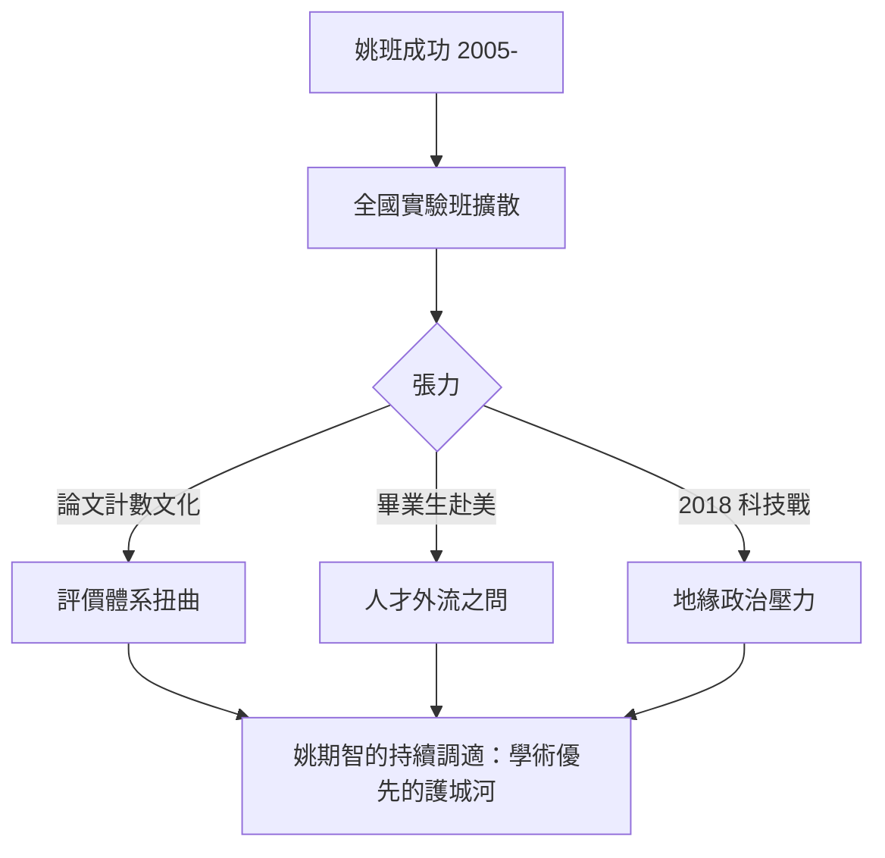

# 5.2 中國計算機科學的制度化與爭議（2010–2026）

姚期智的清華工程是中國計算機科學制度化的縮影，也是它最成功的樣本。但任何制度建設在大國語境下都不可能只有掌聲：評價體系的扭曲、人才政策的競爭、地緣政治的陰影，都構成姚期智故事的另一面。本章嘗試把光環與爭議並置。

## 制度化：姚班模式的全國擴散

2010 年代，姚班模式被廣泛複製：

- 各頂校競相推出「實驗班」「英才班」：北大圖靈班（2017，名字同樣致敬圖靈，→ 詳見《圖靈傳記》）、中科大少年班升級版等；
- 中國的理論計算機會議、暑期學校逐年增多，STOC/FOCS 上中國機構的論文數十倍增長；
- 姚期智本人成為中國計算機科學政策的顧問性人物，參與 AI 發展規劃的討論。

### 「一個人造一片森林」

姚期智常說自己是「探路者」：證明在現行體制內，用國際標準辦教育是可行的。他的存在使體制內的保守力量失去「國情不同做不到」的藉口——這是比任何論文都深遠的影響。

## 爭議的一面

制度化過程中的張力同樣真實：

- **評價體系**：中國高校的論文計數與帽子文化（人才頭銜），與姚期智倡導的「做最難的問題」存在結構性矛盾；姚班內部可以抵抗，體制整體難以免疫；
- **人才外流與回流**：姚班大量畢業生赴美深造，長期被批評「為他人作嫁」；2010 年代末以後隨中國 AI 產業崛起，回流比例才明顯上升；
- **地緣政治**：2018 年後美中科技戰升溫，華人計算機科學家面臨雙重忠誠的拷問。姚期智 2017 年放棄美國國籍（見 4.3）在兩種語境下被解讀為不同的信號；
- **學術自主**：清華的國際合作（如與外企共建實驗室）在政治環境變化下面臨審查，姚期智刻意保持的「學術優先」空間日益需經營。

## 姚期智的回應姿態

面對爭議，姚期智的姿態一貫低調而務實：

- 他極少接受政治性採訪，把全部公共言論聚焦於教育與科學；
- 他反覆強調的兩句話：「**要有耐心，做十年、二十年的事**」；「**中國的學生不比任何人差，缺的是環境**」；
- 他以自身為實驗：如果姚班二十年成功，體制就有了一個無法反駁的反例。這是科學家的說服方式——用對照實驗代替論戰。

### 「姚班模式」能複製嗎

全國學校學姚班者眾，成功者寡。差異的核心不在資源，而在三件難以移植的東西：

- **創辦人的學術權威**：圖靈獎得主的推薦信與課程設計，無法由行政任命的院長替代（見 4.1）；
- **對評價體系的免疫力**：姚班內部不數論文，這種「隔離區」需校方最高層的長期背書；
- **時間耐心**：姚期智反覆說「要等十年看結果」，而多數實驗班在第三年就被要求交出政績。

這解釋了為什麼姚班更像一次**科學實驗**而非**政策模板**：它依賴特定的實驗條件（頂級科學家＋制度空間＋時間窗口），條件不可複製時，結論只能借鑑而無法重現。

### 個人命運與大國敘事

姚期智的選擇不可避免地被放進大國競爭的敘事中，他本人則始終試圖保持距離：

- 他強調自己的動機是教育與科學，不是競賽；「把學生教好」是他唯一願意公開陳述的目標；
- 但身分選擇（2017 年放棄美國國籍，見 4.3）在美中科技戰的語境下，必然被兩邊解讀：在中國是歸根的愛國敘事，在美國則成為人才流失的警示案例；
- 他對此的回應仍是其一生風格：不辯論，繼續做事——用姚班一屆屆的畢業生，代替自己發言。

## 事件關聯與前因後果

| 年份 | 事件 | 後續影響 |
|------|------|----------|
| 2010s | 姚班模式全國擴散 | 中國計算機教育升級 |
| 2017 | 北大圖靈班等相繼設立 | 精英班成為標配 |
| 2017 | 姚期智放棄美國國籍 | 身分選擇成為公共話題（見 4.3） |
| 2018– | 美中科技戰 | 華人科學家的兩難加劇 |
| 2020s | AI 人才競賽白熱化 | 姚班校友成為各方爭奪焦點 |

**因果**：姚班證明了「頂尖可以移植」，這個證明本身推動了全國性的制度化（見 4.2）；但制度化也放大了體制原有的矛盾——評價體系、人才流向、政治邊界。姚期智選擇以「樣本」而非「批判」回應：他無法改造整個體制，但他造出了一個**體制無法否認的反例**。這種「造反例」的方法論，與他數學家生涯一脈相承——複雜性理論家最擅長的，就是構造分離兩個世界的反例（見 2.3）。

## 小結

- 姚班模式推動中國計算機科學教育的全國性制度化，北大的圖靈班等是直接追隨者；
- 制度化的另一面：評價體系扭曲、人才外流之問、地緣政治壓力；
- 姚期智以低調務實回應，用「造反例」的方式為改革提供樣本；
- 他的故事成為全球化科學時代的縮影：人才、思想與忠誠的邊界問題（見 5.3）；
- 下一節，我們退後一步，評估姚期智留給整個計算機科學的遺產（見 5.3）。
