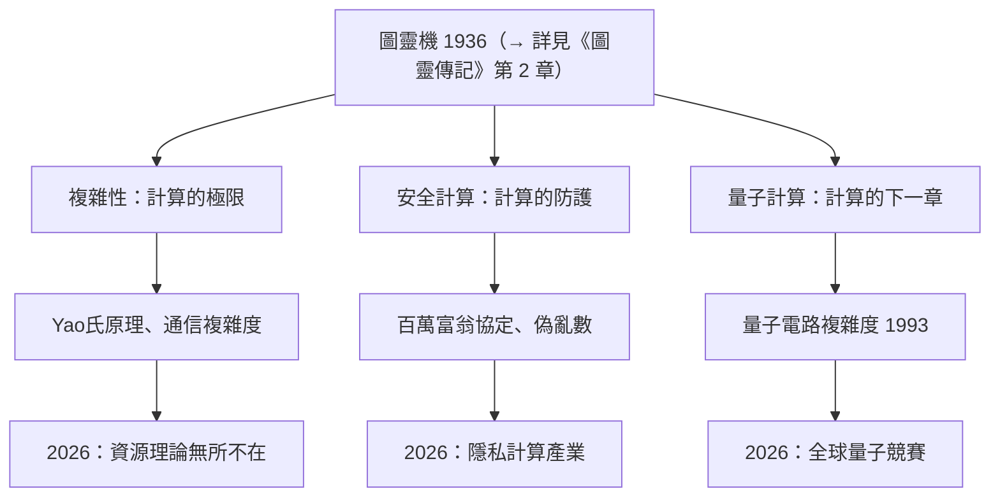

# 5.3 複雜性理論、安全計算與量子計算的遺產（1980–2026）

2026 年，姚期智已年屆八十，仍在清華授課與研究。回望他六十年的學術人生，可以概括為三座相互連通的建築：**複雜性理論**（計算的極限）、**安全計算**（計算的防護）、**量子計算**（計算的下一章）。本章從長時段評估這三座建築的遺產。

## 遺產之一：計算的極限被精確化

圖靈 1936 年回答了「什麼可算」（→ 詳見《圖靈傳記》第 2 章），二十世紀後半葉的問題是「什麼可算得**起**」：

- Yao 氏原理（見 2.2）使隨機性的力量與極限可證明；
- 通信複雜度（見 2.3）使分散式計算的資訊代價可度量；
- 今天從雲端系統、資料庫到神經網路理論，凡論及「計算要花多少資源」，皆站在姚期智參與奠定的地基上；
- 他的方法論——把對手、隨機性、通信都形式化為**資源受限的圖靈機**——已成為整個學科的世界觀（→ 丘奇－圖靈傳統，詳見《丘奇傳記》第 5 章）。

## 遺產之二：保密的重新發明

- 香農 1949 年的完美保密（→ 詳見《香農傳記》第 3 章）證明資訊論安全的昂貴；姚期智 1982 年以計算複雜性重定義安全（見 3.2、3.3），使密碼學得以工程化；
- 百萬富翁協定開創的安全多方計算，在 2010 年後成為**隱私計算產業**的基礎：聯邦學習、隱私集合求交、鏈上拍賣，全是 1982 年那個童話的後代；
- 混雜電路至今仍是兩方安全計算效率最高的通用方案——一篇 1982 年的論文，統治一個技術路線四十餘年。

## 遺產之三：量子計算的理論憲章

- 1993 年姚期智證明量子圖靈機與量子電路的等價性（見 3.1），為量子計算提供了標準語言；
- 此後 Shor 演算法、量子糾錯、量子複雜性類（BQP）的發展，皆在這個語言中進行；
- 2010 年後他把量子理論移植到清華（見 4.3），使中國在量子計算競賽中擁有理論一翼；
- 從香農的位元（→ 詳見《香農傳記》第 3 章）到量子位元（qubit），資訊與物理的第三次會面，姚期智是那個寫下語法的人。

## 遺產之四：人的傳承

最難量化的遺產是**人**：

- 姚班二十餘屆畢業生遍布全球學界與 AI 前沿（見 5.1）——他們正在把姚期智的品味散播到神經網路理論、密碼學、量子軟體等新戰場；
- 清華交叉資訊研究院成為亞洲計算理論的燈塔，每年仍有圖靈獎級學者到訪授課；
- 他證明了一件事：**一流的學術傳統可以跨語言、跨制度移植**——這是馮紐曼那一代人把歐洲數學移植到美國（→ 詳見《馮紐曼傳記》）的二十一世紀重演，只是方向從西向東。

## 遺產之五：一種研究風格的傳播

姚期智留給後世的，還有一種清晰可辨的研究美學：

- **定義即貢獻**：通信複雜度、百萬富翁問題的價值首先在於它們**提出了正確的問題**——這種「先造概念、再解問題」的風格，已進入姚班學生的血液（見 5.1）；
- **極簡模型**：百萬富翁問題只有十個數字，通信複雜度只有兩個角色——用最小的舞台演出最深的定理，與圖靈 1936 年那條無限紙帶（→ 詳見《圖靈傳記》第 2 章）一脈相承；
- **跨域的膽量**：從物理到計算，從密碼學到量子，姚期智示範了「攜帶方法論遷徙」的可行性——他本人的三次大轉向（見 1.2、3.1、4.2）就是這條美學的三份手稿。

### 晚年的持續在場

2020 年代，年逾古稀的姚期智依然活躍：

- 他持續在清華授課，並公開呼籲中國加強 AI 基礎理論研究——警告「只追應用會輸掉下一個時代」；
- 他在量子計算與 AI 的交叉點上推動新方向，主張「量子機器學習的複雜性分析」是下一個戰場；
- 每逢姚班畢業典禮，他的致辭總回到同一主題：**誠實面對難題，尊重智力上的純粹**。

### 歷史座標上的姚期智

把姚期智放進計算機科學的萬神殿，他的獨特之處是「三重身分」的疊加：

| 身分 | 代表人物 | 姚期智的位置 |
|------|----------|--------------|
| 定義者 | 圖靈（機器）、香農（資訊） | 定義了「通信」與「安全」的度量（見 2.3、3.2） |
| 建制者 | 馮紐曼（普林斯頓與美國數學） | 建立清華交叉資訊院（見 4.2、4.3） |
| 傳承者 | 王浩（邏輯東西橋） | 把圖靈傳統整體帶回華語世界（見 4.2） |

三重身分疊加於一人，在圖靈獎得主中唯此一例。這也是為什麼他的傳記不能只是一部學術編年史——它同時是一部華人科學史、一部教育史，以及全球化時代人才流動的史詩。

## 事件關聯與前因後果

| 年份 | 事件 | 長期影響 |
|------|------|----------|
| 1979–1982 | 通信複雜度、Yao 氏原理、百萬富翁 | 資源理論與安全計算的基礎（見 2.2、2.3、3.2） |
| 1993 | 量子電路複雜度 | 量子計算的標準語言（見 3.1） |
| 2000 | 圖靈獎 | 體系獲得歷史定位（見 4.1） |
| 2004–2010 | 清華建制工程 | 學術傳統的東移（見 4.2、4.3） |
| 2020s | 姚班校友主導 AI 前沿戰場 | 遺產進入大模型時代（見 5.1） |
| 2026 | 八十歲仍授課研究 | 活著的傳統 |

**因果**：姚期智的一生是一條完整的因果鏈——戰亂給他遷徙的能力（見 1.1），物理給他數學的抽象（見 1.2），王浩與圖靈機給他問題（見 1.3），北美五校給他方法（見 2.1），圖靈獎給他自由（見 4.1），而清華給他舞台（見 4.2）。他把這一切兌現為三座理論建築與一代人。如果說香農發明了「資訊」的度量（→ 詳見《香農傳記》第 3 章），圖靈發明了「計算」的定義（→ 詳見《圖靈傳記》第 2 章），姚期智發明的則是兩者之間的那門學問：**計算的代價、防護與未來**。

## 小結

- 複雜性理論：Yao 氏原理與通信複雜度使「計算的極限」成為可證明的科學；
- 安全計算：以計算複雜性重定義保密，催生今日的隱私計算產業；
- 量子計算：1993 年的電路等價定理是這個領域的理論憲章；
- 人的傳承：姚班與清華，使計算理論的火種在華語世界燃成燎原；
- 1946 年出生在上海的那個嬰兒，用八十年時間，把圖靈機的種子從劍橋帶到普林斯頓，再帶回北京——這部傳記到此，也是一粒種子長成森林的故事（全書完）。
