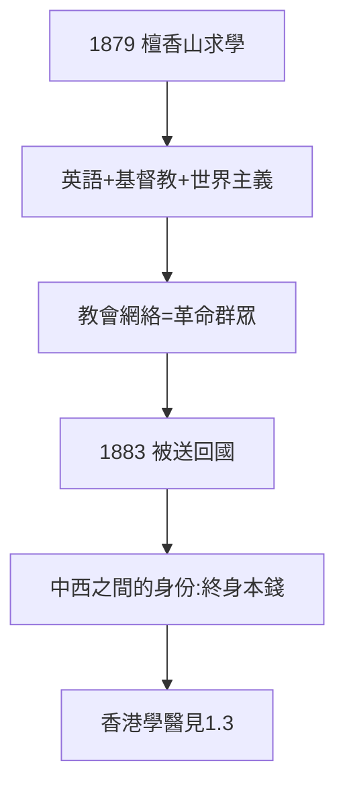

# 1.2 檀香山求學（1879–1883）

## 1879：投奔哥哥

13 歲的孫文赴檀香山投靠孫眉，入意奧蘭尼書院（Iolani School，聖公會學校），後轉歐胡學院（Oahu College，今普納荷學校——歐巴馬的母校）。英語流利，成績優異，畢業獲獎——官方神話說他「勤工儉學」，實際哥哥全額資助，生活不差。

## 基督教的洗禮

在檀香山受洗為基督徒（聖公會）。基督教給他的：

- 一神教的排他性——「打倒偶像」與「打倒滿清」同構（後來搗毀北極殿神像，鄉人譁然）；
- 海外華人教會網絡——革命的第一批群眾；
- 世界主義：上帝面前人人平等，民族面前……也可以平等——三民主義的潛在資源。

## 1883：被送回國

哥哥怕他「全盤西化」（要娶洋女？無稽），把他送回國，入香港拔萃、中央書院。這次「遣返」因禍得福：中西之間的身份，成了他終身的本錢——**在中國人面前是留洋的，在洋人面前是中國的**。

**因果**：哥哥的錢（1.1）→ 檀香山的教育 → 基督徒 + 世界主義者。孫文與蔣介石的根本區別在此：蔣的世界是軍營和中國（《蔣介石傳》1.2），孫的世界是教會和五洲。下一節，香港學醫。
