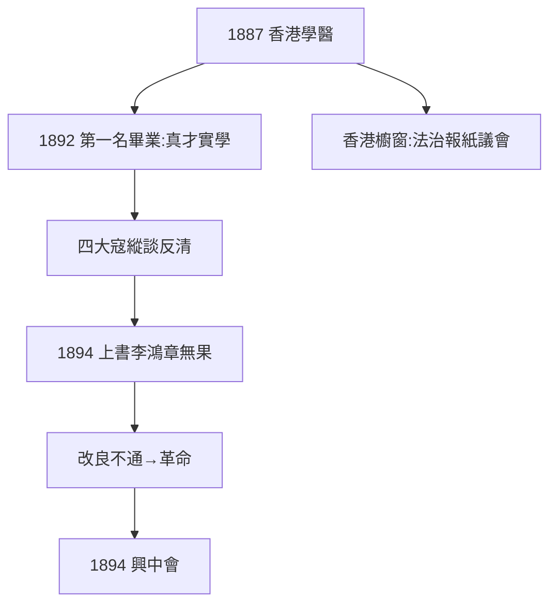

# 1.3 香港西醫書院（1887–1892）

## 1887：學醫

孫文入香港西醫書院（香港大學前身之一），1892 年以第一名畢業，獲行醫執照。是香港第一位華人西醫（之一）——這是貨真價實的成就，官方神話難得沒有誇大的一處。

## 醫生的政治

- 同學：陳少白、尤列、楊鶴齡——「四大寇」（縱談反清，被視為大逆）；
- 醫術與革命的隱喻：中國病了，需要手術（革命）而非湯藥（改良）——「醫國」話語的源頭；
- 1894 年上書李鴻章（改革建議），石沉大海——**改良此路不通**，轉向革命（2.1）。

## 香港的意義

香港是英國殖民地：法治、報紙、議會的櫥窗。孫文在此看到「中國本來可以的樣子」——改良與革命的共同參照。沒有香港，就沒有三民主義中的民權思想。

**因果**：檀香山的世界主義（1.2）+ 香港的醫學與法治見聞 = 革命的全部思想原料。上書的失敗是最後一根稻草——1894 年，醫生決定給中國動手術。下一章，興中會。
