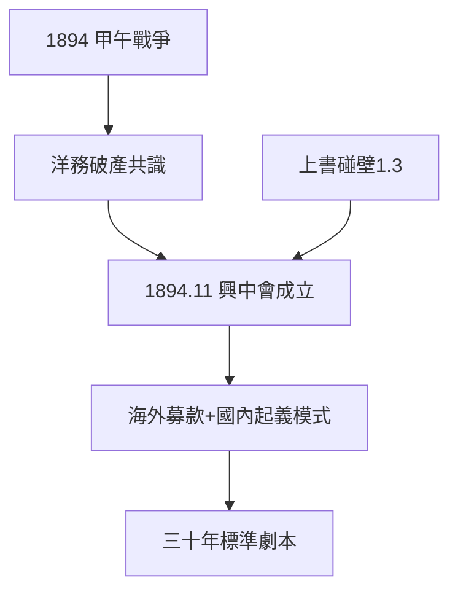

# 2.1 興中會（1894）

## 1894 年 11 月 24 日：檀香山

甲午戰爭（中日開戰）之際，孫文在檀香山創立興中會（「振興中華」），會員多為華僑。入會誓詞「驅除韃虜，恢復中國，創立合眾政府」——民族主義 + 共和主義，二十年後的三民主義雛形。

## 興中會的性質（去神話）

- 官方神話：「第一個革命團體，孫文單槍匹馬創立」；
- 史實：華僑出錢出力，孫文是組織者而非唯一的發起者；會員最多時不過百餘人；
- 意義不在規模，在模式：**海外募款 + 國內起義**——此後三十年革命的標準劇本（2.2、3.2 都是重播）。

## 甲午的刺激

甲午慘敗證明洋務運動破產，「中國病了」（1.3 的醫國論）從隱喻變成共識。孫文的上書碰壁（1.3）+ 甲午的炮聲 = 革命的時機。時勢造英雄，英雄也等時勢。

**因果**：學醫的見聞（1.3）+ 上書的失敗 + 甲午的炮聲 = 興中會。模式確立：海外出錢，國內流血——這個模式的代價（起義屢敗），下一節見分曉。
