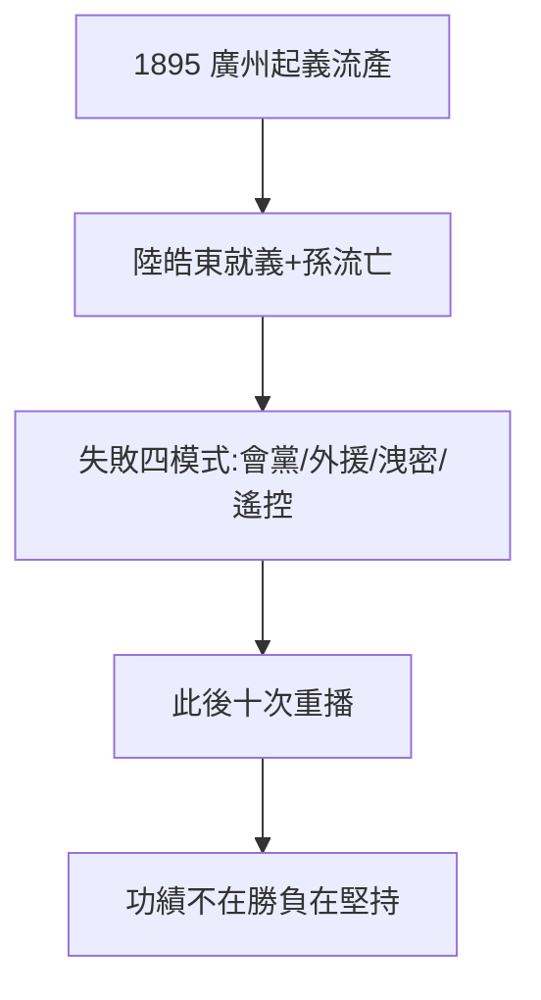

# 2.2 廣州起義（1895）

## 1895 年 10 月 26 日：流產的起義

興中會策劃廣州起義，400 枝槍從香港偷運，因消息洩露、內應動搖，起義流產。陸皓東（孫的摯友，起草檄文者）被捕就義——孙文第一次失去同志。清廷通緝，孫亡命海外，開啟十六年流亡生涯。

## 失敗的模式（此後重播十次）

1. 依賴會黨（洪門、三合會）：人多但無紀律，臨陣靠不住；
2. 依賴外援（日本、法國）：口惠而實不至；
3. 洩密：參加者眾，保密無從談起；
4. 孫在海外指揮：電報遙控，脫離實際。

## 官方神話 vs 史實

官方：「首義之功，雖敗猶榮」。史實：1900 年惠州起義（鄭士良）、1907–11 年黃岡、防城、鎮南關、河口、廣州新軍、黃花崗……**十次起義，九敗一……其實十敗**（武昌起義不是孫策劃的，見 4.1）。孫的功績不在起義本身，在**堅持**——屢敗屢起，本身就是象徵資本。

**因果**：興中會的模式（2.1）第一次實測，不及格。但失敗是最好的宣傳：殉道者（陸皓東）+ 流亡者（孫）= 革命的悲情資本。下一節，倫敦蒙難——悲情資本的最大一筆。
