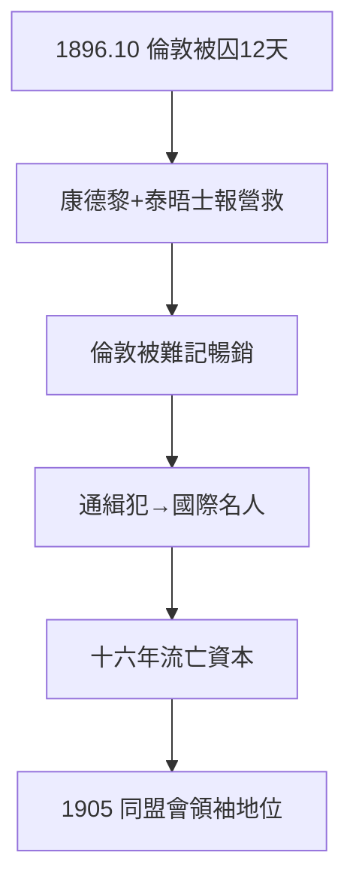

# 2.3 倫敦蒙難（1896）

## 1896 年 10 月：中國公使館的囚徒

孫文在倫敦被清廷公使館誘捕，囚禁十二天，險被引渡回國處死。經康德黎（香港西醫書院老師）營救、《泰晤士報》曝光，英國外交部干預獲釋。出獄後寫《倫敦被難記》，暢銷歐美——**從通緝犯變成國際名人**，只用了一本書。

## 蒙難的紅利

- 知名度：歐美政要開始接見「中國的革命者」；
- 正當性：清廷的綁架證明其野蠻，革命的合法性 +1；
- 人脈：結識日本志士（宮崎滔天）、歐美同情者——流亡十六年的資本。

## 真偽之辯

有學者質疑綁架細節（是否真有引渡船？），但囚禁本身證據確鑿。誇大是宣傳的常態——孫文深諳此道（後來的「國父」神話，部分是他親手參與建構的，見 5.3）。

**因果**：廣州的失敗（2.2）→ 流亡 → 倫敦蒙難 → 國際名聲。宣傳的勝利大於軍事的勝利——孫文一生都是「宣傳家強於軍事家」，這既是他的成功之道，也是他的局限之源（4.2 的讓位、5.1 的空轉）。下一章，同盟會。
