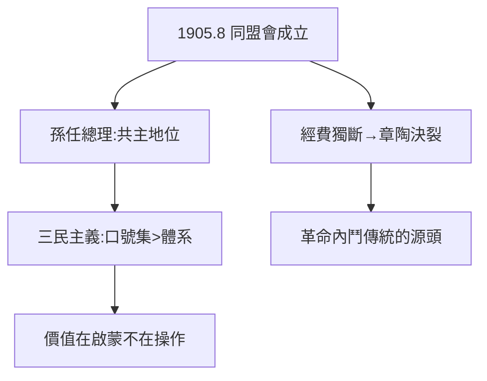

# 3.1 同盟會與三民主義（1905）

## 1905 年 8 月 20 日：東京

孫文聯合興中會、華興會（黃興）、光復會（章太炎、陶成章）在東京成立同盟會，綱領「驅除韃虜，恢復中華，創立民國，平均地權」。孫任總理——**革命陣營的共主地位確立**（倫敦蒙難的名聲，2.3，兌現了）。

## 三民主義（去神話）

- 民族、民權、民生——1905 年《民報》發刊詞提出，內容龐雜：民族主義（反滿）、民權主義（共和，抄美國法國）、民生主義（平均地權，受亨利·喬治影響）；
- 官方神話：「完整的思想體系」。史實：拼盤式的口號集，宣言性大於操作性——「知難行易」「五權憲法」多是後來附會；
- 真實價值：**第一個把「共和」變成中國人聽得懂的口號的人**——思想史地位，不在體系，在啟蒙。

## 同盟會的內訌

成立即分裂：孫文挪用經費、獨斷專行，章太炎、陶成章與之決裂（陶後被陳其美暗殺，見《蔣介石傳》1.3）。**革命者內鬥，從同盟會開始**——此後國民黨的分裂傳統（寧漢、汪蔣、李宗仁），源頭在此。

**因果**：倫敦的名聲（2.3）+ 留學生的集會 = 共主地位。但共主的權力基礎是募款（海外，1.1），不是軍隊——與蔣的槍桿子（《蔣介石傳》1.2）恰成對照。這個對照，決定了 1925 年後誰繼承誰（5.3）。下一節，起義連敗。
