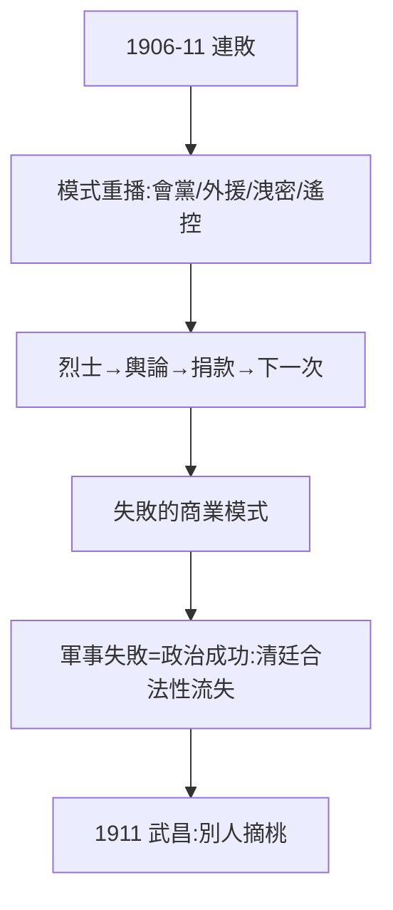

# 3.2 歷次起義（1906–1911）

## 六年間的連敗

1906 萍瀏醴起義、1907 黃岡/惠州七女湖/防城/鎮南關、1908 河口/雲南、1910 廣州新軍——**同盟會策劃的起義幾乎全敗**，模式與 1895 年（2.2）一模一樣：會黨靠不住、外援不來、洩密、孫在海外。

## 為什麼屢敗屢起

- 經費：華僑捐款 + 日本黑龍會零星資助，敗一次募一次；
- 象徵：每次失敗都製造烈士，烈士製造輿論，輿論製造下一次捐款——**失敗的商業模式**：用鮮血換捐款，用捐款換下一次鮮血；
- 清廷：越鎮壓越失分，每次起義都在消耗朝廷的合法性——起義的軍事失敗 = 政治成功。

## 孫的作用：精神領袖，而非軍事指揮

所有起義的實際指揮都是黃興、胡漢民、朱執信等；孫在海外募款、宣傳、調解內訌。官方神話把每次起義都算在他頭上——實際他是董事長，不是總經理。這個分工，預示了 1912 年的讓位（4.2）：**有威望，無實力**。

**因果**：興中會模式（2.1）的六年重播，結論不變：孫能募款造勢，不能指揮打仗。1911 年的桃子，長在別人的樹上（新軍）。下一節，黃花崗——最壯烈的一敗。
