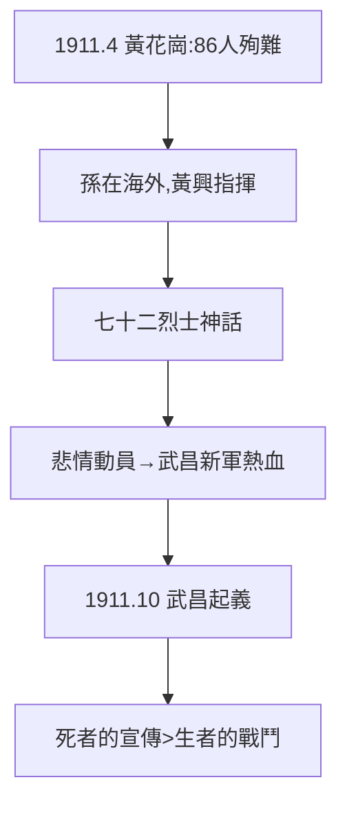

# 3.3 黃花崗（1911）

## 1911 年 4 月 27 日：廣州

黃興率 120 敢死隊攻兩廣總督署，激戰一夜，喻培倫、方聲洞等 86 人（一說 72 人）殉難，葬於黃花崗（潘達微冒死收屍）。孫文在海外（美國），事後才知詳情。

## 七十二烈士的神話建構

- 官方：「黃花崗七十二烈士，驚天地泣鬼神」；
- 史實：人數有出入（72 是約數），孫未親臨，起義計劃是黃興、趙聲制定；
- 意義：悲情頂峰——六個月後武昌起義的新軍，多是讀著黃花崗報導熱血沸騰的年輕人。**死者的宣傳價值，超過生者的戰鬥價值**（3.2 商業模式的巔峰）。

## 黃興 vs 孫文

黃興是起義的實際靈魂，卻甘居副手；孫是募款的靈魂，卻居總理。兩人友誼是革命史上的佳話（黃興 1916 年早逝，孫痛哭）。官方史學抬孫抑黃——本書並列：**沒有孫的錢和名，就沒有起義；沒有黃的命和膽，就沒有烈士**。

**因果**：連敗模式（3.2）的巔峰之敗，敗出了一個神話，神話點燃了武昌。而武昌的槍聲，孫文是在美國報紙上讀到的——下一章，民國。
