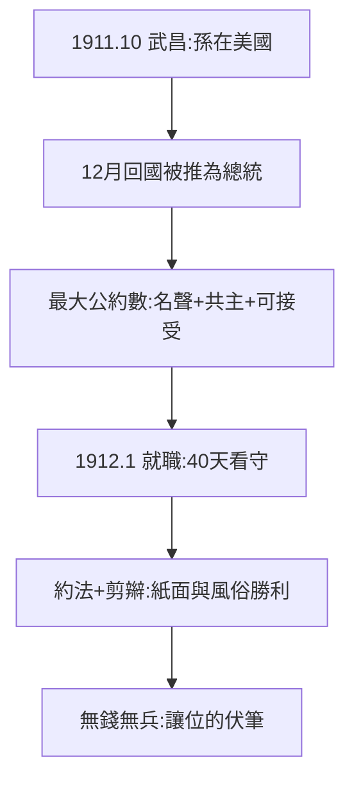

# 4.1 臨時大總統（1912）

## 1911 年 12 月–1912 年 1 月：從美國回來當總統

武昌起義（10 月 10 日）爆發時，孫在美國丹佛，報上得知。12 月回國，各省代表推舉為臨時大總統（1912 年 1 月 1 日南京就職）。**革命的最大果實，落到缺席者的頭上**——為什麼？因為只有他有國際知名度（2.3）、有共主地位（3.1）、各方都能接受（新軍、立憲派、同盟會的最大公約數）。

## 40 天的總統

- 頒布《臨時約法》（民權的紙面勝利）；
- 剪辮、放足、改曆——社會風俗的革命，比政治革命徹底；
- 財政破產：南京政府靠借債度日，連軍餉都發不出——**有威望，無實力**（3.2 的延續）。

## 總統的含金量

官方神話：「開國總統」。史實：40 天看守內閣，實權在北洋軍（袁世凱）手裡。孫的總統，是各方妥協的產物，不是革命勝利的果實——這個定位，決定了 4.2 的讓位。

**因果**：黃花崗的神話（3.3）+ 倫敦的名聲（2.3）+ 同盟會的共主（3.1）= 總統寶座。但寶座是紙糊的——錢和槍，都在袁世凱手裡。下一節，讓位。
