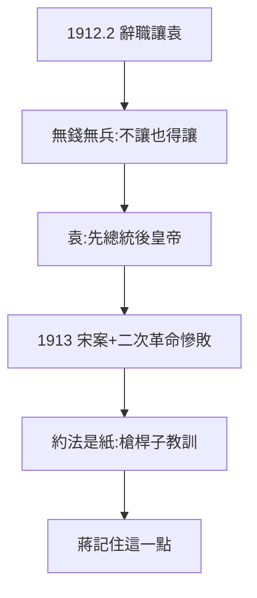

# 4.2 讓位袁世凱（1912）

## 1912 年 2–4 月：讓位

孫文辭去臨時大總統，舉薦袁世凱繼任（2 月 12 日清帝退位，4 月袁在北京就職）。官方（國民黨）史學長期稱「被迫讓位，袁竊國」；學界較平衡的看法：

- 現實：袁掌握北洋軍 + 列強支持 + 清室禪讓的籌碼，孫無錢無兵，不讓也得讓；
- 孫的算計：以總統換取袁擁護共和 + 資助修鐵路（孫迷上實業計劃，寫《實業計劃》）；
- 袁的算計：先當總統，再做皇帝（1915 稱帝，見 4.3）。

## 「二次革命」的種子

讓位時孫提三條件（南京建都、遵守約法等），袁一概不理。1913 年宋教仁被刺（袁嫌疑最大），孫發動二次革命，兩個月慘敗——**證明 1912 年的讓位不是謙讓，是無奈**；也證明沒有槍桿子，約法是一張紙（蔣介石記住了這一點，見《蔣介石傳》1.2）。

## 讓位的歷史評價

官方神話的兩個版本（國民黨：顧全大局；中共：妥協退讓）都有道理，也都不全面。真相：**實力對比決定一切**——孫的悲劇在於，他看懂了共和的理論，沒看懂權力的算術。

**因果**：40 天總統（4.1）的紙糊寶座，讓給了有槍的人。讓位是無奈，不是美德——而無奈的根源（有威望無實力）從 1905 年（3.1）就種下了。下一節，二次革命與護國。
