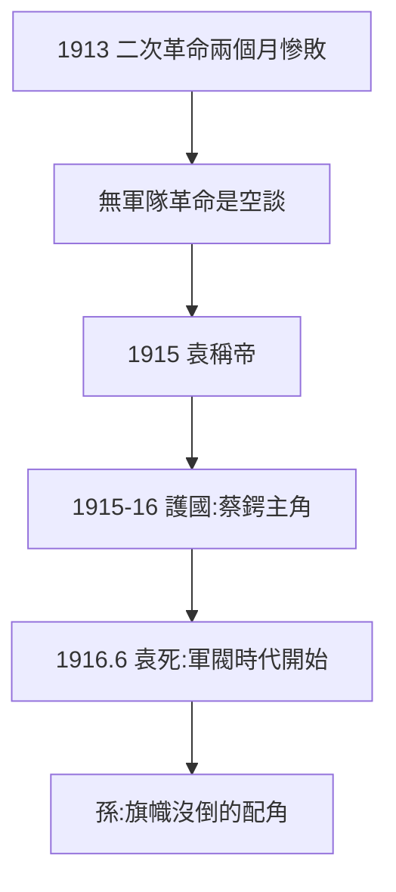

# 4.3 二次革命與護國（1913–1916）

## 1913：二次革命，兩個月慘敗

宋教仁被刺後，孫發動二次革命（贛寧粵討袁），袁世凱以北洋軍 + 善後大借款（英法德日俄 2500 萬鎊）鎮壓，兩個月平定。孫逃亡日本——**證明沒有軍隊的革命是空談**（4.2 的教訓重播）。

## 1915–16：護國運動，摘桃

袁稱帝（1915.12），蔡鍔雲南起兵護國，西南響應，袁被迫取消帝制（1916.3），6 月病死。孫在這場鬥爭中是配角（在日本組中華革命黨，響應者寥寥）——**推翻袁的不是孫，是北洋舊部 + 西南軍閥**。官方神話把護國功勞記在孫頭上，實際他只是啦啦隊。

## 1913–16 的定位

- 功：始終站在反袁一邊，旗幟沒倒（「革命尚未成功」的資本）；
- 過：中華革命黨（1914）搞個人效忠（按手印宣誓），連黃興、陳炯明都反感——獨裁作風的預演；
- 史實：1911–16 年的主角是袁世凱、宋教仁、蔡鍔，孫是重要的配角——官方「國父史觀」把配角寫成主角，本書撥亂反正。

**因果**：讓位的無奈（4.2）→ 二次革命的慘敗 → 護國的配角。1911–16 年，孫文是中國政治的邊緣人——而邊緣人的旗幟，恰恰因為沒倒，才能在 1917 年後重新舉起（第 5 章）。下一章，護法。
