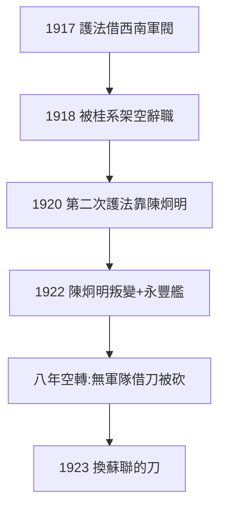

# 5.1 護法運動（1917–1922）

## 1917：南下護法

段祺瑞毀棄約法，孫南下廣州，聯合西南軍閥護法，任大元帥。1918 年被桂系架空（改組七總裁，孫憤而辭職）——**借軍閥打軍閥，借來的刀先砍自己**。

## 1920–22：第二次護法，更慘

驅逐桂系（靠陳炯明粵軍），孫任非常大總統。1922 年陳炯明叛變（炮轟總統府，孫登永豐艦避難——蔣介石護衛 42 天，見《蔣介石傳》2.2），護法破產。陳炯明的主張（聯省自治）與孫的（武力統一）分歧，本質是**聯邦 vs 中央**的路線之爭——學界至今有為陳翻案者。

## 護法的總結：空轉八年

1917–22 年，孫在廣州三起三落，一事無成（除了寫《三民主義》《實業計劃》）。官方神話稱「護法精神不朽」；史實：沒有軍隊（4.3 的教訓沒學會），借誰的刀都被刀砍。轉機在 1923 年：換一種刀——蘇聯的刀（5.2）。

**因果**：二次革命的教訓（4.3：無軍隊不行）→ 護法借刀 → 刀砍自己。八年證明：借刀不如造刀——而造刀需要蘇聯（錢、槍、顧問）。下一節，聯俄容共。
