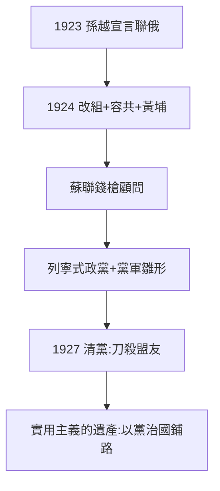

# 5.2 聯俄容共（1923–1924）

## 1923：孫越宣言

與蘇聯代表越飛發表宣言，確立聯俄；1924 年改組國民黨（一大），容納共產黨員以個人身份加入（國共合作），創辦黃埔軍校（蔣任校長——見《蔣介石傳》2.3）。蘇聯出錢（300 萬盧布軍費）、出槍、出顧問（鮑羅廷）。

## 聯俄容共的真相（去神話）

- 國民黨官方：孫的「英明決策」，絕口不提後來的清黨；
- 中共官方：「孫中山聯俄聯共扶助農工三大政策」，把孫塑造成半個共產黨人；
- 學界：孫的實用主義——英美日都不給錢，只有蘇聯給；容共是統戰（借中共的組織力），不是信仰——孫至死是三民主義者，不是馬克思主義者；
- 後果：黃埔的槍，三年後指向共產黨（1927 清黨）——**孫借來的刀，蔣用來殺借刀時的盟友**。

## 1924：最後的遺產

改組後的國民黨是列寧式政黨（民主集中制雛形），黃埔是黨軍雛形——孫一生反對的「以黨治國」，親手為後人鋪好。諷刺乎？必然乎？——有槍才有權（蔣的邏輯），孫到死才懂，懂了就死了（5.3）。

**因果**：護法的空轉（5.1）→ 借蘇聯的刀 → 列寧式政黨 + 黃埔。孫文一生最後的轉向，也是最重要的轉向：它決定了此後一百年中國政治的組織形式（國共兩黨都是列寧式政黨）。下一節，謝幕。
