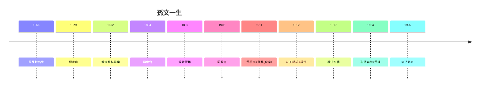

# 5.3 1925 逝世與國父神話（1925）

## 1925 年 3 月 12 日：北京

孫文北上共商國是，病逝北京協和醫院（肝癌），享年 58 歲。遺囑「革命尚未成功，同志仍須努力」——是真是假不重要（宋慶齡整理，多方見證，大意可信），重要的是這句話成了此後一百年所有政治動員的開場白。

## 國父神話的建構（兩岸合謀）

- 國民黨：1940 年尊為「國父」，陵寢中山陵，思想「國父遺教」神聖化——蔣介石是最積極的建構者（借孫的合法性，統治的需要）；
- 中共：「偉大的革命先行者」，孫中山紀念館遍地——借孫的統戰價值（「愛國者都是一家人」）；
- 兩岸合謀：一邊罵對方，一邊拜同一個人——孫文是海峽兩岸唯一的共識，也是最大的分歧（各自解讀）。

## 去神話之後的孫文（本書結論）

1. 成功的宣傳家、失敗的軍事家：名聲（2.3）> 實力（3.2）；
2. 成功的象徵、失敗的執政者：總統 40 天（4.1）、護法空轉（5.1）；
3. 最大的功績：**把「共和」變成中國人回不去的選項**——1912 年之後，再無人敢公開稱帝（袁世凱 83 天垮台為證）；
4. 最大的遺產：列寧式政黨 + 黃埔黨軍（5.2）——福禍參半，禍大於福（一黨專政的組織形式）；
5. 游泳健將死於溺水：玩弄權術者（聯俄容共的實用主義）最終被權術反噬——他死得早，沒看到清黨（1927），這是他的幸運，也是歷史的不幸（沒人為 5.2 的後果負責）。

**因果閉環**：翠亨村的貧農（1.1）→ 檀香山的基督徒（1.2）→ 香港的醫生（1.3）→ 興中會的募款者（2.1）→ 倫敦的名人（2.3）→ 同盟會的共主（3.1）→ 缺席的總統（4.1）→ 空轉的護法（5.1）→ 聯俄的轉向（5.2）→ 北京的遺囑。**一生都在場外，影響全在場內**——這就是孫文：中國近代史上最大的象徵，最小的實權者。而象徵的力量，恰恰在於空——空，才能裝下兩岸各自的神話。
