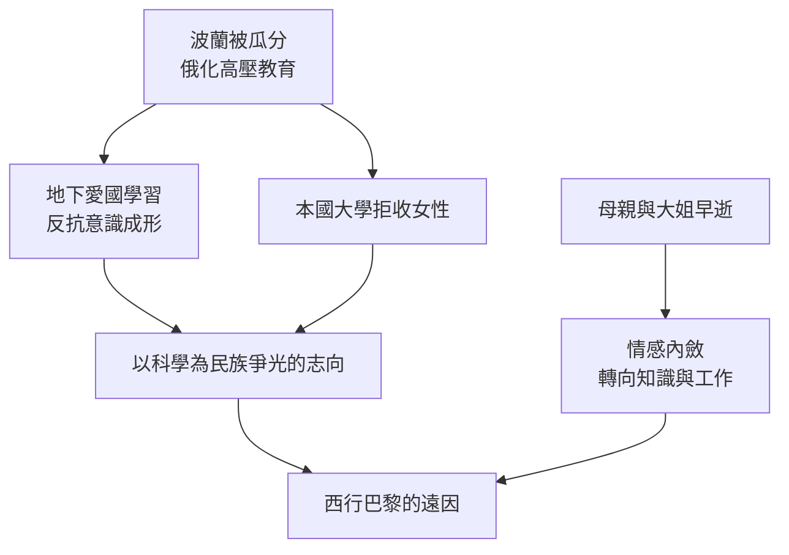

# 1.1 亡國陰影下的童年

1867年11月7日，Maria Skłodowska 生於華沙一個教師家庭。父親 Skłodowski 教數學與物理，母親經營寄宿學校。此時的波蘭已被俄、普、奧三國瓜分近百年，華沙處於俄屬波蘭境內，俄羅斯化政策高壓推行：學校禁教波蘭語與波蘭史，學生須用俄語答話，違者受罰。

這種環境塑造了 Maria 一生的性格底色。她在「地下愛國教育」中背誦被禁的波蘭詩文，也在俄籍督學突擊檢查的場景中學會鎮靜與自持。家庭層面的打擊接踵而至：1876年大姐 Zofia 死於傷寒，1878年母親死於肺結核。幼年經歷國亡與喪親的雙重失落，使她傾向把情感內斂化，轉而寄託於知識與工作。

因果上，「亡國—俄化教育」直接催生了波蘭知識青年的兩條出路：一是秘密結社與愛國運動，二是以科學立身、以學術為民族爭光的信念。Maria 選擇後者：她以金質獎章自俄辦中學畢業（1883），卻因性別與政治身份無法進入本國大學。這一「有才而無門」的結局，正是她日後西行巴黎的遠因。

**因果分析**：三項因素構成遞進鏈條——政治壓迫使求知帶上道德使命感；家庭悲劇使她以工作對抗脆弱；制度性性別歧視封閉本國通道，使「出國求學」從選項變成唯一解。童年的每一項限制，都在為後來的出走與極端自律預作鋪墊。
