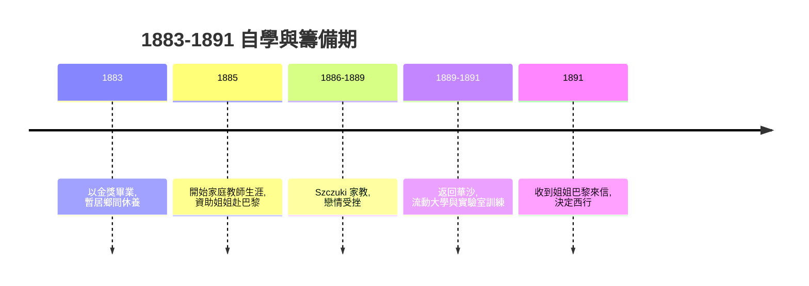

# 1.2 流動大學與家教歲月

中學畢業後，Maria 無法進入大學，便參加了波蘭地下教育組織「流動大學」（Flying University）——一所隨講堂地點更換、祕密傳授被禁學問的大學。她在此修習自然科學，同時接受實驗室訓練：她表哥經營的工農博物館設有化學實驗室，她夜間自學化學分析。這段訓練使她確立了「動手做實驗」的能力，而非只作紙上學者。

為籌措赴法學費與資助姐姐 Bronya 在巴黎學醫，1885 年 Maria 以家庭教師身分先後在私人宅邸任教多年。在 Szczuki 擔任家教期間，她與雇主之子 Kazimierz Zorawski 相戀，卻因門第之見被對方家長反對而告終。這段感情挫折令她一度心灰，卻也強化了她「以自身事業為唯一依靠」的決心。

家教期間她一邊授課一邊自學數學、物理，寄錢給 Bronya，並與姐姐約定：先供妳完成醫學學業，妳再接我到巴黎。這份「姊妹互助契約」是居里夫人傳記中最關鍵的非親情式契約之一——它把個人志向轉化為可執行的財務與時間安排。

**因果分析**：流動大學給了她在沒有大學身分下的知識根基；家教工作提供了經濟籌碼；戀情失敗則移除了留在波蘭的情感牽絆。三者共同作用，使「赴巴黎」從理想落實為具體時程。沒有這八年的沉潛，就不會有後來索邦物理與數學雙學位的爆發式成就。
